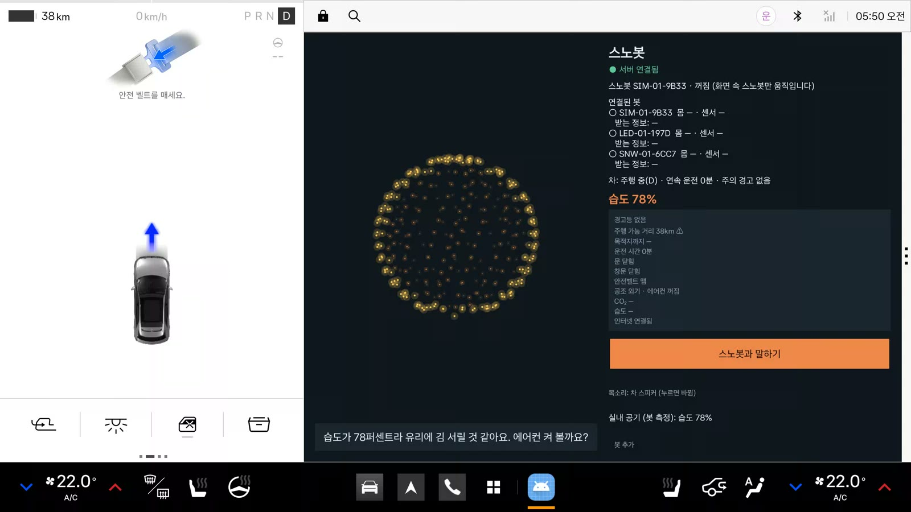
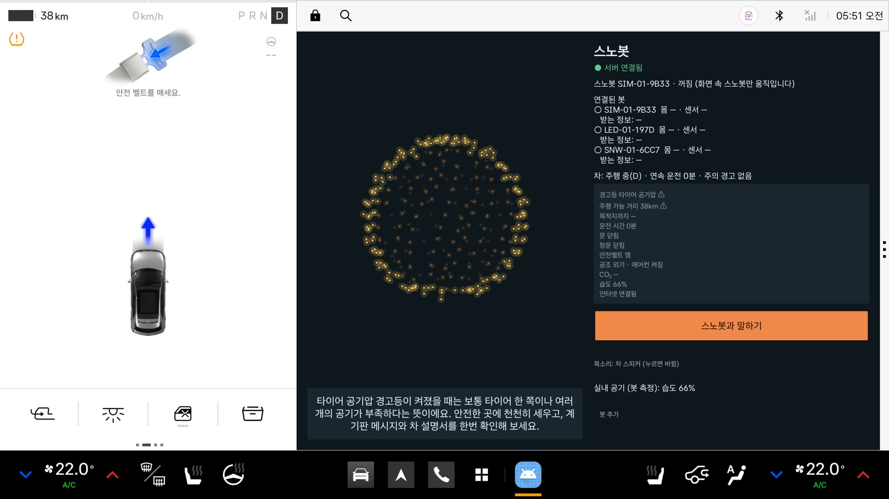
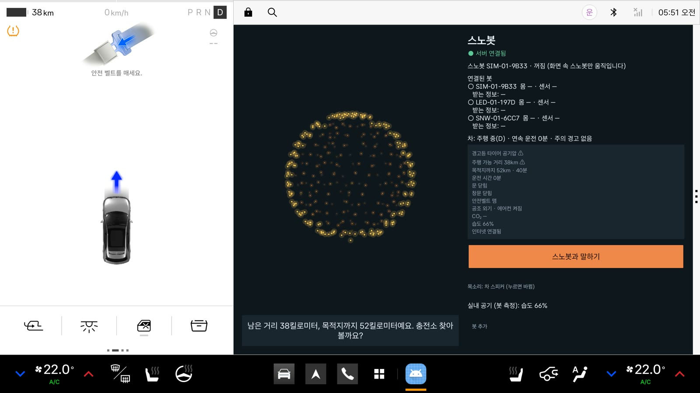
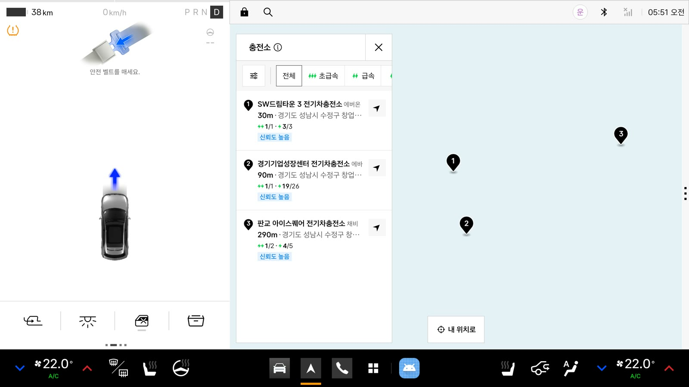
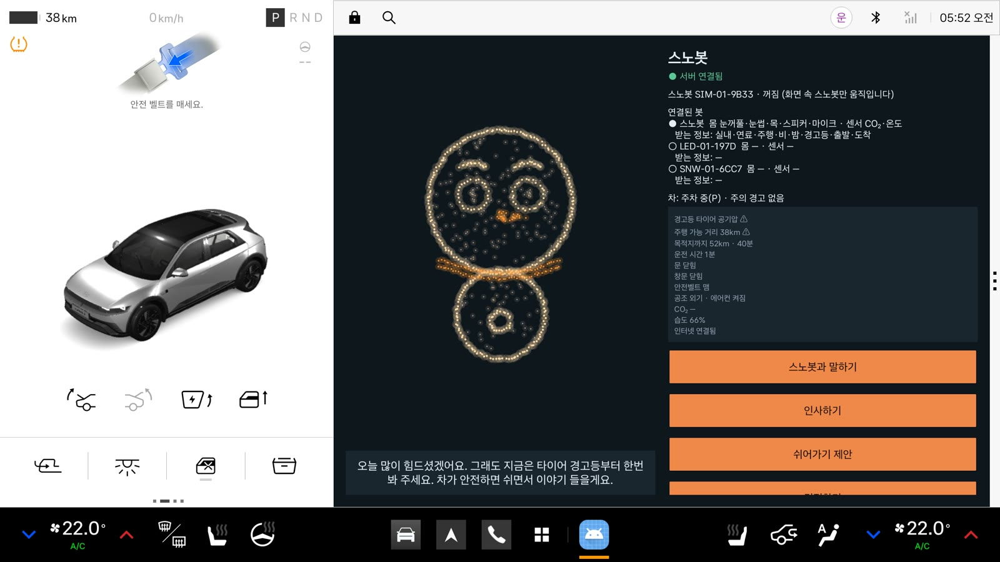
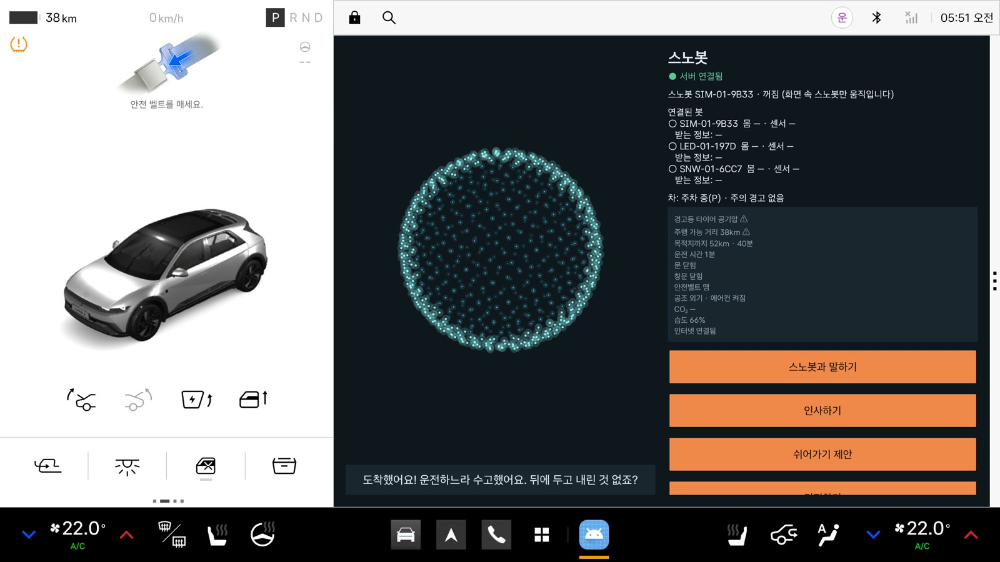
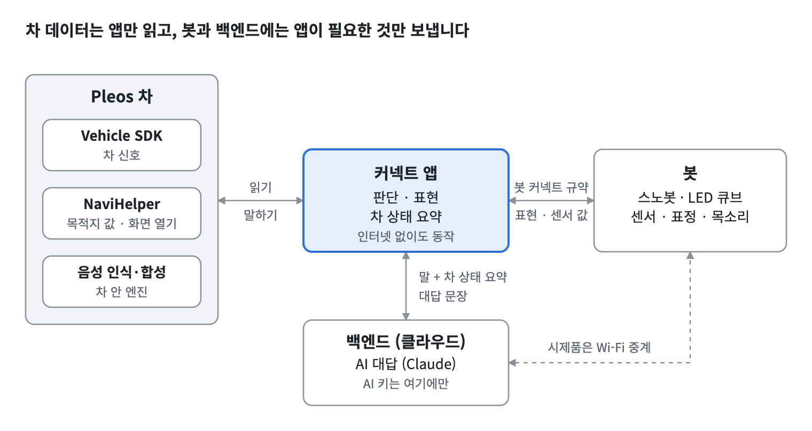

# 스노봇 커넥트 (SnowBot Connect)

> 현대자동차그룹 차량용 앱 개발 공모전 출품작 · Pleos Connect 차량 앱

**차와 운전자를 함께 살피고, 대시보드 위 감성 봇의 얼굴과 목소리로 말을 주고받는 차량 앱입니다.**

앱은 차 신호·내비·봇 센서·운전자 말을 함께 읽고, 알려야 할 것을 근거 숫자와 함께 말합니다.
운전자가 "응" 하면 내비 화면을 열어 줍니다. 열린 연결 규약(봇 커넥트 규약) 덕분에 어떤 봇이든 이 앱에 붙어 몸이 됩니다.
첫 번째 봇은 눈사람 로봇 스노봇이고, **봇이 없어도 앱 화면만으로 모든 기능이 동작합니다.**

| 바로 가기 | |
|---|---|
| 심사용 APK | [`apk/SnowBotConnect_release.apk`](apk/SnowBotConnect_release.apk) |
| 시연 영상 (2분, 소리 있음) | [`docs/demo/snowbot-connect-demo.mp4`](docs/demo/snowbot-connect-demo.mp4) |
| 봇 커넥트 규약 v0.3 | [`docs/pleos/03-module-protocol.md`](docs/pleos/03-module-protocol.md) |

## 화면 (Pleos 에뮬레이터, 2026-11-14 녹화)

| 비 오는 밤, 봇 센서 습도 78% → 김서림 권유 | 경고등 → "어떡해?"에 AI 가 그 경고등을 알고 대답 |
|---|---|
|  |  |
| **주행 가능 거리 38km < 목적지 52km → 대조해서 권유** | **"응 해줘" → 내비의 충전소 화면** |
|  |  |
| **봇이 연결되면 입자 구름이 그 봇의 모양으로** | **도착 인사 (기어 P)** |
|  |  |

화면 오른쪽 위는 차 상태 패널(값과 주의 표시), 가운데는 표정을 대신하는 입자 구름, 아래는 봇이 한 말입니다.

## 실행 방법 (심사용)

1. Pleos Connect 에뮬레이터를 켭니다. 확인한 환경은 아래 "테스트 환경"과 같습니다.
2. APK 를 설치하고 실행합니다.
   ```bash
   adb install apk/SnowBotConnect_release.apk
   adb shell am start -n io.snowbot.hub/.MainActivity
   ```
3. **봇 없이 바로 되는 것:** Virtual Console 에서 차 신호를 바꾸면 앱이 스스로 말합니다.
   - Gear P → D: 출발 인사 / D → P: 도착 인사
   - Telltales 에서 TPMS 켜기: "타이어 공기압 경고등이 켜졌어요." 끄면 "꺼졌어요."
   - 밤에 전조등 끄기: "밤인데 전조등이 꺼져 있어요."
   - 와이퍼 + 창문 열기: "비 오는데 창문이 열려 있어요."
4. **AI 대화까지 쓰려면 심사용 가상 봇과 짝을 맺습니다.** 앱 첫 화면의 칸에 넣고 "짝 맺기"를 누릅니다.

   | 기기 번호 | 등록 코드 |
   |---|---|
   | `JDG-01-AF37` | `E3B0853916` |

   짝을 맺으면 "서버 연결됨"이 뜨고, "스노봇과 말하기" 버튼으로 말을 걸 수 있습니다(에뮬레이터 마이크 사용, 처음 누를 때 권한을 묻습니다).
   "지금 차 어때?", "얼마나 더 갈 수 있어?" 같은 질문은 인터넷 없이 앱이 차 신호로 바로 답하고, 그 밖의 말은 AI 가 차 상태를 알고 대답합니다.
   가상 봇은 꺼져 있어 화면 속 입자 구름만 움직입니다.

## 테스트 환경

| 항목 | 값 |
|---|---|
| Pleos Connect 에뮬레이터 | 빌드 `RELEASE.release_connect_v2.1.0`, 시스템 이미지 `system-images;android-34;pleos_car_emulator;arm64-v8a`, 기기 프로필 Pleos_Connect_v2_0 |
| 화면 규격 | 2560×1440 (가로), RAM 4GB |
| 실행 PC | macOS (Apple Silicon), Android Emulator 37.2.12 |
| 앱 | `io.snowbot.hub` 0.1.0, minSdk 28 · targetSdk 34, Kotlin, Gradle 8 |
| Pleos SDK | Vehicle 2.3.2 · NaviHelper 3.0.5 · TextToSpeech 3.3.1 · SpeechToText 3.3.1 |
| 백엔드 | 클라우드 VM 의 Python FastAPI 중계 서버 (주소는 APK 에 들어 있음) |
| 확인 날짜 | 2026-11-14 (release APK 새로 설치 → 짝 맺기 → 서버 연결 확인) |

## 필요한 설정

- **따로 설정할 것은 없습니다.** 차 권한(`CAR_*`, `NAVI_*`, `STT_SERVICE`, `TTS_SERVICE`)은 매니페스트 선언만으로 허용됩니다(공모전 개발 단계 기준, 신청 불필요).
- 마이크 권한은 "스노봇과 말하기"를 처음 누를 때 묻습니다.
- 인터넷이 없어도 차 살피기(스스로 알림·권유·대조·차 상태 대답)는 동작합니다. AI 대화만 인터넷이 필요합니다.
- 직접 빌드할 때: `app/local.properties` 에 `sdk.dir` 과 `snowbot.server=https://<서버 주소>` 를 넣고 `./gradlew assembleDebug`. 자세한 것은 [`app/README.md`](app/README.md).

## 앱이 하는 일

앱은 네 곳(차 신호 · 내비 · 봇 센서 · 운전자 말)에서 입력을 받아 판단하고, 판단 결과를 봇의 몸에 맞게 표현합니다.
판단은 차 안의 앱이 하므로 인터넷이 끊겨도 차 살피기는 멈추지 않습니다.

| 기능 | 하는 일 | 봇이 하는 말 (예) |
|---|---|---|
| 스스로 알림 | 경고등 44종을 사람 말로, 출발·하차 점검, 2시간 연속 운전이면 휴식 권유 | "타이어 공기압 경고등이 켜졌어요." |
| 권유 | 표정이 먼저 바뀌고, 기준을 넘으면 한마디. 운전자가 따르고 값이 실제로 내려가면 안도 표정 | "CO₂ 1,500피피엠이에요. 외기로 바꿔 볼까요?" |
| 여러 출처 대조 | 차·내비·봇의 값을 맞춰 보고 한 곳만 봐서는 안 보이는 것을 찾음 | "남은 거리 38킬로미터, 목적지까지 52킬로미터예요. 충전소 찾아볼까요?" |
| 수치 보고 | 왜 말했는지 근거 숫자로, 문제가 풀리면 풀렸다고 | "타이어 공기압 경고등 꺼졌어요." |
| 말 알아듣고 실행 | 묻기·수락·거절·요청을 알아듣고 차 상태로 답하거나 내비 화면을 엶 | "응 해줘" → "내비 화면 열었어요." |

안전 알림(경고등·밤 전조등·주행 중 문 열림·오래 운전)은 "그냥 둬"로도 꺼지지 않습니다. 권유는 운전자가 "응"이나 "그냥 둬"로 정합니다.

## Pleos SDK 사용

| SDK | 쓰는 곳 | 상태 |
|---|---|---|
| Vehicle (기어·경고등·문·창문·안전벨트·공조·와이퍼·전조등·주행 가능 거리·배터리) | 판단의 입력 전부. 조회 권한만 씀 | 동작 |
| NaviHelper | 목적지까지 거리·시간, 앞 정체 → 대조. "응" 하면 내비 화면 열기 | 동작 (길 안내 중 값은 PT 까지 확인) |
| SpeechToText · TextToSpeech | 차 안 엔진으로 듣고 말하기. 목소리는 서버로 가지 않음 | 동작 |
| Gleo Interface | "글레오, 스노봇한테 물어봐" | PT 까지 |

## 구조



- **커넥트 앱** (`app/`, Kotlin): 차 신호 읽기, 판단(`Judgement`·`CarCoach`·`CarWatch`·`Ladder`·`DriverWords`), 표현(`Expression`), 차 상태 패널, 입자 구름(`ParticleView`), 봇 연결(`BotConnect`). 포그라운드 서비스라 화면을 닫아도 동작합니다. 단위 시험 175개.
- **백엔드** (`server/`, Python FastAPI): 앱과 봇 사이 중계, AI 대답(차 상태 요약을 받아 숫자를 인용), 봇용 목소리. AI 키는 서버에만 있습니다. 시험 48개.
- **봇 커넥트 규약 v0.3** ([문서](docs/pleos/03-module-protocol.md)): 봇이 자기 몸(부위·움직이는 범위·센서)을 설명하면 앱이 그 몸에 맞는 표현만 보냅니다. 가상 봇 2대(`server/tools/sim.py` 스노봇, `server/tools/led-cube.html` LED 큐브)와 봇 시험기(`server/tools/bcp_check.py`).
- **스노봇** (`cad/`): 첫 번째 봇의 3D 설계(build123d). 실물은 출력·조립 중입니다.

## 개인정보

- 녹음을 저장하지 않습니다. 목소리는 차 안 엔진에서 글자로 바뀌고, 글자만 백엔드로 갑니다.
- 봇에는 운전자가 허락한 정보만 가고, 위치는 기본으로 주지 않습니다.
- 서버 주소·토큰·키는 소스에 넣지 않습니다(빌드할 때 `local.properties` 에서 읽음).

## 저장소 구성

| 폴더 | 내용 |
|---|---|
| [`apk/`](apk/) | 심사용 release APK |
| [`app/`](app/README.md) | 커넥트 앱 소스와 빌드·시험 방법 |
| [`server/`](server/README.md) | 백엔드, 가상 봇, 봇 시험기 |
| [`docs/pleos/`](docs/pleos/README.md) | 기획 자료, 봇 커넥트 규약, 차량 데이터 확인 기록 |
| [`cad/`](cad/README.md) | 스노봇 3D 설계 |
