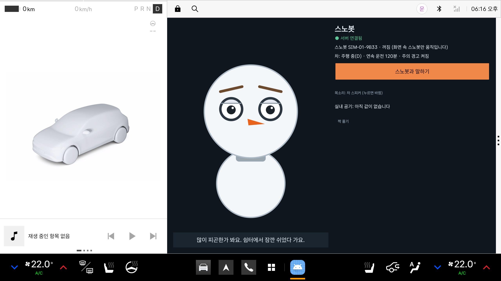
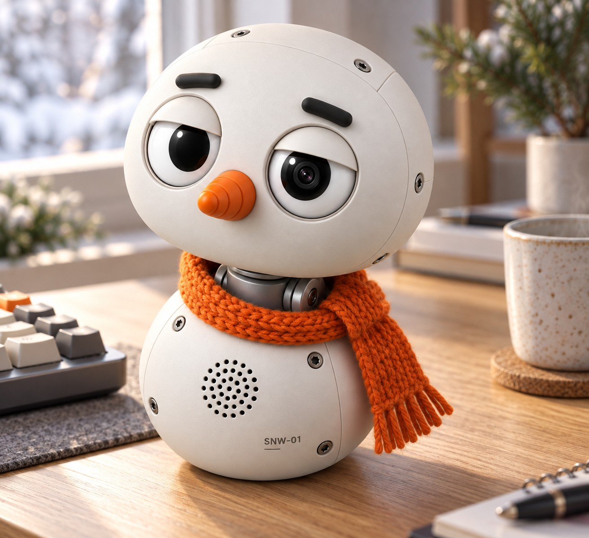
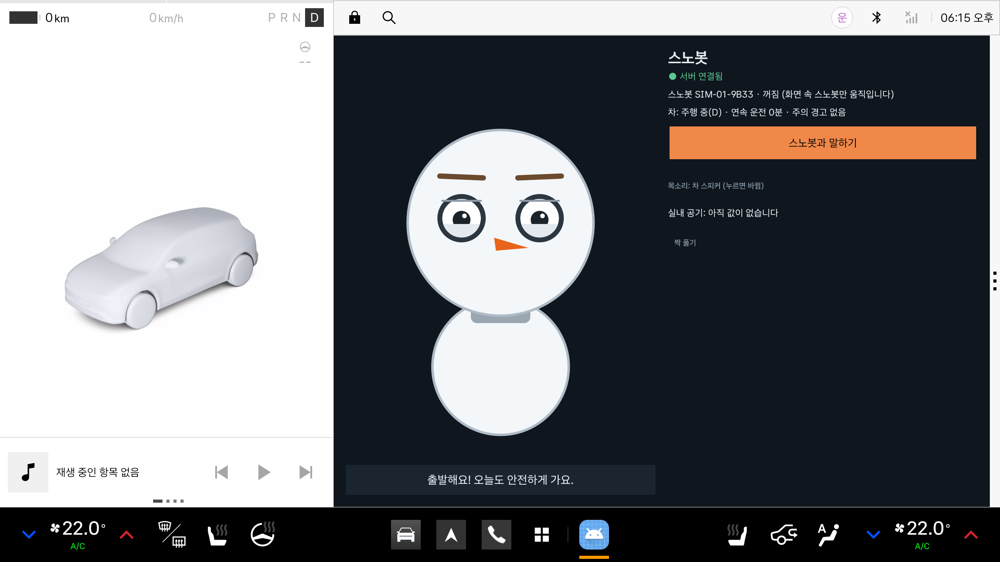
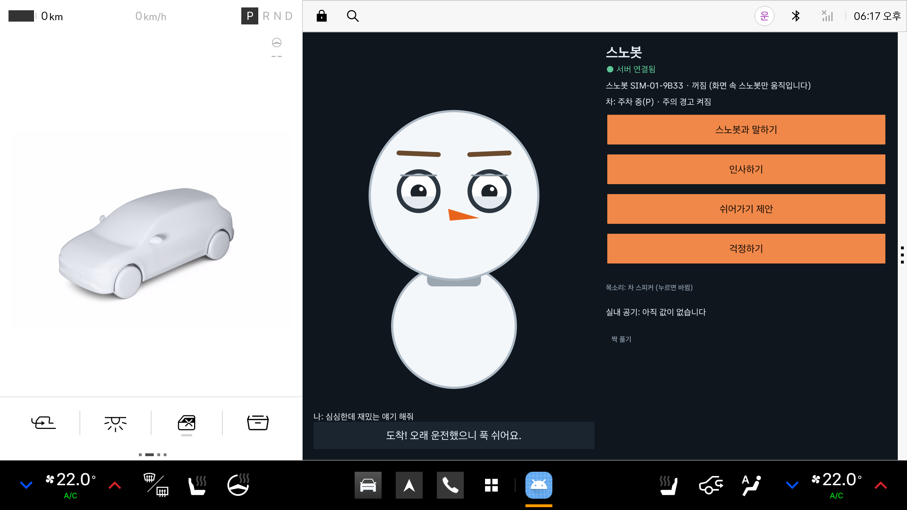
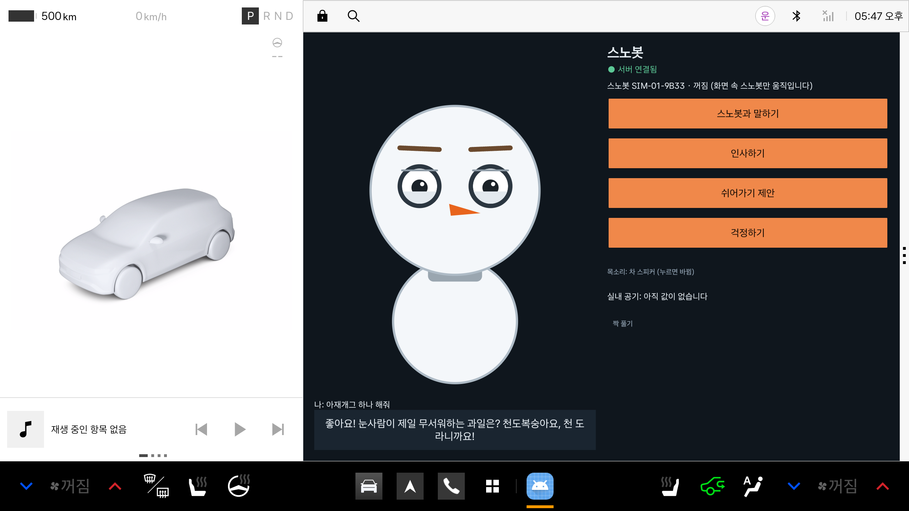
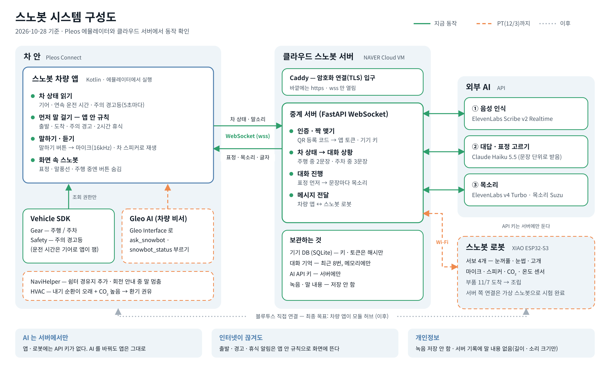

# 스노봇 (SnowBot) — 도로를 보는 눈사람 동승자

> 현대자동차그룹 차량용 앱 개발 공모전 출품작 · Pleos Connect 차량 앱 + 탁상 로봇 모듈

차의 신호(기어·운전 시간·운전자 주의 경고)를 읽고 **말할 때와 말의 길이를 스스로 고르는** 눈사람 동승자입니다.
화면 대신 **표정과 짧은 목소리**로 졸음·실내 공기를 챙기고, 차에서 내리면 같은 스노봇이 **책상 위 로봇으로 이어집니다.**

| 차량 앱 (Pleos 에뮬레이터, 실제 동작 화면) | 실물 스노봇 완성 목표 |
|---|---|
|  |  |
| 주행 중(D) · 연속 운전 120분 · 주의 경고 켜짐 → 걱정 표정과 "많이 피곤한가 봐요. 쉼터에서 잠깐 쉬었다 가요." | 이미지 생성 도구로 만든 목표 그림입니다. 실물은 3D 설계를 마치고 1차 출력과 부품 조립을 진행 중입니다. |

**스노봇 실물이 없어도 앱만으로 모든 기능이 동작합니다.** 화면 속 가상 스노봇이 같은 표정을 짓고, 목소리는 차 스피커로 나옵니다.

---

## 왜 만들었나

- 고속도로 사망사고의 절반 이상이 졸음·전방주시 태만에서 나옵니다. 하지만 주행 중 화면 조작도, 긴 음성 안내도 운전자의 주의를 뺏습니다.
- 옆자리 동승자와의 대화가 전화 통화보다 덜 위험한 이유는 **동승자가 도로를 보고 위험할 때 말을 멈추기 때문**입니다.
- 그래서 스노봇은 "무엇을 말할까"보다 **"지금 말해도 되나, 얼마나 말할까"** 를 차 상태로 먼저 정합니다.
- 차 안 음성 비서(글레오)는 묻는 말에 답하는 비서입니다. 스노봇은 차 상태를 보고 먼저 챙기는 동승자로, 차에 바로 넣기 전의 새 기능을 먼저 시험하는 자리를 맡습니다.

## 지금 동작하는 것

| 기능 | 하는 일 | 쓰는 차량 데이터 |
|---|---|---|
| **상황을 보고 말하는 대화** | 말하기 버튼 → 음성 인식 → AI 대답(표정 + 목소리). 주행 중엔 짧은 두 문장, 주차 중엔 세 문장까지. 주의 경고가 켜졌거나 2시간 넘게 달렸으면 무슨 말에든 쉬자는 말이 먼저 | 기어, 주의 경고등, 연속 운전 시간 |
| **먼저 말 거는 순간** | 출발 인사, 도착 인사, 주의 경고등 → 쉼터 권유(10분에 한 번), 2시간째부터 1시간마다 휴식 권유 | 기어 P↔D, `DRIVER_ATTENTION` |
| **표정 동반자** | 눈꺼풀·눈썹·고개로 7가지 표정 + 고개 4방향. 주행 중에는 시험용 버튼을 숨김 | 기어 |
| **공기질 케어** | 스노봇의 CO₂ 센서가 1,500ppm을 넘으면 걱정 표정 + 환기 제안. "공기 어때?"에 센서 값으로 대답 | 차에 없는 값을 모듈 센서로 더함 |

출발·도착·경고·휴식 한마디는 **앱 안 규칙**이라 인터넷이 끊겨도 표정과 말풍선이 뜹니다. 목소리는 서버가 만듭니다.

| 출발 | 오래 운전 | 도착 | 주차 중 대화 |
|---|---|---|---|
|  |  |  |  |

## 구조



- **차량 앱** (Kotlin, Pleos Connect): Vehicle SDK에서 차 상태를 읽고, 서버에 WebSocket(wss)으로 붙어 차 상태와 말소리를 보냅니다. 받은 표정·목소리를 화면과 차 스피커로 내보냅니다.
- **클라우드 서버** (Python FastAPI): 앱과 스노봇을 짝지어 메시지를 건네고, 대화를 처리합니다. AI API 키는 서버에만 있습니다.
  - 음성 인식 ElevenLabs Scribe v2 Realtime → 대답·표정 Claude Haiku 5.5 → 목소리 ElevenLabs v4 Turbo
  - 대답 맨 앞의 표정 태그가 오면 표정을 먼저 보내고, 문장이 하나 끝날 때마다 바로 목소리로 만듭니다.
- **스노봇 모듈** (ESP32-S3): 같은 서버에 Wi-Fi로 붙습니다. 지금은 가상 스노봇(시험 도구)으로 확인했고, 실물은 조립 중입니다.

**응답 시간 (실측):** 말이 끝나고 첫 소리까지 **보통 1.5초**(17번 중간값 1.46초, 범위 1.31~2.54초), 받아 적은 글자 확정 0.2~0.35초. 목표는 3초 안입니다. ([측정 기록](docs/12-latency-measurements.md))

그림 3장과 설명: [시스템 구조도](docs/pleos/06-system-architecture.md) · 발표용 [구조 PPT](docs/pleos/06-system-architecture.pptx)

## Pleos SDK 사용

| SDK / API | 쓰는 곳 | 상태 |
|---|---|---|
| Vehicle SDK — Gear (`registerGearSelection`) | 주행/주차 판단 → 출발·도착 인사, 대화 길이. 연속 운전 시간도 기어가 P에서 바뀐 순간부터 앱이 잽니다 | ✅ 구현 |
| Vehicle SDK — Safety (`getTelltalesInfo`, `DRIVER_ATTENTION`) | 운전자 주의 경고 → 걱정 표정·쉼터 권유 (5초마다 조회) | ✅ 구현 |
| Vehicle SDK — Odometer (트립 운전 시간) | 휴식 권유에 쓸 예정. 값의 단위가 문서에 없어 지금은 구독만 | 🔧 구독만 |
| NaviHelper | "응, 쉼터 넣어 줘" → 경유지 추가, 회전 안내 구간에서는 말 멈춤 | PT까지 |
| Gleo Interface | "글레오, 스노봇한테 물어봐" — 글레오가 스노봇 기능을 부름 | PT까지 |
| TextToSpeech · SpeechToText · FusedLocation | 인터넷 없는 대화, 주차 위치 기억 | Pleos 공개 후 |

## 개인정보·안전

- 녹음을 저장하지 않습니다. 서버 기록에는 말 내용이 없고 길이·소리 크기만 남깁니다.
- 대화 기억은 앱별 최근 8번 주고받기만, 서버 메모리에만 둡니다(재시작하면 잊음).
- 주행 중에는 글 대신 표정 위주로, 짧게 말합니다. 시험용 버튼도 숨깁니다.
- 서버 주소·토큰은 저장소와 소스에 넣지 않습니다(빌드할 때 `local.properties`에서 읽음).

## 저장소 구성

| 폴더 | 내용 |
|---|---|
| [`app/`](app/README.md) | 차량 앱 (Kotlin, Pleos Connect Emulator). `CarState`·`CarCoach`(차 상태와 먼저 말 걸기 규칙), `RelayClient`(서버 연결), `MicRecorder`·`VoicePlayer`(듣기·말하기), `SnowBotView`(화면 속 스노봇) |
| [`server/`](server/README.md) | 중계·대화 서버 (FastAPI). `chat.py`(대화 설정·차 상태 반영), `stt.py`·`tts.py`(듣기·말하기), 자동 시험 20개, 가상 스노봇·가상 앱 시험 도구 `tools/sim.py` |
| [`cad/`](cad/README.md) | 스노봇 3D 설계 코드 (build123d). 눈꺼풀·눈썹·고개를 움직이는 서보 4개 기구 |
| `print/` | 3D 출력 파일 (STL) |
| [`docs/`](docs/INDEX.md) | 기획서, 조사 자료, 설계 기록. [기획서](docs/pleos/01-proposal.md) · [기획서 PPT](docs/pleos/01-proposal.pptx) · [대화 설계](docs/11-conversation-design.md) · [차량 데이터 확인 기록](docs/pleos/05-vehicle-data.md) |

## 빌드와 실행

**차량 앱** (JDK 17, Android SDK, Pleos Connect Emulator 이미지 필요)

```bash
cd app
# local.properties 를 만든다 (저장소에 없음)
#   sdk.dir=<Android SDK 경로>
#   snowbot.server=https://<서버 주소>
./gradlew assembleDebug
adb install -r app/build/outputs/apk/debug/app-debug.apk
```

에뮬레이터에서 차 상태를 바꿔 보려면 Virtual Console의 Gear Selection을 쓰거나, 디버그 명령으로 운전 시간·주의 경고를 넣습니다.
Virtual Console 경고등 목록에는 `DRIVER_ATTENTION`이 없어서 디버그 명령으로 대신 시험했습니다.

```bash
adb shell "am start -n io.snowbot.hub/.MainActivity --es car 'gear=D add=120 attention=1'"
```

자세한 방법: [app/README.md](app/README.md)

**서버** (Python 3.11)

```bash
cd server
uv venv --python 3.11 .venv && uv pip install --python .venv -r requirements.txt pytest pytest-timeout httpx
.venv/bin/python -m pytest -q tests     # 자동 시험 20개
```

실행·배포·시험 도구: [server/README.md](server/README.md). 대화 기능을 켜려면 서버 환경 변수에 ElevenLabs·Anthropic API 키가 필요합니다.

심사용 APK는 GitHub Releases에 올릴 예정입니다.

## 진행 상태

| 부분 | 상태 |
|---|---|
| 차량 앱 · 서버 · 대화 | 에뮬레이터와 클라우드 서버에서 동작 확인 |
| 스노봇 실물 | 3D 설계 완료, 1차 출력 도착(얼굴·눈 기구·목), 전자 부품 도착 후 조립 |
| PT(12월)까지 | NaviHelper(쉼터 경유지·회전 구간 침묵), Gleo Interface, 실물 스노봇 연결 |
| 그 이후 | 블루투스로 차량 앱에 직접 연결(차량 앱이 모듈 허브), 집에서 쓰는 폰 앱, 주차 위치 기억 |
