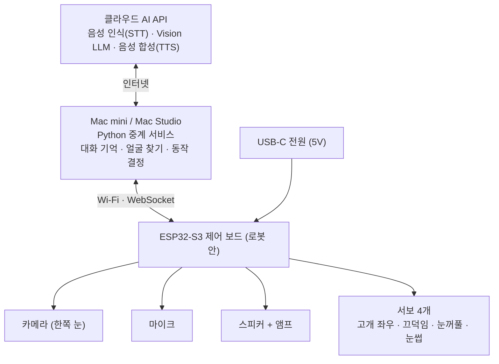
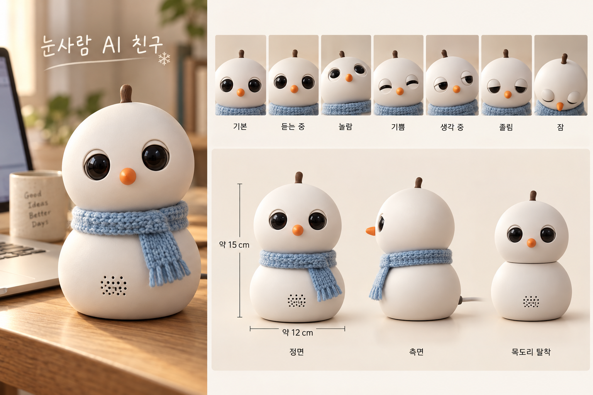
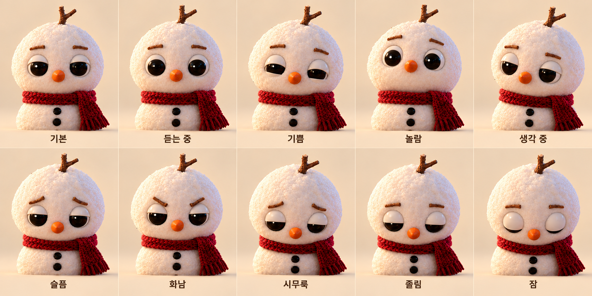
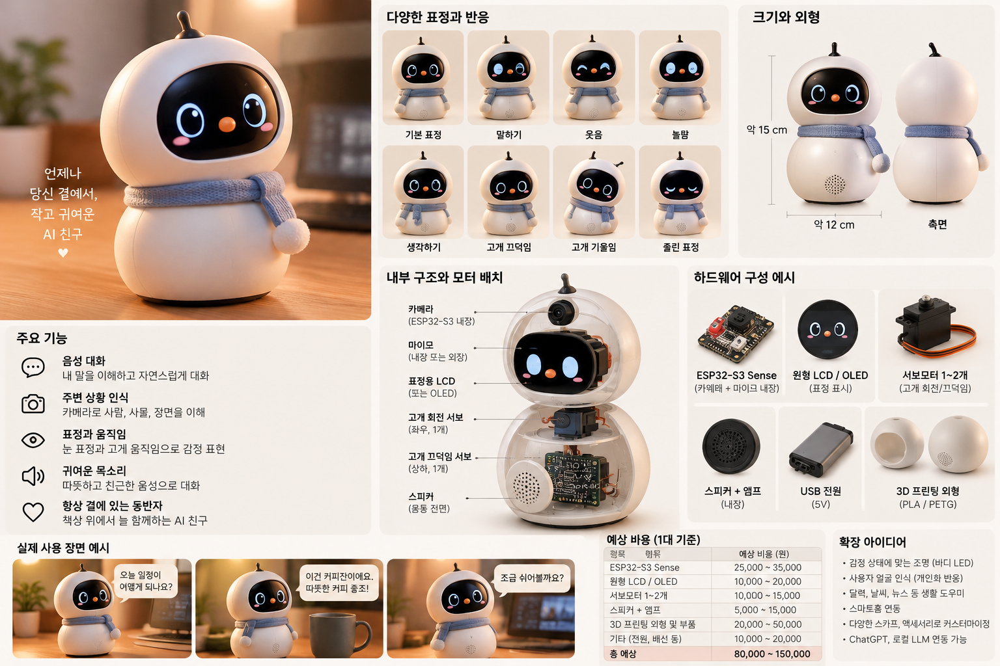

# SnowBot 기획 — 출발점과 콘셉트

- 작성: 2026-10-26
- 출처: ChatGPT 대화 「마이크로봇 만들기 안내」
  (https://chatgpt.com/share/6adeb867-db30-83ee-b5ae-aacd0846a7d5)
- 상태: **아이디어·가능성 검토 단계.** 부품 구매·설계·코드는 아직 없다.

> 이 문서에 나오는 제품 정보·가격·뉴스 날짜는 ChatGPT 가 대화 중에 찾아 제시한 값이다.
> 따로 확인하지 않았다. 구매·설계에 쓰기 전에 다시 확인한다.

---

## 1. 대화가 흘러간 순서

| # | 사용자가 한 말 | 결과 |
|---|---|---|
| 1 | 뉴스에 나오는 마이크로봇 같은 미니 로봇을 만들어 보고 싶다 | ChatGPT 가 의료용 초소형 로봇(존스홉킨스·MIT 등, 자기장으로 움직이는 mm 단위 로봇)으로 잘못 이해하고 설명 |
| 2 | "그게 아니라 **오리같이 생긴** 로봇, **젠슨 황이 소개**한 것" | **Microduck(마이크로덕)** 으로 정정 |
| 3 | 먼저 가능성을 판단하고 싶다. 조건 제시(아래 2절) | "데스크톱 AI 로봇" 으로 방향 전환, 가능성 높음 판단 |
| 4 | 스타일은 **눈사람** | 이름 **SnowBot(가칭)**, 콘셉트 이미지 생성 |

### 참고: Microduck (ChatGPT 가 제시한 정보)

- Hugging Face 의 Pollen Robotics 가 만든 오리 모양 **두 발로 걷는** 오픈소스 AI 로봇
- 2026-10-21 엔비디아 젠슨 황이 베를린 GTC 무대에서 소개
- 높이 25cm, 모터 15개, 800g 미만, 판매가 $399
- 걷기·앉기·일어서기, 넘어지면 스스로 일어나기, 부리로 물건 집기, 카메라 인식, NVIDIA Isaac Sim/Lab 으로 보행 학습
- 공식 자료: https://pollen-robotics.com/microduck/blog/introducing-microduck/ , https://microducks.org/

모터 15개로 걷는 구조라 하드웨어 난도가 높다. 그래서 사용자는 아래 조건으로 방향을 바꿨다.

---

## 2. 사용자가 정한 조건 (요구사항)

1. 마이크로덕처럼 **AI 로봇**이어야 한다.
2. **모터는 적게** 쓴다.
3. **돌아다니지 않는다.** 책상 위에 올려 두고 간단한 움직임만 한다.
4. 구성은 **몸통 + 머리**. 머리에 **카메라 하나**.
5. **내 말을 알아듣고**, **카메라로 상황을 파악**하고, **스피커로 말한다.**
6. **매우 귀여워야 한다.**
7. 외형 스타일은 **눈사람**.

---

## 3. 가능성 판단 (ChatGPT 결론)

**결론: 시제품을 만들어 볼 가치가 충분하다.** 마이크로덕보다 난도와 비용이 낮다.

| 평가 항목 | 판단 |
|---|---|
| 전자회로·기구 제작 | 충분히 가능 |
| AI 음성 대화 | 지금 있는 기술로 가능 |
| 카메라로 상황 이해 | 가능 |
| 고개 움직임 | 매우 쉬운 편 |
| 귀여운 표정 | 대부분 소프트웨어(화면 애니메이션)로 해결 |
| 대화 지연·주변 소음 | 다듬는 작업 필요 |
| 제품 수준 완성도 | 외형 설계와 반복 테스트가 관건 |

비슷한 실제 사례: AI Desk Robot V2 (https://caseygrothaus.com/projects/ai-desk-robot-v2)
— 카메라·마이크·스피커·표정 화면·서보 2개, AI 계산은 PC 에서 처리.

---

## 4. 핵심 설계 방향

**로봇 몸 안에 무거운 AI 컴퓨터를 넣지 않는다.**

- AI(음성 인식, 대화, 카메라 이해, 음성 합성)는 집에 있는 **Mac mini / Mac Studio** 에서 돈다.
- 로봇 안에는 작은 제어 보드(**ESP32-S3**)만 넣는다. 이 보드는 카메라·마이크로 받은 것을 Mac 으로 보내고,
  Mac 이 정한 대로 화면 표정·고개·스피커를 움직이는 일만 한다.
- 둘 사이는 **Wi-Fi + WebSocket**(연결을 계속 열어 두고 양쪽이 수시로 데이터를 주고받는 통신 방식).

보드 후보: **Seeed Studio XIAO ESP32-S3 Sense** — 카메라·마이크가 보드에 붙어 있고 크기가 작다.
국내 판매가 약 25,000원(ChatGPT 확인값).

### 4-1. AI 처리 방식 (2026-10-26 결정)

**결정: 일단 클라우드 API 로 시작한다. 나중에 Mac 로컬 모델로 바꿀 수 있게 만든다.** (사용자)

API 를 쓰더라도 **로봇은 Mac 하고만 이야기한다.** 로봇이 API 를 직접 부르지 않는다.
Mac 의 Python 서비스가 로봇과 API 사이에서 중계한다. 이렇게 하면 나중에 로컬 모델로 바꿀 때
Mac 쪽 코드만 바꾸면 되고, 로봇 펌웨어는 그대로 둔다.

바꿔 끼우기 쉽게 하는 설계 (Claude 제안):

- **세 부분을 따로 나눈다:** 음성 인식(STT) / 대화·이미지 이해(LLM) / 음성 합성(TTS).
  각각 "같은 입력 → 같은 형태의 출력"인 인터페이스(정해 둔 함수 모양) 뒤에 두면,
  예를 들어 TTS 만 먼저 로컬로 바꾸는 식으로 하나씩 옮길 수 있다.
- **어느 API 를 쓸지는 설정 파일로 고른다.** 코드 안에 특정 회사 이름을 박아 두지 않는다.
- **카메라 영상을 계속 API 로 보내지 않는다.** 사람 얼굴 찾기·따라보기는 Mac 에서 가벼운 얼굴 인식으로 처리하고,
  "이게 뭐야?"처럼 이미지 이해가 필요할 때만 사진 한 장을 API 로 보낸다. 요금과 지연이 줄고, 사생활 면에서도 낫다.
- **눈꺼풀을 감은 상태(잠)에서는 카메라 이미지를 보내지 않는다.**

알아 둘 점:

- API 사용료가 계속 든다. 대화를 얼마나 하느냐에 따라 달라지므로, 실제로 써 보며 측정한다.
- 목소리와 사진이 외부 서버로 간다.
- 인터넷이 끊기면 대화가 안 된다. 이때는 눈꺼풀·고개로 "모르겠어요" 같은 반응만 하도록 한다.
- **어느 회사·어느 모델을 쓸지는 아직 정하지 않았다.** 음성 대화는 응답이 늦으면 어색하므로, 후보를 놓고 지연 시간을 재서 고른다.

---

## 5. 디자인 결정 (2026-10-26, 사용자)

ChatGPT 콘셉트(5-1절)를 보고 사용자가 다음과 같이 정했다. **이 절이 콘셉트보다 우선한다.**

*콘셉트 v2 (2026-10-26, GPT Image 로 생성). 이 절의 결정을 그대로 넣어 만든 그림이다.
내부 부품 배치는 실제 크기로 검증하지 않았다.*

그림에서 결정과 어긋나거나 실물로 옮길 때 주의할 점:

- **"기쁨"의 눈웃음:** 그림은 눈 아래쪽이 둥글게 휘는 모양이다. 위에서 내려오는 눈꺼풀만으로는 이 모양이 안 나온다.
  실물에서는 "눈꺼풀을 반쯤 내림 + 끄덕임"으로 표현한다.
- **코 모양:** 정면 그림의 코는 둥근 공처럼, 측면 그림은 길쭉한 당근처럼 그려졌다. 정한 모양은 "짧고 뭉툭한 당근(1cm 안팎)"이다.
- **목 이음새:** 목도리를 뺀 그림에서 머리와 몸통 사이 틈이 보인다. 고개가 돌아가려면 실제로 필요한 틈이고,
  목도리가 이것을 가려 주는 역할도 한다.
- **눈꺼풀이 들어갈 자리:** 눈을 뜬 상태에서 흰 눈꺼풀이 어디에 숨어 있는지 그림에 드러나지 않는다. 머리 설계 때 정해야 한다.

| 항목 | 결정 | 이유 |
|---|---|---|
| 얼굴 화면 | **없앤다.** LCD/OLED 를 쓰지 않는다 | 얼굴이 디스플레이인 로봇은 너무 흔하고 디자인적으로 예쁘지 않다 |
| 눈 | **눈 2개 모양, 그중 1개만 진짜 카메라.** 다른 1개는 같은 모양의 장식 눈 (마이크로덕처럼 카메라를 눈으로 씀). **흰자 + 가운데 고정된 큰 검은자** — 카메라 렌즈는 한쪽 검은자 한가운데 (2026-10-26 추가 결정, [비교](02-design-options.md)) | 두 눈이라 귀엽다. 흰자가 있어 시선과 눈꺼풀 표정이 잘 보인다. 회로는 보드 1개로 유지 |
| 눈꺼풀 | **기계식 눈꺼풀을 단다.** 눈꺼풀 움직임으로 감정을 표현한다 | 더 귀엽다. 화면 없이 표정을 만드는 핵심 수단 |
| 코 | **당근 코를 단다** | 눈사람다움 |
| 목도리 | **액세서리**로 둔다. 몸체와 따로 만들어 끼우고 뺄 수 있게 | 꾸미기 요소로 남긴다 |
| 팔 | **초기 버전에는 없다** | 팔 제어가 쉽지 않다 |
| 눈썹 | **움직이는 나뭇가지 눈썹.** 모터 1개로 양쪽을 거울처럼 같이 돌린다 | 눈꺼풀만으로 못 하는 기울어진 표정(슬픔·화남)을 만든다 |

### 이 결정으로 바뀌는 것

- **표정을 화면으로 그릴 수 없다.** 감정은 **눈꺼풀·눈썹**, 고개 움직임(돌리기·끄덕이기·기울이기), 목소리로 표현한다.
  콘셉트의 "귀여움은 화면 속 눈 표정에서 나온다"는 전제가 "**눈꺼풀·눈썹·고개 움직임·목소리에서 나온다**"로 바뀐다.
- **카메라 렌즈 위치 = 한쪽 눈 위치.** 렌즈가 한쪽 눈 자리에 오도록 머리 안 보드·카메라 배치를 맞춘다.
  장식 눈도 같은 렌즈 모양 부품으로 만들어 어느 쪽이 카메라인지 겉으로 구분되지 않게 한다.
  (5-1절의 "카메라를 얼굴 중앙에 숨김 / 머리 위쪽" 문제는 이것으로 정리됨)
- **카메라가 고개와 함께 움직인다.** 고개를 돌리면 보는 방향도 바뀌므로, 사람을 바라보는 동작과 카메라 추적이 같은 동작이 된다.
- **모터가 늘어난다.** 고개 2개 + 눈꺼풀 1개 + 눈썹 1개 = **4개**. 머리 안에 들어갈 작은 서보가 필요하다.
- **부품 증감:** 표정용 LCD(1~2만 원)가 빠지고, 눈꺼풀·눈썹 서보와 연결 부품이 들어간다.
- **ChatGPT 콘셉트 이미지는 이제 맞지 않는다.** 검은 얼굴 화면·팔이 들어간 그림이라, 위의 콘셉트 v2 로 대신한다.

### 눈: 카메라 2개 대신 1개로 정한 이유

카메라 2개(스테레오)의 장점과, 그래도 1개로 정한 이유.

| 카메라 2개의 장점 | SnowBot 에서는 |
|---|---|
| 두 영상의 어긋남으로 **거리를 정확히 잰다** | 움직이거나 물건을 집지 않으므로 정밀한 거리는 필요 없다. "다가왔다/멀어졌다"는 얼굴 크기만 봐도 대략 안다. 사진 한 장으로 깊이를 추정하는 AI 모델도 Mac 에서 돌릴 수 있다 |
| 시야를 넓히거나 광각·근접으로 역할을 나눈다 | 고개를 돌려 보면 된다 |
| 두 눈이라 귀엽고 "나를 본다"는 느낌이 강하다 | **장식 눈 1개로 같은 효과를 낸다** |
| 한쪽이 고장 나도 계속 본다 | 시제품에서는 중요도가 낮다 |

카메라 2개의 비용:

- ESP32-S3 보드는 보통 카메라를 하나만 연결한다. 보드를 2개 쓰거나 카메라 단자가 두 개인 보드(Raspberry Pi 5 등)로 바꿔야 한다.
- Wi-Fi 로 보낼 영상이 두 배라 지연이 늘 수 있다.
- 두 렌즈 간격·각도를 정확히 고정하고 보정(캘리브레이션)해야 거리 계산이 맞는다.
- 13~15cm 머리 안 공간이 빠듯해진다.

**확장 여지:** 나중에 거리 감지가 필요해지면 장식 눈 자리에 카메라를 넣을 수 있도록, 머리 안에 그 공간을 남겨 둔다.

### 눈꺼풀·눈썹으로 감정 표현

눈꺼풀은 눈 위를 덮었다 열었다 하는 반달 모양 덮개다. 얼마나 덮는지(열림 정도)와 움직이는 속도로 감정을 만든다.
**눈썹**(2026-10-26 추가)은 머리 꼭지와 같은 나뭇가지 모양이고, 가운데 축을 중심으로 **돌기만 한다**(위아래로 올라가지는 않음).
양쪽이 거울처럼 같이 돌아서, 안쪽 끝이 올라가면 슬픈 얼굴, 내려가면 화난 얼굴이 된다.
고개 움직임과 같이 쓰면 표현이 훨씬 풍부해진다. 아래는 첫 설계안이며, 실물로 만들어 보고 다듬는다.

*표정 그림 v4 (2026-10-26, GPT Image). 선택한 외형(D + 큰 머리) + 회전 눈썹 + 흰자·검은자 눈. 그림과 실제 기구가 다른 곳:
검은자가 그림에서는 흰자를 거의 채울 만큼 크지만, 정한 크기는 눈 폭의 약 60%다.
"기쁨"·"생각 중"은 두 눈꺼풀 높이와 검은자 위치가 좌우 다르게 그려졌지만, 실제로는 한 모터라 두 눈꺼풀 높이가 같고 검은자는 항상 가운데다.
이전 판(석탄 눈): [표정 그림 v3](assets/snowbot-expressions-v3.png).*

| 감정 | 눈꺼풀 | 눈썹 | 같이 쓰는 고개 움직임 |
|---|---|---|---|
| 기본 | 거의 다 뜸. 몇 초마다 한 번씩 깜빡임 (간격을 불규칙하게) | 수평 | 가끔 좌우로 살짝 둘러봄 |
| 듣는 중 | 활짝 뜸, 깜빡임 줄임 | 수평 | 말하는 사람 쪽으로 고개 고정 |
| 놀람 | 순간적으로 활짝 뜸 → 빠르게 두 번 깜빡임 | 수평 | 고개를 살짝 뒤로 |
| 기쁨·웃음 | 절반쯤 내려 눈웃음처럼 | 수평 | 끄덕끄덕 |
| 생각 중 | 3분의 1쯤 내리고 천천히 깜빡임 | 수평 | 고개를 한쪽으로 기울임 |
| 못 알아들음 | 뜬 채로 빠르게 한 번 깜빡임 | 안쪽 살짝 올림 | 갸웃 |
| **슬픔·걱정** | 조금 내림 | **안쪽 올림** | 고개 살짝 숙임 |
| **화남·삐짐** | 3분의 1쯤 내림 | **안쪽 내림** | 고개를 살짝 돌림 |
| **시무룩** | 반쯤 내림 | **안쪽 올림** | 고개 숙임 |
| 졸림 | 아주 천천히 내려오다 반쯤에서 멈췄다 다시 올라감 반복 | 수평 | 고개가 천천히 숙여짐 |
| 잠 / 쉬는 중 | 완전히 감음 | 수평 | 고개 숙임 |
| 의심·장난 | 반쯤 감은 실눈 | 안쪽 살짝 내림 | 고개를 살짝 돌려 곁눈질 |

**눈꺼풀을 감으면 카메라도 가려진다.** 이것을 장점으로 쓴다:

- "잠자기" 상태 = 눈을 감아 카메라를 물리적으로 가린 상태. 사용자가 "지금 안 보고 있다"를 눈으로 확인할 수 있다(사생활 보호).
- 깜빡이는 순간(0.1~0.2초)에는 영상이 끊긴다. 영상 처리 쪽에서 눈꺼풀이 열려 있을 때의 프레임만 쓰도록 맞춘다.

**설계 선택 (초기 버전 제안):**

- **두 눈꺼풀을 한 모터로 같이 움직인다.** 모터를 하나만 추가하고, 연결 막대(링크)로 양쪽을 동시에 여닫는다.
  윙크처럼 한쪽만 움직이는 표현은 안 되지만 위 표의 감정은 모두 가능하다.
  한쪽씩 움직이려면 모터가 하나 더 필요하다 — 나중 버전 후보.
- 눈꺼풀 모양은 일직선 반달로 시작한다. 화난 눈·슬픈 눈처럼 기울어진 표현은 눈꺼풀 대신 **눈썹**이 맡는다.
- **눈썹도 한 모터로 양쪽을 같이 돌린다.** 머리 안 서보가 연결 막대로 양쪽 눈썹 축을 반대 방향으로 돌린다.
  구조(제안): 각 눈썹 가운데에 축이 있고, 축은 머리 껍데기의 작은 구멍을 지나 안으로 들어간다(구멍은 눈썹이 덮어 가림).
  머리 안쪽 축 끝에는 얼굴 가운데를 향하는 짧은 팔이 있고, 두 팔 끝은 가운데의 **위아래로만 움직이는 막대(슬라이더)** 에 함께 걸린다.
  서보가 슬라이더를 올리면 두 팔 끝이 같이 올라가 양쪽 눈썹 안쪽이 올라가고(슬픔), 내리면 안쪽이 내려간다(화남).
  회전 범위는 수평에서 위아래 약 20~25도.
  **눈썹은 회전만 한다 (2026-10-26 사용자 확정).** 오르내림(축이 세로 홈을 따라 움직이게 하거나 모터 추가)은 실물 표정을 본 뒤 필요하면 검토한다. 대안: 구멍 없이 자석으로 껍데기 너머 눈썹을 끌어 돌리는 방식(떼어 내기 쉽지만 힘이 약해 미끄러질 수 있음).
  눈썹 축은 머리 껍데기를 뚫고 나오므로 그 주변은 질감 없이 매끈하게 둔다. 눈썹을 위로 올리는 동작은 안 된다.
  한쪽씩 움직이는 눈썹(한쪽만 치켜뜨기)은 모터가 하나 더 필요하다 — 나중 버전 후보.
- 서보 소음이 조용한 책상에서 거슬릴 수 있다. 작고 조용한 서보를 고르고, 실물로 들어 본다.

### 세부 디자인 (2026-10-26, 사용자가 Claude 제안에 맡김)

사용자가 남은 세부를 Claude 제안대로 하자고 했다. 실물을 만들어 보고 바꿀 수 있다.

| 항목 | 제안 | 이유 |
|---|---|---|
| 눈 | **검은 광택 렌즈 모양.** 두 눈 같은 크기 | 눈사람의 석탄 눈. 진짜 카메라 렌즈도 검어서 장식 눈과 구분되지 않는다 |
| 눈꺼풀 색 | **몸통과 같은 무광 흰색** | 눈을 감으면 얼굴에 자연스럽게 묻혀 "자는 눈사람"이 된다. 색을 넣으면 눈꺼풀이 따로 붙은 부품처럼 보인다 |
| 당근 코 | **주황색, 짧고 뭉툭하게(길이 1cm 안팎).** 두 눈 사이보다 조금 아래에서 정면으로. 따로 출력해 끼우는 부품 | 길면 카메라 영상 아래쪽에 코가 비칠 수 있고, 부딪혀 부러지기 쉽다. 끼우는 부품이면 크기를 바꿔 가며 시험하기 쉽다 |
| LED | **초기 버전에는 넣지 않는다** | 화면을 뺀 이유(전자기기처럼 보이는 것)와 같다. 감정은 눈꺼풀·고개·목소리로 충분히 시험해 본 뒤 정한다. 몸통 안에 나중을 위한 배선 공간만 남긴다 |
| 고개 서보 | **2개로 시작: 좌우 회전 + 끄덕임.** 눈꺼풀·눈썹 포함 총 4개 | 감정표에서 끄덕임을 많이 쓴다 |

**외형 시안:** [02-design-options.md](02-design-options.md) — **D(진짜 눈 질감) + 큰 머리**로 정함 (2026-10-26).

### 고개 회전 범위 (Claude 제안, 사용자 확인 전)

**360도로 계속 돌지 않는다. 좌우 약 180도(정면에서 양쪽 90도씩)만 돈다.**

- 일반 서보모터는 대개 180도 범위에서 "몇 도로 가라"는 위치 명령을 받는다.
  끝없이 도는 360도 회전 서보도 있지만, 그런 서보는 지금 몇 도를 보고 있는지 모른다. 사람을 바라보려면 위치를 알아야 한다.
- 머리 안에 보드·카메라·끄덕임 서보·눈꺼풀 서보·눈썹 서보가 있어 몸통에서 머리로 전선(전원, 스피커 등)이 올라간다.
  한 방향으로 계속 돌면 전선이 꼬인다. 막으려면 슬립링(돌면서도 전기를 이어 주는 부품)이 필요해 비용·크기가 늘어난다.
- 책상 위 로봇은 앞에 앉은 사람과 양옆을 보면 충분하다. 뒤를 볼 일은 거의 없다.
- 더 넓게 필요하면 270도 서보로 바꿀 수 있다. 360도 연속 회전은 다음 버전 후보.
- 끄덕임은 위아래 약 20~30도면 충분하다 (큰 머리라 많이 숙이면 앞으로 쏠린다).

**한계 — "갸웃"(고개를 옆으로 기울이기)은 서보 2개로 정확히 할 수 없다.** 좌우 회전·끄덕임과 다른 세 번째 축이기 때문이다.
초기 버전에서는 고개를 살짝 돌리면서 숙이는 동작 + 눈꺼풀 깜빡임으로 비슷하게 흉내 낸다. 이것만으로 부족하면 다음 버전에서 축을 추가한다.

코 길이 1cm 는 시작값이다. 첫 출력 후 카메라 영상에 코가 보이는지 확인하고 줄인다.

---

## 5-1. ChatGPT 초기 콘셉트 (참고용, 5절 결정 이전)

*위 이미지는 ChatGPT 가 만든 콘셉트 그림이다. 얼굴 화면·팔은 5절 결정으로 빠졌다. 내부 배치는 실제 부품 크기로 검증하지 않았다.*

| 항목 | 초기 콘셉트 | 현재 (5절 반영) |
|---|---|---|
| 외형 | 동그란 머리 + 동그란 몸통, 무광 흰색. 머리 위 작은 꼭지 | 유지 |
| 목도리 | 파란 목도리 | **탈착식 액세서리** |
| 크기 | 높이 약 13~15cm, 폭 약 12cm | 유지 |
| 얼굴 | 검은색 화면에 눈을 그려 표정 표시. 주황색 당근 코 | **화면 없음. 눈 2개(1개는 카메라, 1개는 장식) + 기계식 눈꺼풀 + 당근 코** |
| 카메라 | 얼굴 쪽에 숨김 (그림에서는 머리 윗부분) | **한쪽 눈 자리** |
| 팔 | 짧은 팔 | **초기 버전 없음** |
| 모터 | 고개 좌우 회전 1개, 상하 끄덕임 1개 (최소 1개부터) | 고개 2개 + **눈꺼풀 1개 + 눈썹 1개** = 4개 |
| 마이크·스피커 | 몸통에 배치. 스피커는 몸통 앞면 | 유지 |
| 전원 | USB-C 상시 연결 (배터리 없음) | 유지 |
| 외장 | 3D 프린팅 (PLA / PETG) | 유지 |

초기 콘셉트에서 ChatGPT 는 귀여움이 눈 표정·고개 타이밍·목소리·반응 방식에서 나온다고 봤다.
화면이 빠졌으므로 이제는 **눈꺼풀·고개 타이밍·목소리·반응 방식**이 핵심이다.
예: 좌우로 살짝 바라보기, 갸웃하기, 말을 못 알아들으면 눈을 깜빡이며 고개를 기울여 되묻기.

### 초기 콘셉트의 표정 목록 (화면 기준, 현재는 미사용)

기본 · 말하기 · 웃음 · 놀람 · 생각하기 · 고개 끄덕임 · 고개 기울임 · 졸린 표정
— 고개 끄덕임·기울임은 서보로, 웃음·놀람·생각하기·졸림은 눈꺼풀로 살린다(5절 "눈꺼풀로 감정 표현" 표).

### 기능 목록 (5절 반영)

| 기능 | 구현 방법 | 난도 |
|---|---|---|
| 목소리 듣기 | MEMS 마이크 + 음성 인식(STT) | 낮음 |
| 자연스러운 대화 | LLM + 대화 기억 | 낮음~중간 |
| 주변 상황 인식 | 카메라(눈) + Vision AI | 중간 |
| 사람 바라보기 | 얼굴 위치 추적 + 서보 (카메라가 고개와 함께 돈다) | 중간 |
| 음성으로 답하기 | TTS + 스피커 | 낮음 |
| 눈 깜빡임·표정 | ~~작은 LCD / OLED~~ → **기계식 눈꺼풀 + 움직이는 눈썹 (서보 각 1개, 양쪽 연동)** | 낮음~중간 |
| 고개 끄덕임·기울임 | 서보모터 | 낮음 |
| 먼저 말 걸기 | 상황(이벤트)을 보고 AI 가 판단 | 중간 |

대화 예시:

> 사용자: "오늘 날씨 어때?"
> SnowBot: (고개를 살짝 기울이며) "오늘은 조금 쌀쌀해요. 외출하실 거예요?"
>
> 사용자: (카메라 앞에 물건을 보여 주며) "이게 뭔지 알아?"
> SnowBot: (물건을 바라보며) "커피잔 같은데요? 커피 마시려고요?"

### 확장 아이디어 (콘셉트 이미지에 있던 것)

- 감정에 맞춘 조명(몸통 LED)
- 사용자 얼굴 인식으로 사람마다 다르게 반응
- 달력·날씨·뉴스 같은 생활 도우미
- 스마트홈 연동
- 스카프 등 액세서리로 꾸미기
- ChatGPT 또는 로컬 LLM 연동

---

## 6. 예상 비용 (시제품 1대)

> **2026-10-26 갱신:** 실제 판매가로 다시 계산한 목록은 [03-parts-list.md](03-parts-list.md) — 시제품 1대 **약 13~17만 원**
> (출력 대행 1회 포함). 아래 표는 기획 초기 추정이다.

| 구성품 | 예상 비용 |
|---|---:|
| ESP32-S3 Sense + 안테나 (카메라 = 눈) | 2.5~3.5만 원 |
| ~~표정용 작은 LCD / OLED~~ | ~~1~2만 원~~ → 5절 결정으로 제외 |
| 마이크 | 보드 내장 |
| 스피커 + 앰프 | 0.5~1.5만 원 |
| 서보모터 2개 (고개 좌우·끄덕임) | 0.5~1.5만 원 |
| 눈꺼풀 서보 1개 + 연결 부품 | 0.5~1만 원 (추정) |
| 눈썹 서보 1개 + 연결 부품 | 0.5~1만 원 (추정) |
| 3D 프린팅 외형·기구 (장식 눈·눈꺼풀·당근 코·목도리 액세서리 포함) | 2~5만 원 |
| 전원·배선·기타 | 1~2만 원 |
| **합계** | **7.5~15.5만 원** |

- 콘셉트 이미지 속 표에는 8~15만 원으로 적혀 있다(LCD 포함·눈꺼풀 없음). 목표 예산은 **10~15만 원**.
- ChatGPT 원래 표는 합계를 7.5~17.5만 원으로 적었지만, 항목을 더하면 7.5~15.5만 원이다(LCD 포함). 위 합계는 다시 더한 값이다.
- 눈꺼풀·눈썹 서보 비용은 ChatGPT 대화에 없던 값으로, 고개 서보 가격을 바탕으로 잡은 추정치다.
- LED 는 초기 버전에 넣지 않으므로 비용에 없다.
- 빠진 것: AI API 사용료(4-1절, 매달 계속 듦), 3D 프린터 구입비, 배송비. Mac 은 이미 있는 것을 쓴다는 전제.
- 견적이 아니라 추정치다.

---

## 7. 제작 순서 (ChatGPT 제안)

1. **외형 설계** — 3D 프린팅을 고려한 머리·몸통 구조
2. **표정 구현** — ~~화면 애니메이션~~ → **눈꺼풀 기구 + 깜빡임·감정별 움직임** (5절 결정)
3. **AI 연동** — 마이크·카메라 입력 → 대화 → 음성 출력
4. **움직임 추가** — 고개 좌우 회전 먼저, 필요하면 끄덕임 추가

5절 결정에 따라 1단계 외형 설계에 다음이 들어간다:
**카메라 렌즈를 한쪽 눈 자리에 맞추는 머리 구조**, **같은 모양의 장식 눈**, **눈꺼풀이 들어갈 공간과 연결 막대**,
**당근 코**, **목도리를 끼우고 빼는 구조**, 나중에 카메라를 하나 더 넣을 **여유 공간**.

---

## 8. 아직 정하지 않은 것

디자인은 5절에서 모두 정했다
(화면 없음·눈 2개 중 카메라 1개·흰 눈꺼풀·짧은 당근 코·목도리 액세서리·팔 없음·LED 없음·움직이는 눈썹·서보 4개).
AI 처리는 4-1절에서 정했다(클라우드 API 로 시작, 교체 가능 구조).

남은 확인 거리:

- 어느 AI API(STT·LLM·TTS)를 쓸지 — 지연 시간을 재서 고른다
- 카메라가 한쪽 눈 자리에 오도록 보드·카메라를 머리 안 어디에 둘지 — XIAO 보드는 카메라가 보드에 딸려 있어
  보드 위치가 카메라 위치를 정한다. 눈꺼풀 기구와 공간이 겹치지 않아야 한다
- 머리 안에 들어갈 만큼 작고 조용한 서보 고르기 (눈꺼풀용·고개용)
- 3D 출력 방법 — **3D 프린터 없음 (2026-10-26 확인).** 출력 대행·메이커스페이스·프린터 구입 중 고른다
- 위에 적은 제품 정보·가격 재확인
