# SnowBot 디자인 시안 (2026-10-26)

[01-concept.md](01-concept.md) 5절의 결정은 모든 시안에 그대로 두었다:
화면 없음 · 팔 없음 · LED 없음 · 같은 모양의 검은 눈 2개(1개는 카메라) · 몸과 같은 색 눈꺼풀 · 짧은 당근 코 · 탈착 목도리 · 높이 약 15cm.
바꾼 것은 **비율·재질·소품·분위기**다. 그림은 GPT Image 로 만들었고, 실제 부품 배치는 검증하지 않았다.

기준안은 [콘셉트 v2](assets/snowbot-concept-v2.png) (매끈한 무광 흰색, 머리·몸통 비슷한 크기, 파란 목도리).

---

## A. 큰 머리 (치비)

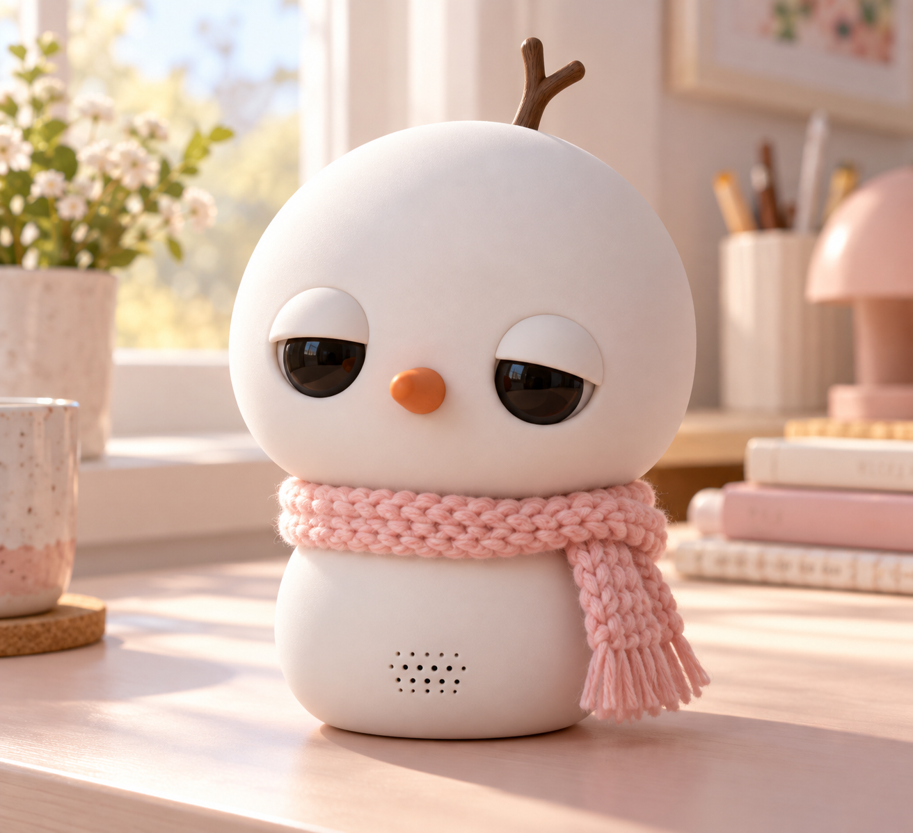

- 머리가 몸통보다 크고, 눈을 얼굴 아래쪽에 둔 아기 같은 비율. 말랑한 실리콘 느낌의 무광 흰색. 분홍 목도리, 나뭇가지 꼭지.
- 그림은 눈꺼풀을 반쯤 내린 "편안·졸림" 표정 — **눈꺼풀이 눈 위에 덮인 실제 모습을 가장 잘 보여 준다.**
- 만들 때: 머리가 무거워 고개 서보에 힘이 더 들고, 끄덕일 때 앞으로 넘어지지 않게 몸통 바닥을 무겁게 해야 한다.
  대신 머리가 커서 보드·카메라·눈꺼풀 기구를 넣을 공간은 가장 넉넉하다.

## B. 북유럽 도자기

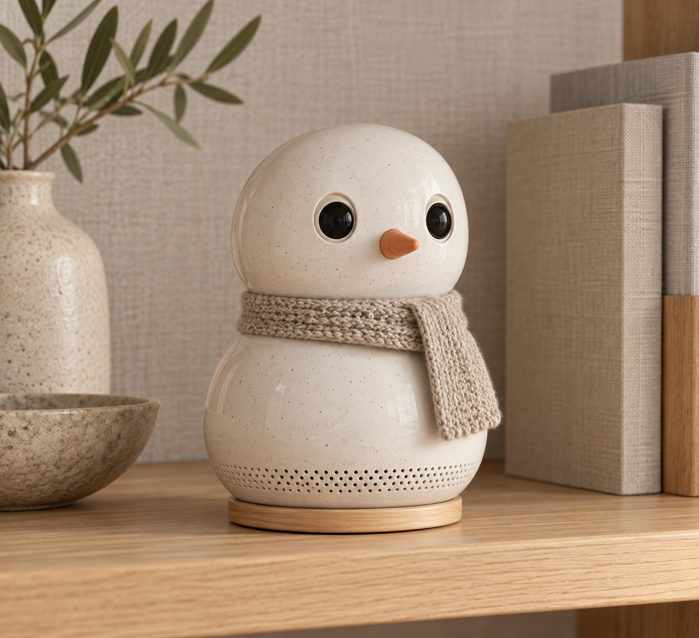

- 살짝 달걀형인 머리·몸통, 반짝이는 미색 도자기 느낌에 작은 점무늬. 얇은 원목 받침. 베이지 목도리. 스피커는 몸통 아래 둘레의 작은 구멍 띠.
- 장난감보다 **인테리어 소품**에 가깝다. 어른 책상에 어울린다.
- 만들 때: 진짜 도자기는 어렵다. 점무늬 들어간 필라멘트로 출력하고 광택 코팅으로 흉내 낸다.
  **원목 받침은 무게중심을 낮추고 USB 선을 숨기기 좋아서** 다른 시안에도 쓸 만하다.

## C. 레트로 장난감

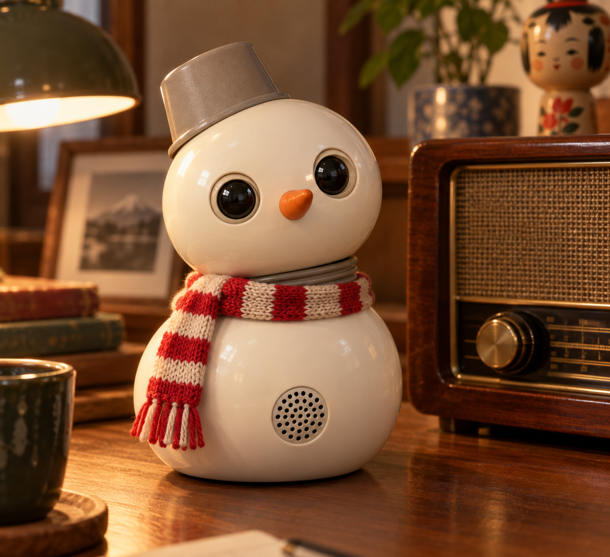

- 1960년대 일본 소프트비닐 장난감 느낌. 광택 크림색, 머리 위 회색 양동이 모자, 빨강·흰 줄무늬 목도리.
- **머리와 몸통 사이 회색 주름 목(링)** 이 보인다. 고개가 돌아간다는 걸 드러내는 디자인 — 목 틈을 숨기지 않고 장식으로 바꿨다.
- 만들 때: 모자가 머리 무게를 늘린다. 모자는 떼어 낼 수 있는 액세서리로 두면 목도리와 함께 꾸미기 요소가 된다.

## D. 진짜 눈 질감

- 표면이 반짝이는 눈 뭉치 질감이고, 모양이 살짝 울퉁불퉁해 손으로 만든 눈사람 같다. 밤 책상, 빨간 목도리.
- **몸통의 검은 석탄 단추 3개가 스피커·마이크 구멍을 겸한다.** 구멍을 단추로 숨기는 아이디어는 다른 시안에도 쓸 수 있다.
- 만들 때: 질감 코팅은 먼지가 끼기 쉽고 닦기 어렵다. 눈꺼풀이 미끄러지는 부분은 매끈해야 하므로 질감을 넣을 수 없다.
  XIAO 보드의 마이크는 머리 안 보드에 붙어 있어서, 단추 구멍을 마이크로 쓰려면 마이크를 따로 달아야 한다.

---

## 시안끼리 섞어 쓸 수 있는 아이디어

| 아이디어 | 나온 시안 | 좋은 점 |
|---|---|---|
| 눈꺼풀이 눈 위에 도톰하게 덮이는 모양 | A | 감정 표현이 가장 잘 보인다 |
| 원목 받침 | B | 넘어짐 방지, USB 선 숨김 |
| 드러낸 목 링 | C | 고개 회전 틈을 장식으로 바꾼다 |
| 떼어 내는 모자 | C | 목도리와 함께 꾸미기 액세서리 |
| 석탄 단추 = 스피커 구멍 | D | 구멍이 안 보여 깔끔하다 |

## 선택: D + 큰 머리 (2026-10-26, 사용자)

**D(진짜 눈 질감)에 A(큰 머리)의 비율을 적용한다.**

- 반짝이는 눈 뭉치 질감, 살짝 울퉁불퉁한 손맛, 나뭇가지 꼭지, 빨간 목도리, 석탄 단추 3개(스피커 구멍 겸용)는 D 그대로.
- 머리가 몸통보다 크고 눈이 얼굴 아래쪽에 있는 A 의 비율.
- 그림은 눈꺼풀을 3분의 1쯤 내린 표정.

이 조합에서 만들 때 챙길 것 (A·D 의 주의점이 합쳐진다):

- **머리가 무겁다.** 몸통 바닥에 무게추를 넣어 무게중심을 낮춘다. 끄덕일 때 앞으로 쏠리지 않는지 확인한다.
  고개 좌우 서보 위에 큰 머리가 올라가므로, 서보 축 하나에만 무게를 싣지 말고 베어링(회전판)으로 받친다.
- **질감 코팅:** 먼지 관리가 어렵다. 눈꺼풀과 그 주변, 목이 돌아가는 이음새는 매끈하게 남긴다.
- **목 틈:** 목도리가 머리와 몸통 사이 회전 틈을 가려 준다. 목도리를 뺐을 때 틈이 어떻게 보일지는 실물에서 정한다.
- **마이크:** 석탄 단추를 마이크 구멍으로도 쓰려면 몸통에 마이크를 따로 단다(보드 마이크는 머리 안).

### 눈 모양: 흰자 + 검은자로 결정 (2026-10-26, 사용자)

아래 비교 그림을 보고 **흰자 + 검은자**로 정했다. 석탄 눈(위 줄)은 쓰지 않는다.

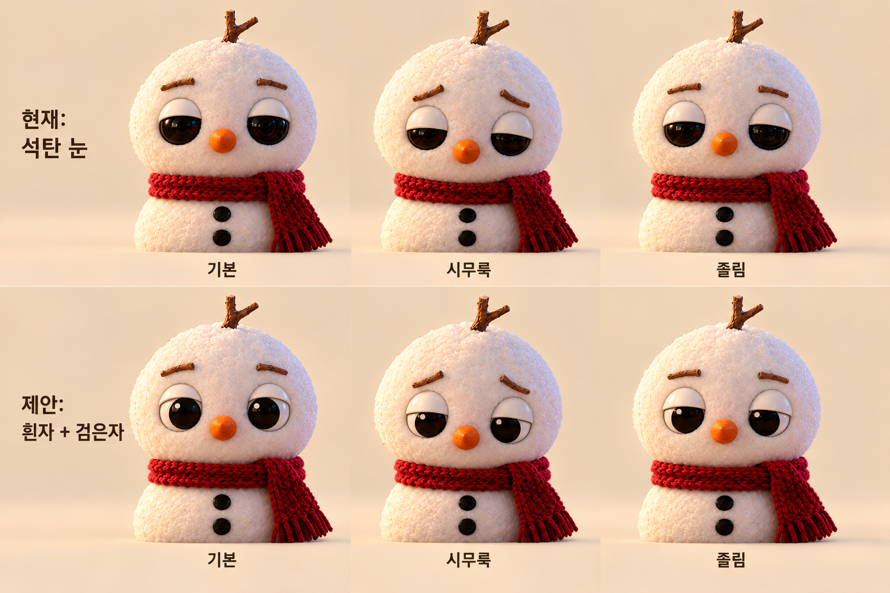

- **현재 (위 줄):** 눈 전체가 검은 광택 돔. 전통 눈사람의 석탄 눈.
- **제안 (아래 줄):** 흰자 + 가운데 고정된 큰 검은자(눈 폭의 약 60%) + 검은자 위쪽의 작은 흰 반짝임 점 + 눈꺼풀 아래 끝의 가는 어두운 선.

흰자·검은자로 갈 때 실물에서 챙길 것:

- 카메라 렌즈는 한쪽 검은자 한가운데에 둔다. 검은자 지름이 렌즈보다 커야 한다.
- 검은자는 고정이다. 눈동자를 굴려 옆을 보는 동작은 없고, 시선은 고개로 바꾼다.
  (그림의 "시무룩"·"졸림"은 검은자가 한쪽으로 쏠려 보이지만, 실제로는 항상 가운데다.)
- 흰 눈꺼풀이 흰자 위에서 잘 안 보인다. 그림에서도 눈꺼풀 아래 끝 선이 거의 보이지 않았다.
  실물에서는 선을 더 진하게 하거나, 흰자는 광택·눈꺼풀은 무광으로 질감 차이를 준다.
- 반짝임 점은 그림에서 거의 드러나지 않았다. 실물에서는 렌즈를 가리지 않게 검은자 가장자리에 칠한다.

## 테크 눈사람 시안 (2026-10-26)

사용자 의견: "눈사람 캐릭터는 겨울용으로 괜찮은데, 지금 디자인은 사람들이 좋아할 만한 디자인이 아닌 것 같다. 테크적인 눈사람이면 어떨까?"
D + 큰 머리 선택은 이 검토가 끝날 때까지 보류한다. 구조(흰자·검은자 눈 2개 중 1개에 카메라, 흰 눈꺼풀, 눈썹, 짧은 당근 코, 목도리, 팔·LED·화면 없음, 큰 머리)는 그대로 두고 재질과 마감만 바꿨다.

| 시안 | 그림 | 특징 | 만들기 (3D 프린터 없음, 출력 대행 기준) |
|---|---|---|---|
| **A. 프리미엄 가전** | 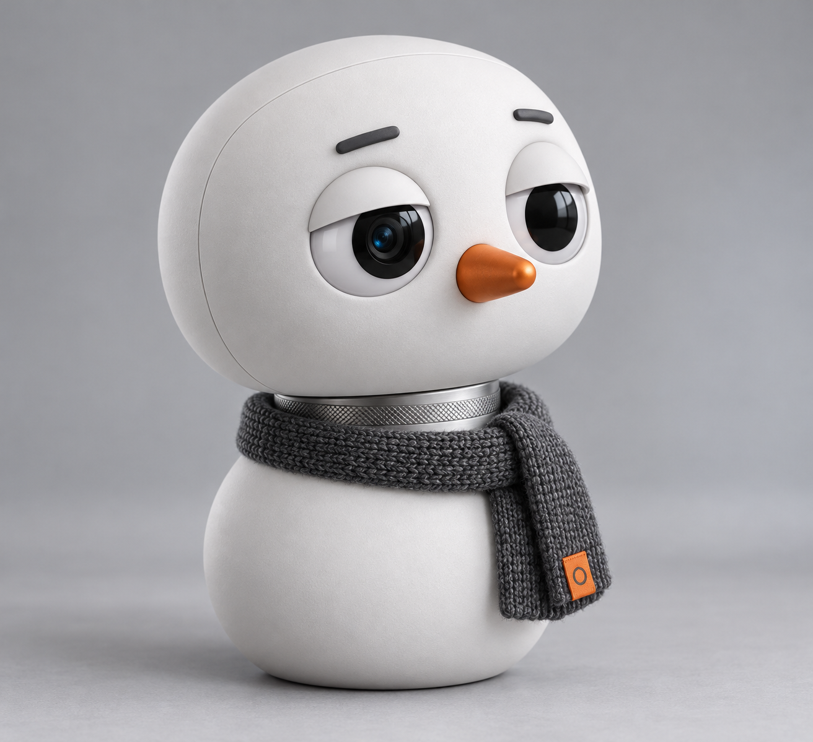 | 이음새 없는 무광 흰 껍데기, 손으로 돌리는 다이얼 같은 알루미늄 목 링, 주황 금속 코, 회색 니트 목도리에 주황 태그 | 출력물의 층 무늬가 보이면 이 느낌이 안 난다. 사포질·도장이 필요해 손이 가장 많이 간다. 목 링은 은색 필라멘트로 흉내 낸다 |
| **B. 얼음 투명** | 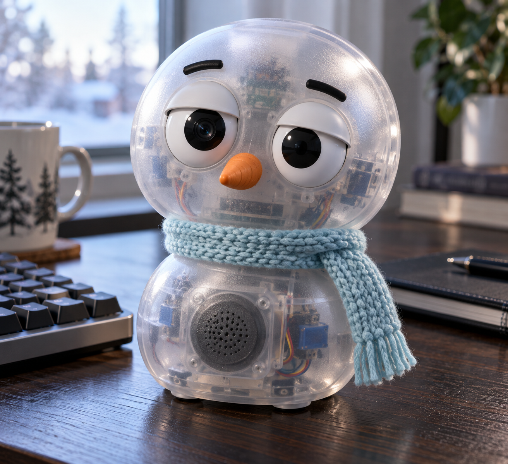 | 반투명 얼음 같은 껍데기 속으로 기판·서보·선·스피커가 비친다 | 투명 PETG 를 일반 출력하면 뿌옇게 나와 오히려 얼음 느낌이 난다. 속이 보이므로 배선을 깔끔하게 정리해야 한다 |
| **C. 공업 디자인** | 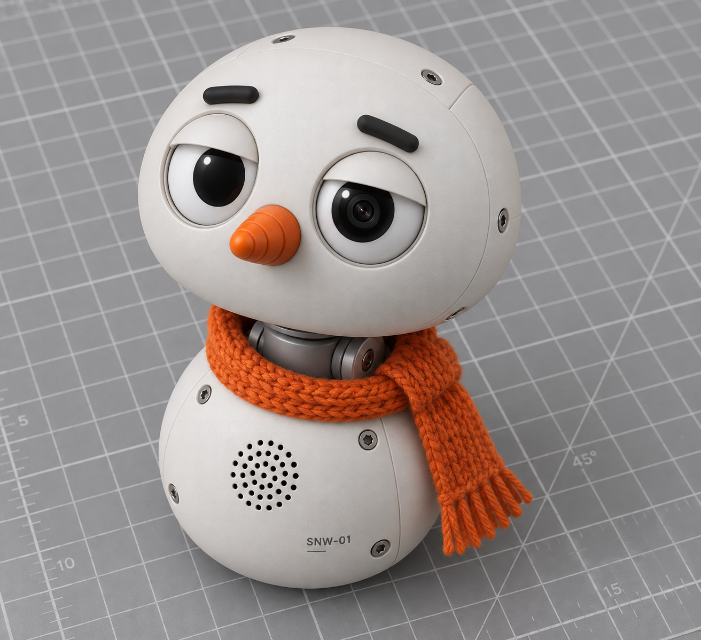 | 겉에 드러난 육각 나사, 점 구멍 스피커 그릴, "SNW-01" 각인, 드러낸 금속 목 관절, 홈이 파인 주황 코 | **가장 만들기 쉽다.** 나사는 실제 M2 나사, 그릴은 출력 구멍, 각인은 출력이나 스티커. 실제 부품이 곧 디자인이 된다 |
| **D. 로우폴리** | 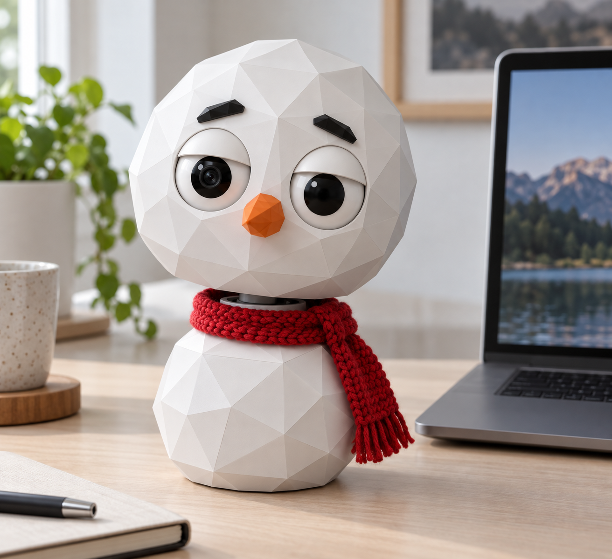 | 삼각형 평면으로 깎은 다면체 머리·몸통 | 평면은 출력이 깔끔해서 층 무늬가 잘 안 보인다. 사포질이 거의 없다. 테크보다는 디자인 소품 느낌 |

그림에서 실제 구조와 다른 점: 네 그림 모두 양쪽 눈꺼풀·눈썹 높이가 다르다(실제는 한 모터로 같이 움직인다). 카메라 위치는 그림마다 왼쪽·오른쪽이 다르다.

## 선택: C 공업 디자인 (2026-10-26, 사용자)

사용자: "C 좋다. 일단 이거 킵하고 이를 바탕으로 디테일 업해보자."
**C 를 기준안으로 한다.** 이전 선택(D + 큰 머리, 눈 뭉치 질감)은 쓰지 않는다.

### 세부 사양 (Claude 제안)

실제 부품 구조에 맞춰 정했다. 원칙: **로봇에 원래 있어야 하는 부품을 숨기지 않고 디자인으로 드러낸다.**

| 부분 | 정한 것 | 이유 |
|---|---|---|
| 색 | 흰색·밝은 회색 몸체, 짙은 회색 기계 부품, 주황 포인트(코·목도리) — 3가지만 | 공업 제품 느낌. 주황이 눈사람의 당근·겨울 느낌을 맡는다 |
| 표면 | 매끈한 무광. 퍼지 스킨·반짝이 필라멘트는 쓰지 않는다 | 일반 흰색·회색 PLA 로 출력 대행 가능. 반짝이 재료를 해외에서 살 필요가 없다 |
| 머리 껍데기 | 앞 얼굴판 + 뒤 덮개 2조각, 옆의 가는 이음선, 육각 M2 나사로 결합 | 앞판을 떼면 눈 기구를 고칠 수 있다. 알리에서 담은 육각 버튼머리 M2 나사가 그대로 디자인이 된다 |
| 눈 | 흰자 돔 + 가운데 고정 검은자. **양쪽 검은자 모두 얇은 금속색 링** — 한쪽은 카메라 렌즈, 다른 쪽은 같은 모양의 검은 돔 | 카메라 눈과 장식 눈이 똑같아 보인다. 렌즈가 "기계 눈"으로 자연스럽다 |
| 눈꺼풀 | 무광 흰색, 아래 끝에 짙은 회색 선 | 흰자 위에서도 눈꺼풀이 보이게 |
| 눈썹 | 검은 고무 막대, **둥근 금속색 축 캡**이 겉에 보인다 | 회전만 하는 실제 구조(가운데 축)를 그대로 보여 준다 |
| 코 | 짧은 주황 당근(약 1cm), 가로 홈 몇 줄 | 깎아 만든 부품 느낌 |
| 목 | 목 관절을 드러낸다. 짙은 회색 회전판(6800ZZ 베어링 테두리) + 끄덕임 축 양쪽의 둥근 캡 | 목도리를 벗겨도 틈이 아니라 기계 부품으로 보인다 (D 안의 "목 틈" 문제 해결) |
| 몸통 앞 | 점 구멍 스피커 그릴, 작은 "SNW-01" 각인 | 석탄 단추 대신 스피커 구멍을 그대로 보여 준다 |
| 머리 뒤 | 가는 가로 환기 슬롯 몇 줄 | 보드·카메라 열 배출 |
| 마이크 구멍 | 아주 작은 구멍 몇 개 | 위치는 보드(눈 뒤)에 가장 가까운 곳으로 3D 설계 때 정한다 |
| 바닥 | 뒤쪽에 USB-C 단자, 고무발 4개, 금속 무게판을 나사로 고정 | 큰 머리 때문에 넘어지지 않게. 고무발은 아직 장바구니에 없다 |
| 쓰지 않는 것 | 팔, 얼굴 화면, LED | 기존 결정 유지 |

> **3D 설계 기준 (2026-10-26, 사용자):** 아래 정면·옆·뒤 그림의 얼굴 비율을 그대로 지킨다("지금의 스타일을 포기하면 안돼"). 기준 그림: [assets/design-tech/c-reference-turnaround.png](assets/design-tech/c-reference-turnaround.png). 그림을 잰 치수와 설계 비교는 [05-cad-stages.md](05-cad-stages.md) 0단계.

### 분해도 (콘셉트)

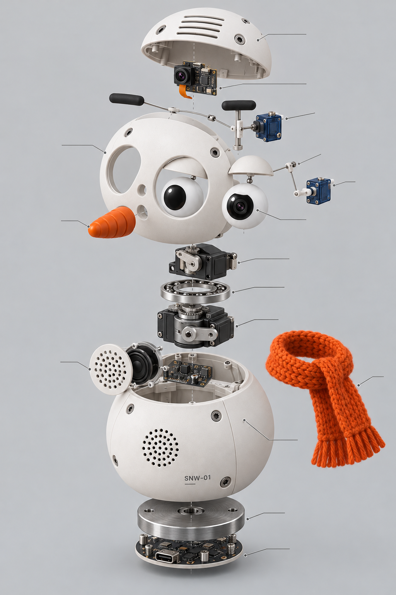

위에서부터: 뒤 덮개(환기 슬롯) → 보드·카메라 → 눈썹(축)·눈썹 서보 → 얼굴판 → 눈·눈꺼풀·눈꺼풀 서보 → 코 → 끄덕임 서보 → 베어링 → 고개 좌우 서보 → 스피커·그릴, 앰프 → 몸통 → 무게판 → USB-C 전원 보드. 옆에 목도리.

그림이 실제 설계와 다른 점: 머리를 위·아래로 나눠 그렸다(정한 것은 앞·뒤 2조각). 눈썹 연결이 T자 막대로 그려졌다(실제는 가운데 세로 슬라이더). 코가 정한 것보다 길다. 얼굴판에 쓰지 않는 구멍이 있다. 부품 배치를 보여 주는 참고 그림이고, 실제 배치는 1단계 실물 치수로 정한다.

### 정면 · 옆 · 뒤

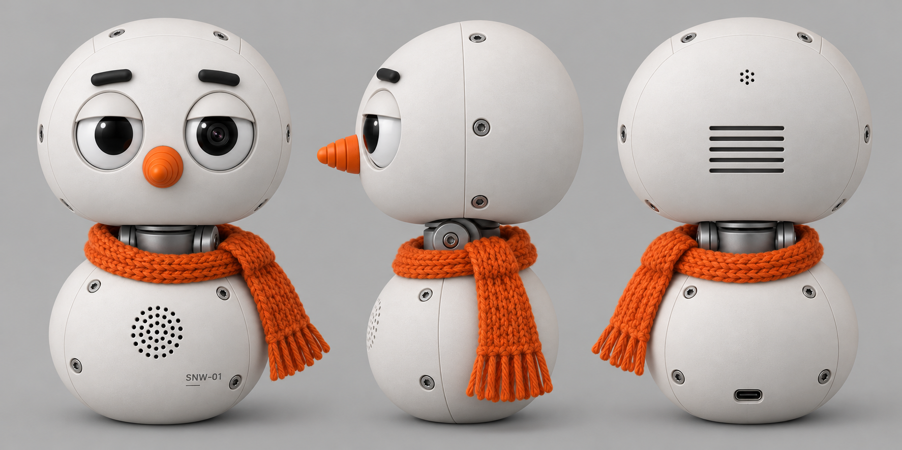

- 정면: 오른쪽 눈 검은자에 카메라, 몸통에 스피커 그릴과 SNW-01.
- 옆: 머리가 앞·뒤 2조각(세로 이음선 + 나사), 끄덕임 축의 둥근 캡. 옆에서 본 코가 정한 길이(약 1cm)보다 길게 그려졌다.
- 뒤: 머리 뒤 가로 환기 슬롯 5줄, 그 위 마이크 구멍 무리, 몸통 아래 USB-C 단자.

### 세부 확대

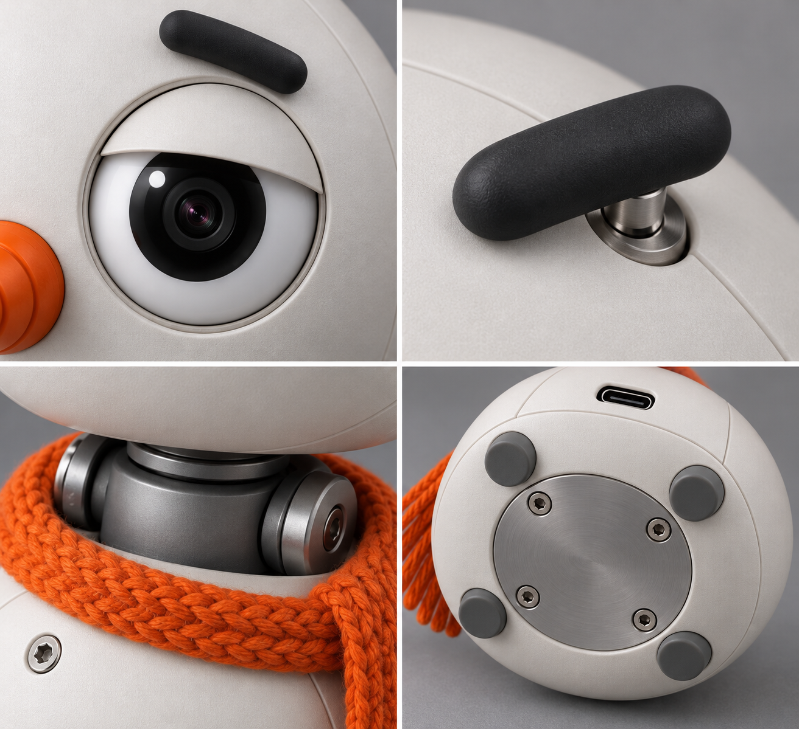

- 왼쪽 위 — 눈: 흰자, 카메라가 든 검은자, 반짝임 점, 눈꺼풀. 눈꺼풀 아래 끝 짙은 선은 거의 안 보인다.
- 오른쪽 위 — 눈썹: 검은 고무 막대가 금속 축에 꽂혀 껍데기 구멍에서 나온다. **회전만 하는 실제 구조와 같다.**
- 왼쪽 아래 — 목: 회전판과 끄덕임 축 양쪽 캡.
- 오른쪽 아래 — 바닥: 고무발 4개, 금속 무게판(육각 나사 4개), USB-C 단자.

### 연출 사진

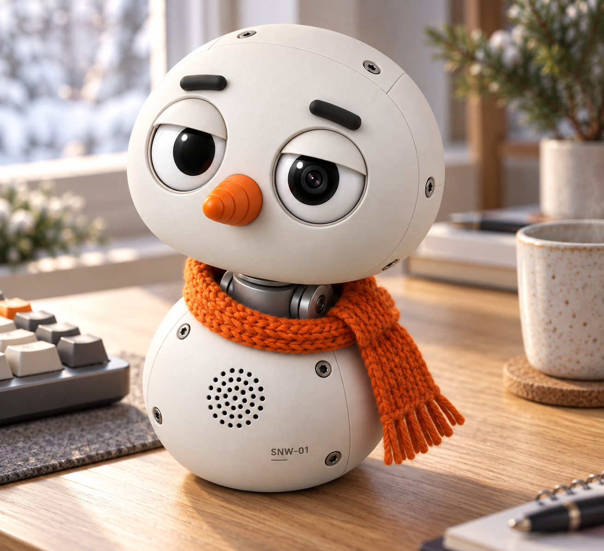

### 샘플: 색 조합 3가지

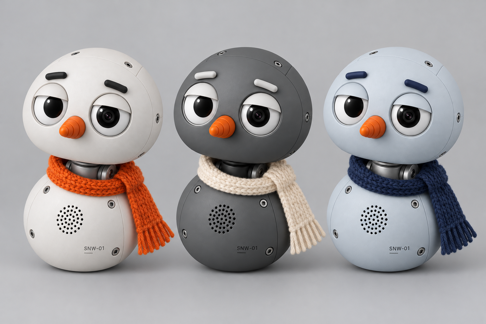

왼쪽부터 흰색 + 주황 목도리 / 짙은 회색 + 크림 목도리·밝은 회색 눈썹 / 연한 얼음 파랑 + 남색 목도리·남색 눈썹. 당근 코는 셋 다 주황.

### 샘플: 반투명 뒤 덮개 (B 섞기)

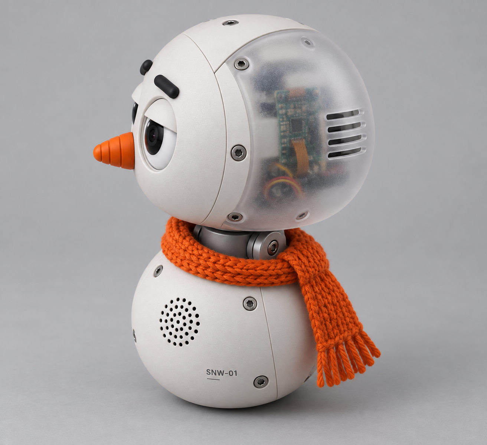

머리 뒤 덮개만 뿌연 반투명으로 바꿔 보드·카메라 케이블·선이 비친다. 얼굴은 불투명 흰색 그대로. 뒤 덮개만 투명 PETG 로 출력하면 된다.

### 아직 못 그린 샘플

알루미늄 목 링(A 섞기), 겨울 소품(비니·목도리·귀마개)은 2026-10-26 에 이미지 서비스 429 로 그리지 못했다.
요청 내용: [assets/design-tech/c3-pending-prompts.json](assets/design-tech/c3-pending-prompts.json).

공통으로 그림이 실제와 다른 점: 양쪽 눈꺼풀·눈썹 높이가 조금씩 다르게 그려진다(실제는 한 모터로 같은 높이).

### 눈 질감을 만드는 방법 (Claude 제안, 2026-10-26)

몸체는 3D 프린팅 플라스틱(PLA/PETG)이다. 질감은 아래 방법으로 낸다. 가격은 확인하지 않은 대략값이다.

| 방법 | 화면에서 보이는 결과 | 추가 비용 | 비고 |
|---|---|---|---|
| **퍼지 스킨(fuzzy skin)** — 슬라이서(3D 프린터용 출력 설정 프로그램)의 기능. 바깥 벽을 출력할 때 노즐을 아주 조금씩 무작위로 흔들어 표면을 까슬하게 만든다 | 눈 뭉치처럼 오돌토돌한 무광 표면 | **없음** (출력 시간만 조금 늘어남) | 반짝임은 없다 |
| **반짝이 필라멘트** — 작은 펄·글리터 가루가 섞인 흰색 출력 재료 | 빛을 받으면 반짝임 | 거의 없음 (일반 흰색과 비슷한 가격대) | 퍼지 스킨과 같이 쓰면 D 그림에 가장 가깝다 |
| 도장 — 질감 스프레이·펄 가루 섞은 투명 코팅 | 질감·반짝임을 더 강하게 | 재료비 1~2만 원 + 칠하는 시간 | 벗겨질 수 있다. 시제품에서는 필요할 때만 |
| 실리콘 껍데기 주조 | 말랑하고 고급스러운 질감 | 틀 제작비가 커서 시제품에는 맞지 않음 | 여러 대 만들 때 검토 |

**제안: 1차 시제품은 "흰색 반짝이 필라멘트 + 퍼지 스킨"으로 출력하고 도장은 하지 않는다.** 단가는 거의 오르지 않는다.

- 눈꺼풀·장식 눈 테두리·목 이음새는 매끈해야 한다. 눈꺼풀은 어차피 따로 출력하는 부품이라 퍼지 스킨을 끄고 출력하면 되고,
  머리·몸통의 이음새 부분은 슬라이서의 영역 설정으로 퍼지 스킨에서 뺀다.
- 오돌토돌한 표면은 먼지가 낀다. 부드러운 솔로 털어 내는 정도로 관리한다.
- 본체를 출력하기 전에 지름 5cm 정도의 작은 공을 설정별로 몇 개 출력해 질감을 비교해 본다.
