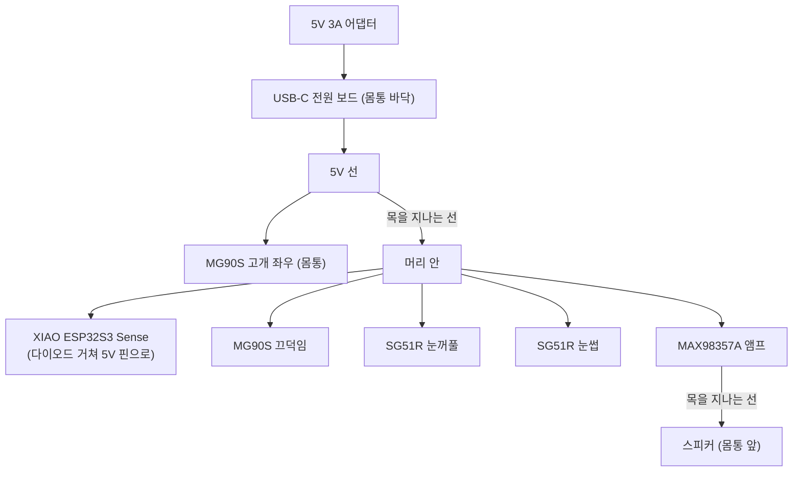

# SnowBot 부품 구매 목록 (시제품 1대)

- 작성: 2026-10-26
- 가격: 2026-10-26 국내 판매 페이지에서 확인한 값. **"추정"** 표시는 판매 페이지로 확인하지 않은 값이다.
- 전제: [01-concept.md](01-concept.md) 의 결정 — 서보 4개(고개 좌우·끄덕임·눈꺼풀·눈썹), 카메라 1개(한쪽 검은자),
  스피커는 몸통(석탄 단추 뒤), USB-C 상시 전원, AI 는 Mac + 클라우드 API.

## 사는 순서: 두 단계로 나눈다

| 단계 | 사는 것 | 하는 일 | 예상 비용 |
|---|---|---|---|
| **1단계 — 전자부품** | 보드·카메라·앰프·스피커·서보 4개·전원 | 몸체 없이 책상 위에서 선을 연결해 **말하기·듣기·카메라·서보 움직임을 먼저 시험**한다 | 약 7만 원 + 배송비 |
| **2단계 — 기구·외형** | 3D 출력, 베어링, 축·연결 막대, 나사, 무게추, 목도리 | 1단계에서 실제 부품 크기를 재고 머리·몸통을 설계해 출력·조립한다 | 약 6~10만 원 (출력 1회 기준) |

1단계를 먼저 하는 이유: 부품을 손에 쥐고 크기를 재야 머리 설계가 정확해진다. 그리고 몸체를 만들기 전에
"대화가 자연스러운지(응답 지연)"를 먼저 확인할 수 있다.

**시제품 1대 합계: 약 13~17만 원** (출력 1회 기준. 다시 출력할 때마다 3~6만 원 추가).
01-concept.md 의 추정(7.5~15.5만 원)보다 조금 높다. 출력 대행비·배송비·자잘한 부품이 실제로 더 들기 때문이다.

---

## 1단계 — 전자부품

| 부품 | 수량 | 용도 | 추천 제품 (판매처) | 단가 | 소계 |
|---|---:|---|---|---:|---:|
| **XIAO ESP32S3 Sense** | 1 | 두뇌 보드 + 카메라 + 마이크. 머리 안, 한쪽 눈 뒤 | 디바이스마트 (품절 시 쿠팡·브이씨텍) | 25,520 | 25,520 |
| **MAX98357A I2S 앰프** | 1 | 보드의 디지털 소리를 스피커 신호로 키움 | 호환 모듈 (엘레파츠, VAT 별도 2,000) | 2,200 | 2,200 |
| **스피커 28mm 2W 8Ω** | 1 | 목소리 출력. 몸통 앞(석탄 단추 뒤) | VLT-SK013 (디바이스마트) | 1,650 | 1,650 |
| **MG90S 메탈기어 서보** | 2 | 고개 좌우 회전, 끄덕임 (큰 머리 무게를 받음) | SMG 호환품 (디바이스마트) | 4,620 | 9,240 |
| **SG51R 초소형 서보** | 2 | 눈꺼풀, 눈썹 | TowerPro 정품 (디바이스마트) | 6,380 | 12,760 |
| **USB-C 전원 입력 보드** | 1 | 몸통 바닥에서 5V 전원을 받는 단자 | SparkFun BOB-17110 (디바이스마트) | 6,050 | 6,050 |
| **5V 3A USB-C 어댑터** | 1 | 벽 콘센트 전원 (KC 인증) | WT-5V3A-C (디바이스마트) | 6,050 | 6,050 |
| 브레드보드 + 점퍼선 | 1세트 | 1단계 책상 위 시험 배선 | — | 약 5,000 | 약 5,000 (추정) |
| 쇼트키 다이오드 + 1000µF 콘덴서 | 각 1~2 | 보드 보호, 서보가 갑자기 전류를 끌 때 전압 흔들림 방지 | — | — | 약 1,000 (추정) |
| | | | | **합계** | **약 69,500** |

### 고른 이유와 대안

- **XIAO ESP32S3 Sense:** 카메라·마이크가 붙어 있고 21 × 17.8 × 15mm(확장보드 포함)로 작다.
  디바이스마트는 지금 품절(재고 확보 중). 대안: 쿠팡 28,870(해외배송 약 2주), 브이씨텍 28,500(VAT 별도), IC뱅큐 22,000(해외재고, 최대 8주).
- **MG90S:** 고개는 큰 머리를 움직이므로 플라스틱 기어 SG90 보다 튼튼한 메탈기어를 쓴다. 더 싼 호환품: IC뱅큐 3,410, 쿠팡 3,200.
- **SG51R:** 눈꺼풀·눈썹은 가볍지만 머리 안 공간이 좁아 5g급 초소형을 쓴다. 대안: Feetech FS0307 4,730(디바이스마트, 무게 미확인),
  EMAX ES9051 4.3g 13,200(디바이스마트).
  **"저소음"을 내세운 초소형 서보는 찾지 못했다.** 소리는 실물을 받아 들어 보고 판단한다.
- **USB-C 보드:** 충전기에서 5V 를 받으려면 보드에 5.1kΩ 저항(CC 저항)이 있어야 한다.
  SparkFun 은 "CC 풀다운 저항 내장"이라고만 적혀 있고 저항값은 판매 페이지에 없다. 쿠팡 500원짜리는 "5.1K 저항 포함"이 적혀 있다(배송비 3,000).
- **앰프:** 디바이스마트에서 같이 사려면 Adafruit 3006 11,880(해외, 2주). 배송비를 아끼려면 앰프만 엘레파츠보다 디바이스마트로 맞추는 것도 방법이다.

### 꼭 확인할 것: 카메라 종류

- Seeed 공식 문서(2026-10-26 확인)는 지금 **OV5640(자동초점)** 을 넣어 판다고 적혀 있다.
- 국내 판매 페이지는 **OV2640** 이라고 적힌 곳이 많고, 에듀이노는 "OV2640 또는 OV3660 섞여서 배송"이라고 적었다.
  **어떤 카메라가 올지는 재고에 따라 다르다.** 셋 다 보드에서 쓸 수 있으므로 SnowBot 에는 어느 것이든 된다.
- **OV5640 이 오면 열을 챙긴다.** 방열판이 같이 들어 있고 판매 페이지에 "화상 주의" 문구가 있다.
  닫힌 머리 안에 넣으려면 열이 빠져나갈 구멍이 필요하다(목도리 선 아래, 머리 뒤, 나뭇가지 꼭지 둘레 등 안 보이는 곳).
- 카메라를 보드에 잇는 납작한 케이블(FPC)의 길이는 공식 자료에서 찾지 못했다. **이 길이가 머리 안에서 보드를 어디에 둘지 정한다.** 1단계에서 실물을 재서 기록한다.

---

## 2단계 — 기구·외형

| 부품 | 수량 | 용도 | 추천 / 판매처 | 비용 |
|---|---:|---|---|---:|
| **3D 출력 (머리·몸통·눈·눈꺼풀·눈썹·코·내부 틀)** | 1회 | 외형과 기구 | 출력 대행 (아래 표) | 약 3~6만 원 (추정 계산) |
| 베어링 6800ZZ (10 × 19 × 5mm) | 1 | 고개 회전판 — 머리 무게를 서보 축 대신 받침 | 디바이스마트 (중국산) | 1,320 |
| 황동봉 2mm, 피아노선 1mm | 조금 | 눈썹 축, 눈꺼풀·눈썹 연결 막대 | — | 약 5,000 (추정) |
| M2 나사·너트, 열압입 인서트 | 1세트 | 출력물 조립 | — | 약 5,000~10,000 (추정) |
| 실리콘 전선 26AWG, 수축튜브, JST 커넥터 | 조금 | 머리↔몸통 배선(목 통과) | — | 약 10,000 (추정) |
| 무게추 (쇠구슬·봉돌 등) | 약 100~200g | 몸통 바닥 — 큰 머리 때문에 넘어지지 않게 | — | 약 5,000 (추정) |
| 니트 목도리 | 1 | 탈착 액세서리 (인형용 목도리 또는 직접 뜨기) | — | 약 5,000~10,000 (추정) |
| | | | **합계** | **약 6~10만 원** |

### 3D 출력 대행 (3D 프린터 없음)

| 서비스 | 가격 방식 (PLA) |
|---|---|
| 3DFARM | 주문당 기본료 5,000 + 출력비 + 배송비. 예: 10cm³ 16,000원, 50cm³ 25,000원 |
| 와우쓰리디 | 부피 × 소재 단가 + 장비 시간 + 작업비. 소형 부품 최소 22,000원 |
| 아이컨택 | 파일을 올리면 바로 견적. 6,600원부터, 6~9영업일 |
| 크몽 "메이크잇" | 10g 당 1,500원(0.2mm 층), 배송 포함 |

- **출력량 추정:** 머리(지름 약 9cm)·몸통(약 8cm)을 두께 2mm 껍데기로 출력하면 약 90cm³(110g 안팎),
  눈·눈꺼풀·코·내부 틀을 더해 150~200g. 크몽 기준 약 2.5~3만 원, 3DFARM 기준 약 4~5만 원.
  설계 전 대략 계산이며, 실제 견적은 3D 파일로 받는다.
- **질감:** 4곳 모두 "퍼지 스킨" 설정 언급은 찾지 못했다. 주문 전에 문의한다.
  흰색 반짝이 PLA 는 국내 재고를 찾지 못했다(쿠팡 해외배송 29,370원/1kg). 대행업체가 가진 재료로 먼저 출력하고, 반짝임은 나중에 판단한다.
- 처음 한두 번은 대행으로 하고, 다시 출력할 일이 많아지면 프린터 구입을 검토한다.

---

## 배선과 전원 (제안)

- **목을 지나는 선은 5가닥:** 5V, GND, 고개 좌우 서보 신호, 스피커 +, 스피커 −.
  고개는 좌우 180도만 돌기 때문에 선에 여유 고리를 주면 꼬이지 않는다.
- **보드 전원:** Seeed 문서는 외부 전원을 5V 핀에 넣을 때 **다이오드를 거치라**고 한다.
  다이오드가 있어야 보드 USB-C 와 외부 전원이 동시에 꽂혀도 서로 부딪히지 않는다.
- **서보 전원:** 서보 4개가 동시에 움직이면 순간적으로 전류를 많이 끈다. 5V 3A 어댑터를 쓰고, 서보 근처에 1000µF 콘덴서를 단다.
- **핀:** 보드에서 쓸 수 있는 핀 11개 중 서보 4개 + 앰프 3개(BCLK·LRC·DIN) = 7개. 별도 서보 제어 보드는 필요 없다.
  SD 카드는 쓰지 않는다(D8~D10 핀과 겹침). 어느 핀에 무엇을 꽂을지는 회로를 짤 때 정한다.
- **프로그램 올리기:** 조립 후에는 보드 USB-C 가 머리 안에 숨는다. 무선(Wi-Fi)으로 프로그램을 올리는 방식(OTA)을 처음부터 넣는다.
- **소리 되울림:** 마이크는 머리(보드), 스피커는 바로 아래 몸통이다. 로봇이 말할 때 자기 목소리를 듣는다.
  처음에는 "말하는 동안은 듣지 않기"로 처리하고, 끼어들기가 필요하면 나중에 되울림 제거(AEC)를 넣는다.

## 머리 안에 들어가나 (대략)

| 부품 | 크기 | 위치 |
|---|---|---|
| XIAO + Sense 확장보드 | 21 × 17.8 × 15mm (Seeed 공식) | 한쪽 눈 바로 뒤 (카메라가 검은자 가운데에) |
| MG90S (끄덕임) | 일반 규격 약 23 × 12 × 29mm (판매처마다 조금 다름) | 머리 아래쪽, 목 회전판 위 |
| SG51R × 2 | 5g급 초소형 (치수는 실물로 확인) | 눈 위쪽 — 눈꺼풀·눈썹 기구 옆 |
| MAX98357A | 작은 모듈 | 남는 공간 |

큰 머리(지름 약 9cm)라 부품 자체는 들어간다. **어려운 부분은 눈 주변**이다.
카메라·눈꺼풀 기구·눈썹 기구가 모두 눈 근처에 모이므로, 1단계에서 실물 치수를 잰 뒤 3D 설계에서 앞뒤 깊이를 나눠 배치한다.

## 디바이스마트 장바구니 (2026-10-26, Claude 가 담음 · 결제 전)

| 상품 (디바이스마트 상품번호) | 수량 | 금액 (VAT 별도) | 납기 |
|---|---:|---:|---|
| SMG TowerPro 호환 MG90S (1313389) | 2 | 8,400 | 2~3일 |
| 28mm 스피커 2W 8Ω VLT-SK013 (15960138) | 1 | 1,500 | 3~4일 |
| [해외] TowerPro 정품 SG51R (12503473) | 2 | 11,600 | 1~2일 |
| [해외] SparkFun BOB-17110 (16055612) | 1 | 5,500 | **1주일** |
| WT-5V3A-C 어댑터 (12504725) | 1 | 5,500 | 1~2일 |
| 6800ZZ 베어링, 중국산 (14117014) — 2단계 부품이지만 배송비를 아끼려고 같이 담음 | 1 | 1,200 | 3~4일 |
| [해외] Adafruit MAX98357A ada-3006 (12496231) | 1 | 10,800 | **2주일** |
| 브레드보드 830핀 MB-102 (1322408) | 1 | 1,400 | 2~3일 |
| 점퍼와이어 4종 65개 (1329628) | 1 | 2,000 | 1~2일 |
| 1N5817 쇼트키 다이오드 (3015) — 최소 주문 10개 | 10 | 500 | 1~2일 |
| 전해 콘덴서 16V 1000µF 105℃ (29524) — 최소 주문 10개 | 10 | 900 | 1~2일 |
| **합계** | | **49,300 + VAT 4,930 + 배송비 2,700 = 56,930원** | |

- **XIAO ESP32S3 Sense(14991199)는 품절이라 담지 못했다.** 납땜된 판(15781788)도 품절. 쿠팡·브이씨텍에서 따로 산다.
- 디바이스마트는 국내·해외 상품을 같이 주문하면 **가장 늦은 해외 상품에 맞춰 한 번에 보낸다.** 앰프(2주일) 때문에 전체가 약 2주 걸린다.
  빨리 받으려면 앰프를 빼고 엘레파츠 호환 모듈(2,200원)을 따로 산다.
- 장바구니는 일주일 뒤 자동으로 지워진다.

## 알리익스프레스 비교 (2026-10-26 확인)

| 부품 | 알리 가격 | 비고 |
|---|---:|---|
| XIAO ESP32S3 Sense | **19,520원, 무료배송** | 판매자 "Seeedstudio AI Hardware Store"(평점 97.3%), 2,000+ 판매, 카메라 OV3660, 11/1~11/7 도착, 1인 1개 제한. 상품 1005006988111963. 쿠팡(28,870원)보다 싸다 |
| MAX98357A 앰프 | 약 1,400~2,200원 | 판매 1,000~3,000+ 상품 여럿. 디바이스마트 Adafruit(11,880원)보다 훨씬 싸다 |
| 28mm 스피커 8Ω 2W | 약 800~2,200원 (2개 묶음 많음) | |
| USB-C 보드 (CC 5.1kΩ) | 약 1,400원 / 5개 | 5.1kΩ 저항이 적혀 있다 |
| MG90S / SG51R | 개당 약 1,600~4,000원 | 호환품·가짜 "메탈기어"가 섞여 있다. 고개·눈꺼풀은 품질이 중요해서 국내 정품·검증품을 쓴다 |
| 6800ZZ | 1,900원~ (10개 묶음 많음) | 디바이스마트 1,320원과 차이 없음 |

알리 가격은 검색 결과의 "가장 싼 옵션" 기준이 섞여 있어 실제 옵션 가격은 조금 다를 수 있다(보드는 상품 페이지에서 확인).
어댑터는 전기 안전 인증(KC)이 있는 국내 제품을 쓴다.

## 알리익스프레스 장바구니 — 한곳에서 모두 사기 (2026-10-26, Claude 가 담음 · 결제 전)

사용자가 "가급적 한곳에서" 사기를 원해서 1단계 부품 전부와 베어링을 알리에 담았다. 서보는 불량에 대비해 여분을 더 담았다.

| 상품 (알리 상품번호) | 옵션 · 수량 | 장바구니 금액 | 판매자 |
|---|---|---:|---|
| XIAO ESP32S3 Sense (1005006988111963) | 1pc | 19,520 (무료배송) | Seeedstudio AI Hardware Store |
| MAX98357A 앰프 (1005007003802663) | 1PCS | 2,120 | Module Wholesale Store |
| MG90S 메탈기어 (1005006219266362) | 4개 묶음 (2개 여분) | 9,700 | Dogmang Plus Store |
| SG51R 5g (1005012040176391) | 1PC × 3 (1개 여분) | 11,940 + 배송비 4,154 | FuturesUAV Store |
| 28mm 스피커 8Ω 2W (1005004677353660) | 1개 | 3,480 | Noodel Cheng Store |
| USB-C 보드 CC 5.1kΩ (1005013004590116) | 5개, 핀 납땜된 것(red welding needle) | 2,880 + 배송비 1,687 | Suzpng Limited Store |
| 6800ZZ NSK (1005007845626243) | 1개 | 3,240 | APE 공식 스토어 |
| 830핀 브레드보드 + 점퍼선 (1005010435623453) | 830 cable 1PCS | 3,680 | Hornaxy Electronic Store |
| 1N5817 (1005001552094086) | 50개 | 2,380 | shenzhenYida Store |
| 전해 콘덴서 16V 1000µF (1005011631970768) | 40개 | 6,540 | LXQY Store |
| **합계** | | **상품 65,480 + 배송비 5,841 − 할인 783 = 70,538원** | |

- **XIAO 상품에 카메라가 들어 있다.** 상품 사진에 메인 기판, Sense 확장보드(마이크·SD 슬롯), 짧은 케이블이 달린 카메라 모듈 3개가 나온다. 장바구니 썸네일은 기판 뒷면만 보여서 카메라가 없어 보인다.

### 여분·작업용 부품 (2026-10-26 추가)

사용자 요청: 만능기판과 "혹시나 하는 부품"을 같이 담기.

| 상품 (알리 상품번호) | 옵션 | 장바구니 금액 | 쓰는 곳 |
|---|---|---:|---|
| 만능기판 양면 4종 10장 (1005010545549310) | 10pcs Combo Kit (2×8·3×7·4×6·5×7cm) | 6,220 | 최종 조립 때 선을 모아 납땜 |
| 핀 헤더 수·암 40핀 10쌍 (1005011994442064) | — | 3,280 | XIAO·모듈에 핀 달기, 끼우고 빼는 연결 |
| 점퍼선 20cm 120개 (1005006205169394) | 수-수·수-암·암-암 40개씩 | 1,752 | 1단계 시험 배선. 서보 단자(암)↔보드 핀 |
| 서보 연장선 30cm 10개 (1005006010430063) | 10pcs-300mm | 7,400 + 배송비 1,542 | 머리↔몸통 서보 배선, 시험 때 거리 늘리기 |
| 실리콘 전선 26AWG 5m × 3색 (32625434966) | 빨강·검정·노랑 | 6,640 | 목을 지나는 선 (5V·GND·신호) |
| 수축튜브 164개 (1005007496691491) | 164PCS NO BOX | 2,040 | 납땜한 선 감싸기 |
| M2 열압입 인서트 50개 (1005006071488810) | M2 × L3 × OD3.2 | 4,200 | 출력물에 나사산 만들기 |
| M2 나사·너트 세트 (1005005478212295) | M2 (1set) | 6,070 | 출력물 조립 |
| INMP441 I2S 마이크 (1005008870682636) | — | 1,090 + 배송비 1,675 | 예비: 몸통 단추 쪽 마이크, 보드 마이크가 부족할 때 |
| 1% 저항 세트 30종 300개 (1005011772534173) | 300PCS bags | 4,060 | 예비 |

**알리 장바구니 전체 (22개 품목): 상품 109,612 + 배송비 9,058 − 할인 1,014 = 117,656원** (2026-10-26 16시경).
XIAO 가격이 처음 담을 때 19,520원에서 20,900원으로 바뀌었다(재방문 회원 할인이 빠짐).

- 장바구니 가격은 상품 페이지의 "신규 회원 혜택가"보다 조금 높게 잡혔다.
- **5V 3A 어댑터는 담지 않았다.** 집에 있는 USB-C 충전기(5V 3A 를 내는 것, 예: 20W 이상 USB-C PD 충전기)를 쓴다. 없으면 국내 KC 제품을 산다.
- 도착 예정: 11/1~11/7 (상품 페이지 기준).
- 디바이스마트 장바구니는 쓰지 않으면 일주일 뒤 자동으로 지워진다.

## 1차 구매: 꼭 필요한 것만 (2026-10-26, 사용자 결정)

사용자 결정: **테이블용으로 먼저 만든다. 차량용 보완은 공모전 합격 뒤에 한다.** 일단 꼭 필요한 부품만 사서 만들어 보고, 나머지는 그 뒤에 산다.
알리 장바구니에서 아래 10개를 먼저 체크했고, 이어서 외형용 8개를 더 체크했다(총 18개). 나머지 4개는 지우지 않고 체크만 풀었다.

| 체크한 상품 | 수량 | 금액 | 왜 지금 사나 |
|---|---|---:|---|
| XIAO ESP32S3 Sense | 1 | 20,900 | 두뇌·카메라·마이크 (품절 임박 표시) |
| MAX98357A 앰프 | 1 | 2,120 | 소리 |
| 28mm 스피커 8Ω 2W | 1 | 3,480 | 소리 |
| MG90S 4개 묶음 | 1묶음 | 9,700 | 고개 2개 + **여분 2개** |
| SG51R | 3 | 11,940 | 눈꺼풀·눈썹 2개 + **여분 1개** |
| USB-C 5.1kΩ 보드 5개 | 1봉 | 2,880 | 충전기에서 서보 전원 받기 |
| 1N5817 다이오드 50개 | 1봉 | 2,380 | 보드 보호 (최소 묶음) |
| 1000µF 콘덴서 40개 | 1봉 | 6,540 | 서보 전압 흔들림 방지 (최소 묶음) |
| 830핀 브레드보드 + 점퍼선 | 1 | 3,680 | 납땜 없이 시험 배선 |
| 핀 헤더 수·암 40핀 10쌍 | 1 | 3,280 | XIAO·앰프를 브레드보드에 꽂으려면 핀이 필요 |

**합계: 상품 65,522 + 배송비 5,841 − 할인 640 = 70,723원** (장바구니 표시, 2026-10-26).

- 여분은 **서보만** 넣었다. 싼 호환 서보는 받자마자 안 돌거나 떨리는 것이 흔하고, 초소형 서보는 기구를 맞추다 걸리면 기어가 쉽게 상한다.
  다시 주문하면 2주를 기다려야 한다. 나머지 부품은 묶음에 이미 여분이 있거나(USB-C·다이오드·콘덴서), 정품(XIAO)이다.
- **외형용 부품도 같이 체크 (사용자 요청, 같은 날):** 베어링 6800ZZ 3,240 · M2 나사 세트 6,070 · M2 인서트 50개 4,200 · 실리콘 전선 26AWG 빨강·검정·노랑 2,200·2,220·2,220 · 수축튜브 2,040 · 만능기판 6,220.
  **체크 18개 합계: 상품 93,932 + 배송비 5,841 − 할인 2,229 = 97,544원** (장바구니 표시).
- **체크를 푼 것 (안 사도 되는 것):** 점퍼선 120개(브레드보드에 점퍼선이 들어 있다), 서보 연장선(머리 서보는 보드와 같이 머리 안에 있다), INMP441 마이크(보드 마이크로 먼저 해 본다), 저항 세트.
- **납땜인두가 필요하다.** 핀 헤더를 XIAO·앰프에 납땜해야 브레드보드에 꽂을 수 있다. 공구가 없으면 따로 산다.

### 결제 완료 확인 (2026-10-26, Claude 가 주문 내역에서 확인)

- 사용자가 결제했다(네이버페이). **알리 주문 17건 = 체크한 18줄 전부.** 실리콘 전선 검정·빨강은 한 주문으로 묶였다.
- 17건 총 금액을 더하면 **97,544원** — 장바구니 예상 금액과 같다. 수량도 모두 맞다(SG51R 3개, MG90S 4개 묶음, 나머지 1개씩).
- 상태: 모두 "결제 확인 중 / 처리 중". 예상 배송일 **2026-11-07**, 그보다 늦으면 주문마다 1,300원 쿠폰.
- 장바구니에는 체크를 푼 4개(점퍼선 120개·INMP441·서보 연장선·저항 세트)가 그대로 남아 있다.
- XIAO 상품 이름에 카메라가 **OV3660** 으로 적혀 있다. 보드에서 쓸 수 있는 카메라라 문제없다(위 "카메라 종류" 참고).

## 도착 확인 (2026-11-07)

- 11/4 사진: XIAO 를 뺀 알리 주문 봉지가 모두 보인다(MG90S 4·작은 파란 서보 3·앰프·스피커·USB-C 보드 5·브레드보드+점퍼·만능기판·핀 헤더·실리콘 전선 3색·수축튜브·M2 나사 상자·M2 인서트·1N5817·베어링). 은색 정전기 봉투 하나는 사진으로 내용이 안 보인다 — 1000µF 콘덴서로 추정, 열어서 확인.
- 11/7: **XIAO ESP32S3 Sense 도착** → 주문 18줄 모두 도착.
  - 카메라는 상품명의 OV3660 이 아니라 **OV5640**(리본에 인쇄). 쓰는 데 문제없고, 위 "카메라 종류"대로 열 대책이 필요하다.
  - 검은 선 + 납작한 끝 = 외장 Wi-Fi 안테나. U.FL 단자에 끼워야 Wi-Fi 가 제대로 잡힌다.
  - 스펀지에 7핀 헤더 2줄이 꽂혀 있다(납땜 전). 파란 조각은 방열 패드로 보인다 — 확인 필요.

## 사기 전에 정할 것

- 공구가 있는지 — 납땜인두, 니퍼, 작은 드라이버, 글루건, 멀티미터(전압 재는 도구). 없으면 1단계 목록에 더한다.
- 판매처를 디바이스마트 한 곳으로 모을지 (배송비 절약) — XIAO 가 품절이면 쿠팡·브이씨텍으로 나눠야 한다.

## 서보 실측 (2026-11-07, 디지털 캘리퍼스)

| 서보 | ① 길이 | ② 폭 | ③ 높이 | ④ 날개 끝~끝 | 축 지름 | 비고 |
|---|---|---|---|---|---|---|
| MG90S (설계값) | 22.8 | 12.2 | 22.7 | 32.2 | — | ⑤ 16.0 ⑥ 6.0 |
| MG90S (실측) | 22.41 | 11.11 ⚠ | 22.4 | 32.2 | 4.8 | ② 는 설계와 1.1 차이 — 다시 잴 것. ⑤⑥ 미측정 |
| SG51R (설계값) | 21.5 | 11.7 | 17.0 | — | — | ⑥ 5.5 |
| SG51R (실측) | 21.0 | — | 19.4 (톱니 덮개 포함) | 30.0 | 4.8 | ② ⑥ 미측정. 작은 서보 라벨은 SG51R 로 확인 |

## 서보 동작 시험 (2026-11-07)

- MG90S 4개, SG51R 3개 모두 정상 (D0·D1·D3·D5 각 핀에서 명령대로 회전 확인).
- 시험 코드 `firmware/servo_test/servo_test.ino` — ESP32Servo 3.2.1 + esp32 코어 3.3.12 조합에서 서보 4개 attach 시 D0·D3 펄스가 끊겨, 라이브러리 없이 LEDC(`ledcAttach` 50Hz/14bit)로 바꿈. 시리얼 `t` 로 네 핀 펄스 비율 자가 진단(90° ≈ 7.3%).

## 앰프 확인 (2026-11-07)

- 받은 모듈: MAX98357A I2S Mono Amp (보라 기판). 뒷면 표기 2.5–5.5V, 4–8Ω 3W, 기본 9dB, (L+R)/2 출력.
- 앞면 핀 순서(왼쪽부터): **LRC · BCLK · DIN · GAIN · SD · GND · Vin** — Adafruit 원본과 같음. 스피커 단자는 앞면 기준 왼쪽 −, 오른쪽 +.
- 연결 계획: BCLK → D4(GPIO5), LRC → D6(GPIO43), DIN → D7(GPIO44), Vin → 5V 레일, GND → GND. GAIN·SD 는 비움.
