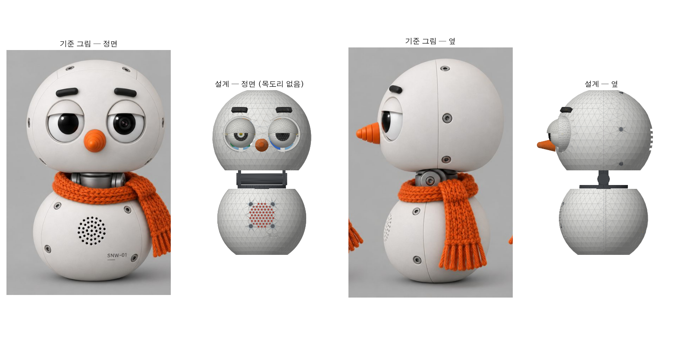
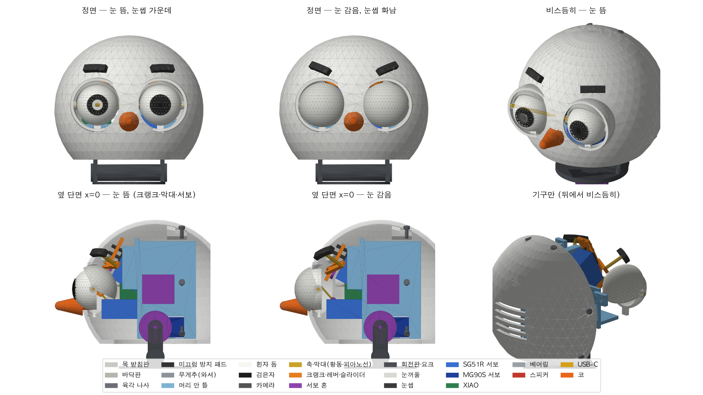
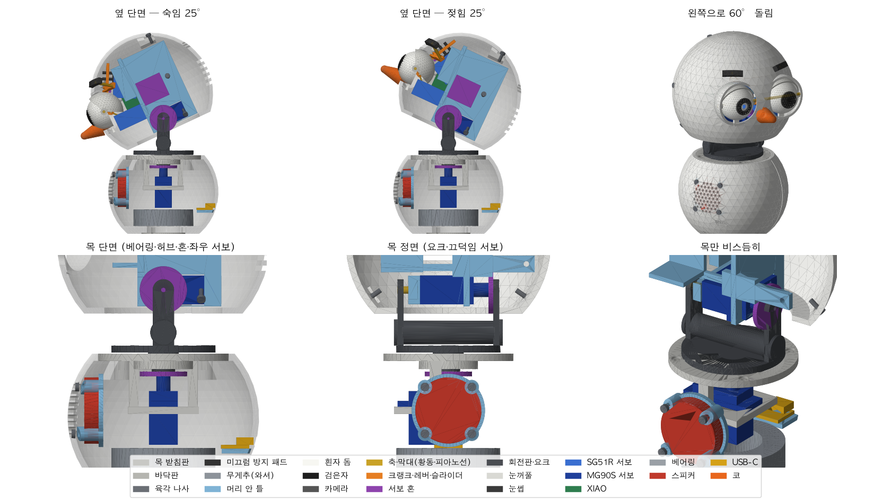
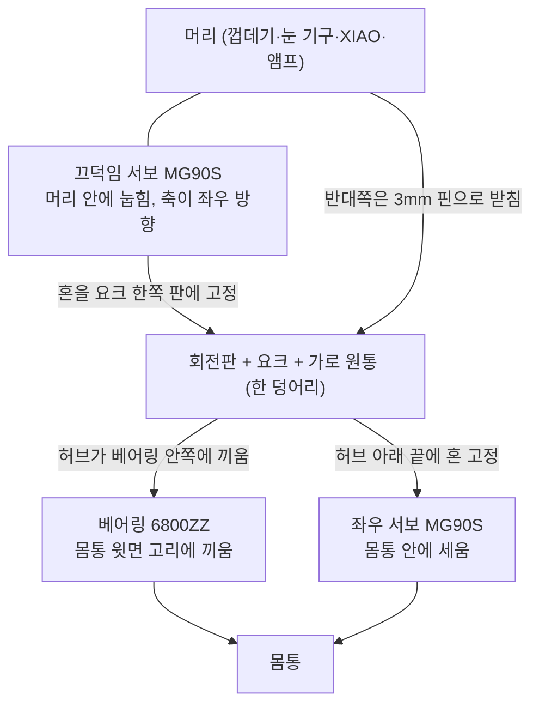
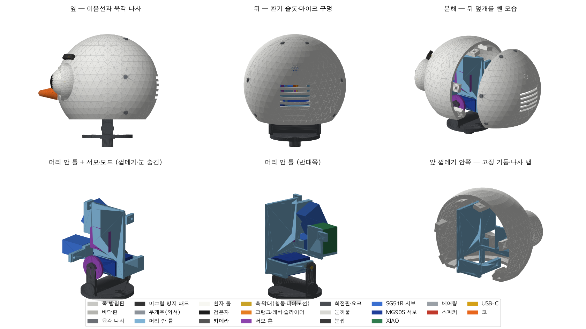
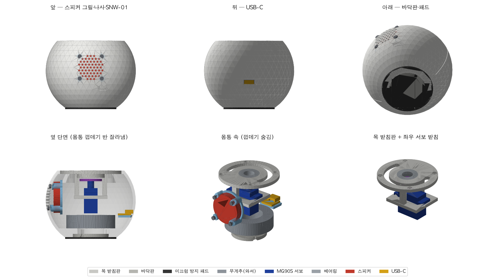
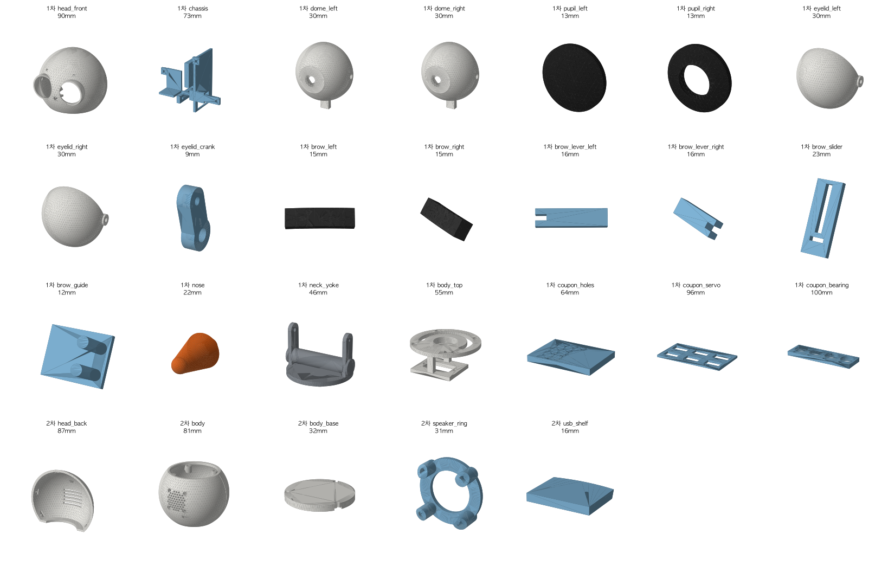

# 3D 설계 단계 (코드 설계, `cad/`)

외형 제작 준비(`04-body-build-plan.md`)의 설계 부분을 단계로 나눠 진행한다. 각 단계는 **움직이는 자세마다 부품이 서로·껍데기와 겹치지 않는지** 코드로 검사한다.
치수는 아직 판매 페이지 자료값과 추정값이다. 부품이 오면(11/7 예정) 실측해서 숫자만 바꾸고 다시 검사한다.

| 단계 | 내용 | 상태 |
|---|---|---|
| 0. 기준 비율 | C 디자인 기준 그림을 재서 키·머리·몸통·눈·코·눈썹 치수로 옮김 | **완료 (2026-10-26)** |
| 1. 눈 기구 | 눈 테·흰자 돔·검은자·카메라, 눈꺼풀, 눈썹, 코, 서보 2개와 연결 | **완료 (2026-10-26, 기준 비율로 다시 설계)** |
| 2. 목 관절 | 베어링·회전판, 고개 좌우 서보, 끄덕임 축과 서보, 은색 가로 원통 | **완료 (2026-10-26, 기준 비율로 다시 맞춤)** |
| 3. 머리 안 틀 + 껍데기 나누기 | 서보·보드를 붙잡는 틀, 머리 앞뒤 분리, 나사·인서트 자리, 환기 슬롯 | **완료 (2026-10-26)** |
| 4. 몸통·바닥 | 몸통 비율, 목 받침판·좌우 서보 받침, 스피커 그릴, USB-C, 무게추·바닥 패드 | **완료 (2026-10-26)** |
| 5. 출력 파일 + 주문표 | 출력 부품 STL 26개, 공차 시험 판 3장, 눈썹 안내, 선 구멍, 주문표 | **완료 (2026-10-26)** |

검사 결과(10가지 자세 — 눈 뜸·감음·반쯤, 눈썹 걱정·화남, 고개 숙임·젖힘 25°, 좌우 90°): [report.txt](assets/cad/report.txt) — 모두 겹침 없음.

## 0단계: 기준 비율 (2026-10-26)

사용자: "지금 얼굴 비율이 너무 좋은데? 지금의 스타일을 포기하면 안돼." → **C 디자인 정면·옆·뒤 그림이 기준이다.**
기준 그림: [c-reference-turnaround.png](assets/design-tech/c-reference-turnaround.png) (사용자가 붙여 넣은 그림 = `c2-turnaround.png` 를 1400×700 으로 줄인 것. 잰 픽셀 좌표가 이 크기 기준이라 따로 둔다). 머리 지름을 90mm 로 두고 픽셀을 재서 환산했다.

| 부분 | 기준 그림에서 잰 값 | 설계 |
|---|---|---|
| 키 | 약 150mm | **152mm** (끄덕임 여유 때문에 2mm 높임) + 바닥 패드 1.5 |
| 머리 | 지름 90, 아래를 머리 중심 30mm 아래에서 평평하게 자름(지름 약 67) | 같음 |
| 몸통 | 지름 약 81, 중심 높이 약 36, 바닥 평면 지름 약 37 (아래가 둥글게 말려 들어감) | 지름 81, 바닥 평면 **지름 47** (넘어짐 여유 때문에 넓힘, 사용자 승인) |
| 눈 | 정면을 보는 둥근 눈 테 지름 약 32, 흰자 약 25, 검은자 약 13. 중심 좌우 ±19, 머리 중심보다 3mm 위 | 눈 테 지름 33, 흰자 25, 검은자 13, ±19, +3 |
| 코 | 밑면 지름 약 12, 길이 약 15, 머리 중심보다 7mm 아래 | 밑면 12, 길이 14, -7 |
| 눈썹 | 길이 약 15, 두께 약 4~5, 머리 곡면을 따라 붙음, 머리 중심보다 23mm 위 | 15 × 4 × 3, +24 (눈 테와 닿지 않게 1mm 올림) |
| 목 | 짧은 은색 가로 원통 + 양 끝 둥근 캡, 길이 약 37 | 요크 판 사이 가로 원통(지름 10) + 캡(지름 11), 판 바깥 폭 43 |

처음 잰 눈 크기(흰자 20)는 흰자 테두리 안쪽만 잡은 값이라 작았다. 비교 그림을 보고 1.25배로 고쳤다.
앞에서 "그림 속 머리 아래는 둥글다"고 했던 것도 틀렸다. 재 보니 그림도 머리 아래가 평평하다(목에 가려져 잘 안 보임).

## 1단계: 눈 기구

위 줄: 정면(눈 뜸) · 정면(눈 감음 + 눈썹 화남) · 비스듬히. 아래 줄: 옆 단면(눈 뜸·감음) · 기구만 뒤에서 본 모습.
코드: `cad/eye_module.py`.

### 정한 것

| 부분 | 정한 것 | 이유 |
|---|---|---|
| **눈 테 (눈 상자)** | 눈마다 **정면을 보는 둥근 테**(구 껍데기 조각, 바깥 지름 33)가 머리 밖으로 나온다. 머리는 둥근 구 그대로 | 기준 그림의 눈 모양. 두 눈 테가 같은 방향을 보므로 두 눈 중심이 x 축 한 줄에 놓인다 |
| 눈꺼풀 축 | **황동봉 2mm 하나(길이 약 71mm)가 두 눈 중심을 꿰뚫는다.** 바깥쪽 눈 테 벽에 뚫린 구멍(지름 2.3)으로 밀어 넣고 끝을 벽 바깥면에 맞춰 자른다. ※ 1차 출력(2026-10-26 주문)에는 이 구멍이 빠져 있었다 — 2026-11-07 끼워 보기에서 발견, 코드 수정 | 서보 1개로 두 눈꺼풀이 똑같이 움직인다. 테가 없으면 축 끝이 머리 밖으로 튀어나온다 |
| 눈꺼풀 | 두께 1mm 반구 조각(±70° 덮음). 눈 뜰 때 위로 135° 돌아 눈 테 안 → 머리 안으로 숨는다 | 감으면 흰 눈꺼풀이 눈을 덮는다. 기준 그림처럼 반쯤 감은 "졸린 눈"도 된다 |
| 흰자 돔 | 지름 25, 눈 테 앞으로 볼록. 아래쪽 다리로 눈 테 벽에 고정, 축이 도는 받침 | 기준 그림 비율 |
| 검은자 | 지름 13. 앞면을 돔과 같은 곡면으로 | 납작한 판이면 가장자리가 눈꺼풀에 걸렸다 |
| 눈꺼풀 서보 | 두 눈 사이 아래 뒤. 축 가운데 크랭크(5.5mm)와 서보 혼(5.5mm)을 피아노선 1mm 막대로 연결(평행사변형) | 서보가 돈 만큼 눈꺼풀도 돈다. 크랭크가 막대와 한 줄이 되는 각(약 229°)을 지나지 않게 범위를 75~210° 로 잡았다 |
| 눈썹 | 머리 곡면을 따라 휜 막대(15 × 4 × 3). **축이 머리 중심 쪽을 향해** 돌아서 곡면과 틈(0.8mm)이 늘 같다 | 기준 그림처럼 머리에 붙어 보인다 |
| 눈썹 연결 | 축 안쪽 끝 레버(13mm) 두 개를 가운데 슬라이더가 같이 올리고 내린다. 눈썹 서보 혼(5.5mm)의 핀이 슬라이더를 민다. 서보는 슬라이더 뒤에 세워 둔다 | 좌우가 거울처럼 움직인다. 서보 약 ±54° → 눈썹 ±20° |
| 코 | 밑면 지름 12, 길이 14, 끝이 뭉툭한 원뿔 + 머리에 꽂는 핀 | 홈 무늬는 출력용 모델에서 |
| 카메라 | 오른쪽 눈 검은자 가운데. 모듈은 흰자 돔 안, 케이블은 축 아래로 빼서 XIAO 로 | |
| XIAO | 오른쪽 눈 뒤, 눈꺼풀이 도는 공간 바로 뒤 | 카메라 케이블이 짧을 수 있어서 |

### 아직 모르는 것 (부품이 오면 실측)

- SG51R 높이와 출력축 위치, 서보 혼 모양 — 지금은 높이 17mm, 축이 끝에서 5.5mm 라고 가정
- 카메라 모듈 크기(8 × 8 × 4 가정)·렌즈 지름(6.4 가정)·**케이블 길이**

### 위험한 곳

- **눈꺼풀 두께 1mm.** 일반 출력으로는 얇은 곡면이 약하고 거칠 수 있다. 5단계 시험 출력에 넣고, 안 되면 눈꺼풀만 레진 출력(더 정밀한 방식)으로 맡긴다.
- 눈썹 레버·슬라이더는 기울어진 면에서 움직여 핀이 홈 안에서 조금 비스듬히 미끄러진다. 홈을 넉넉하게 만들고 시험 출력으로 확인한다.
- 크랭크와 머리 안쪽 벽 사이 여유가 약 1mm 다.
- 고정 구조(서보 자리, 슬라이더 안내 홈)는 아직 없다 → 3단계.

## 2단계: 목 관절

위 줄: 숙임 25° 단면 · 젖힘 25° 단면 · 왼쪽으로 60° 돌림. 아래 줄: 목 단면(베어링·허브·혼·좌우 서보) · 목 정면 · 목만 비스듬히.
코드: `cad/neck_module.py`.

### 구조

| 부분 | 정한 것 | 이유 |
|---|---|---|
| 몸통 위 | 몸통 꼭대기를 조금 잘라 지름 약 30mm 평면. 아래로 내민 고리에 베어링을 끼움 | 머리 무게는 베어링이 받고 서보는 돌리는 힘만 낸다 |
| 회전판 | 지름 44mm, 두께 3mm 원판. 베어링 안쪽에 끼우는 허브와 한 몸. 몸통 곡면 위에 떠 있다 | |
| 좌우 서보 | 몸통 안에 세움. 출력축이 베어링 바로 아래에서 허브 끝의 혼을 돌림 | 서보 축과 베어링이 한 선 |
| 요크 | 회전판 위 양옆에 세운 판 2장(안쪽 간격 38, 두께 2.5, 폭 9). 판 사이를 **가로 원통(지름 10)** 이 묶고, 판 바깥에 **둥근 캡(지름 11)** | 기준 그림의 은색 목·캡 모양. 원통이 두 판을 묶어 흔들림도 줄인다 |
| 끄덕임 서보 | 머리 안 아래쪽에 눕힘. 혼은 요크 한쪽 판에 고정, 반대쪽은 3mm 핀이 같은 선에서 받침 | 서보가 돌면 서보에 붙은 머리 전체가 끄덕인다. 연결 막대가 없어 흔들림이 적다 |
| 끄덕임 축 | 머리 아래 면 + 10mm (머리 안) | 서보 몸체(축에서 한쪽으로 17mm)가 머리 밖으로 나오지 않는 가장 낮은 위치 |
| 목 높이 | 회전판 위 ~ 머리 아래 13.5mm | 고개를 25° 숙이면 머리 아래 테두리가 약 13mm 내려간다 |
| 머리 아래 | 평평한 면 지름 약 67, 가운데 구멍 지름 50 | 요크 판이 들어가고, 끄덕여도 테두리가 판에 닿지 않게 |
| 선 지나는 길 | 회전판 뒤쪽 구멍 → 몸통 윗면 반달 홈(뒤쪽 중심 ±110°) | 고개를 ±90° 돌려도 선이 홈 안에서 움직인다. 홈은 회전판 아래에 가려진다 |

### 움직일 수 있는 범위

| 움직임 | 범위 | 여유 |
|---|---|---|
| 끄덕임 | **±25° (프로그램에서 제한)** | ±25° 에서 머리와 회전판 사이 최소 1.0mm, 약 28~30° 에서 닿는다(멈춤 장치 역할) |
| 좌우 | ±90° | 회전판이 몸통 위에서 0.5mm 떠서 돈다 |

### 아직 모르는 것 · 위험한 곳

- MG90S 실제 크기, 고정 날개 위치, 출력축 위치, **부속 혼 모양**(원형이 없으면 십자 혼을 나사로 고정)
- 베어링 자리 지름 여유(지금 +0.1mm) — 5단계 공차 시험 조각에서 정한다
- **요크 판 두께 2.5mm** 가 머리를 받친다. 가로 원통이 묶어 주지만 실물에서 흔들리면 두께를 늘린다.
- 회전판·허브·요크를 한 덩어리로 출력하면 허브(아래로)와 요크(위로)가 반대 방향이라 지지대가 필요하다 → 3단계에서 나누는 방법을 정한다.
- 기준 그림의 목은 은색이다. 출력 색(짙은 회색 / 은색 도장)은 본 출력 전에 정한다.

## 3단계: 머리 안 틀 + 껍데기 나누기

위 줄: 옆(이음선 나사) · 뒤(환기 슬롯·마이크 구멍) · 뒤 덮개를 뺀 분해. 아래 줄: 머리 안 틀과 서보·보드(양쪽) · 앞 껍데기 안쪽(고정 기둥·나사 탭).
코드: `cad/head_module.py`.

### 정한 것

| 부분 | 정한 것 | 이유 |
|---|---|---|
| 껍데기 나누기 | 머리 중심 12mm 뒤의 세로 면에서 **앞 껍데기(얼굴)** 와 **뒤 덮개**로 나눔 | 기준 그림 옆모습의 이음선 자리. 뒤가 크게 열려(지름 약 82mm) 머리 안 틀을 통째로 넣을 수 있다 |
| 이음선 나사 | 6곳. 앞 껍데기 안쪽 탭에 M2 열압입 인서트, 뒤 덮개 밖에서 육각 M2 나사를 머리 중심 쪽으로 | 기준 그림처럼 나사 머리가 옆에서 보인다. 머리 자리 홈을 파서 0.2mm 만 나온다 |
| 뒤 덮개 | 가로 환기 슬롯 5줄(26 × 2.2mm), 그 위 마이크 구멍 7개(지름 1.2) | 기준 그림 뒤모습 |
| **머리 안 틀** | 한 덩어리. 세로 판(두께 2.5) + 끄덕임 서보 날개를 잡는 창 + 뒤 받침판과 **핀 받침**(요크 반대쪽 핀이 들어옴) + 눈꺼풀 서보 뒤 블록 + 눈썹 서보 옆 받침 + XIAO 받침(뒤판·아래 턱)과 가로 막대 + 앰프 자리 | 끄덕임 힘이 서보 → 틀 → 껍데기로 전해진다. 서보·보드를 틀에 먼저 붙여 한 번에 넣는다 |
| 틀 고정 | 앞 껍데기 안쪽 벽에서 뒤로 뻗은 **기둥 3곳**(지름 7, 뒤끝에 M2 인서트)에 틀의 귀를 나사로 고정. 나사는 뒤에서 앞으로 | 뒤 덮개를 열면 드라이버가 닿는다 |
| 앰프 | 세로 판 바깥(왼쪽)에 기둥으로 띄워 붙임 | 2단계에서는 머리 뒤에 떠 있었다 |

### 조립 순서

1. 앞 껍데기 기둥·탭에 인서트를 인두로 박는다.
2. 머리 안 틀에 끄덕임 서보·눈꺼풀 서보·눈썹 서보·XIAO·앰프를 붙이고 배선한다.
3. 흰자 돔·눈꺼풀·축·크랭크를 앞 껍데기에 넣고, 틀을 뒤에서 넣어 기둥 3곳에 나사로 고정한다. 막대로 크랭크와 서보 혼을 잇는다.
4. 끄덕임 서보 혼을 요크 판에 나사로 고정(요크 바깥 캡이 나사를 가림), 반대쪽 핀을 요크 판 밖에서 틀의 핀 받침에 끼운다.
5. 뒤 덮개를 닫고 이음선 나사 6개.

### 출력 부피 (꽉 채워 출력할 때 PLA 무게 추정)

| 조각 | 부피 | 무게 |
|---|---:|---:|
| 앞 껍데기 (눈 테·기둥·탭 포함) | 35.5 cm³ | 약 44 g |
| 뒤 덮개 | 19.3 cm³ | 약 24 g |
| 머리 안 틀 | 9.1 cm³ | 약 11 g |

실제 출력은 속을 덜 채우므로 이보다 가볍다. 출력 대행 견적은 5단계에서 STL 로 받는다.

### 아직 없는 것 · 위험한 곳

- **눈썹 슬라이더 안내 홈**이 아직 없다. 슬라이더가 기울어진 면을 따라 움직이도록 틀에 작은 안내 판을 붙여야 한다 → 5단계 시험 출력 전에 추가.
- **선 지나는 길**(XIAO → 서보 4개·앰프, 머리 → 회전판 구멍 → 몸통)은 아직 그리지 않았다. 4단계에서 몸통 쪽과 같이 정한다.
- **마이크:** 뒤 덮개 마이크 구멍은 모양만이다. XIAO 마이크는 오른쪽 눈 뒤에 있어 소리가 머리 속을 돌아 들어간다. 소리가 작으면 INMP441(장바구니에서 뺀 것)을 구멍 바로 안쪽에 둔다.
- **출력 방향:** 앞 껍데기·뒤 덮개는 이음선 면을 바닥에 놓고 출력하면 돔이 위로 서서 바깥면이 깨끗하다. 안쪽 기둥·탭은 지지대가 필요하다. 머리 안 틀은 모양이 복잡해 두 조각으로 나눌지 5단계에서 정한다.
- 틀과 눈썹 서보 사이 0.1mm, 틀과 뒤 덮개 사이 0.6mm — 실측 후 다시 검사한다.

## 4단계: 몸통·바닥

위 줄: 앞(스피커 그릴·나사·SNW-01) · 뒤(USB-C) · 아래(바닥판·패드). 아래 줄: 옆 단면 · 몸통 속 · 목 받침판과 좌우 서보 받침.
코드: `cad/body_module.py`.

### 몸통 비율을 다시 잼

0단계에서는 몸통을 "지름 78, 바닥 지름 61"로 잡았는데, 4단계에서 기준 그림 윤곽을 높이별로 다시 재 보니
**지름 약 81, 중심이 바닥에서 36mm, 바닥 평면 지름 약 37** — 아래가 둥글게 말려 들어간 오뚝이 모양이었다. 이 값으로 고쳤다.
스피커 그릴 가운데는 몸통 중심 높이(바닥에서 약 37), 점 구멍 무리 지름 약 22 다.

### 정한 것

| 부분 | 정한 것 | 이유 |
|---|---|---|
| 몸통 껍데기 | **한 덩어리.** 위가 크게 열리고(지름 55), 아래 작은 구멍(지름 24) | 위를 바닥에 놓고 거꾸로 출력하면 지지대 없이 껍데기가 나온다. 앞뒤로 나누지 않아 튼튼하고 나사가 적다 |
| 옆 이음선 | 기준 그림 자리에 **장식 홈**(폭 0.8, 깊이 0.5) | 실제로 나누지는 않지만 모양은 같게 |
| 목 받침판 | 위 구멍을 덮는 지름 58 판. **베어링 자리 + 선 지나는 반달 홈 + 좌우 서보 받침판(기둥 2개에 매달림)** 이 한 부품. 몸통 안 기둥 4곳에 나사 | 베어링과 서보 축 위치가 한 부품 안에서 맞는다. 서보·스피커·보드를 위 구멍으로 넣는다 |
| 좌우 서보 받침 | 서보 고정 날개 높이에 판(창 뚫음), 기둥은 혼 바깥(앞뒤 ±12.5) | 날개 나사 구멍이 혼 반지름 안쪽이라 날개 위로 기둥을 내릴 수 없다 |
| 스피커 | 몸통 앞 안쪽 벽에 붙이고, 뒤에서 **누름 고리**로 누른다. 고리는 앞에서 박는 육각 나사 4개(그릴 둘레)로 고정 | 기준 그림 앞면의 나사처럼 보이고, 실제로 스피커를 잡는다 |
| 스피커 그릴 | 지름 1.5 점 구멍 55개, 지름 22 원 안 | 기준 그림 |
| SNW-01 | 앞 오른쪽 아래 0.5mm 파인 글자 + 밑줄 | 기준 그림 |
| USB-C | 뒤, 바닥에서 23mm. 보드는 뒤 벽에 매단 선반에 | 무게추 위로 올렸다(기준 그림은 조금 더 아래) |
| **무게추** | **M24 평와셔 2장(지름 44, 약 64 g)** 을 몸통 안 바닥 고리 위에 에폭시로 붙임 (11/7: 목 서보 실측 31.6 으로 3장이면 서보 바닥과 겹침) | 아래 참고 |
| **바닥** | 바닥판(지름 32, 나사 3개) + **바닥 전체 실리콘 미끄럼 방지 패드(지름 36)** | 바닥이 작아 고무발 4개로는 지지 폭이 좁다 |

### 넘어지지 않는지 (추정)

출력물은 부피 × PLA 비중 × 80%, 부품은 판매 페이지 무게로 셈했다.

| 경우 | 총 무게 | 무게 중심 높이 | 넘어지는 기울기 |
|---|---:|---:|---:|
| 처음 (M16 와셔 3장 34 g, 고무발 4개) | 약 241 g | 65 mm | **약 10°** |
| 이전 (M24 와셔 3장 97 g, 바닥 전체 패드) | 약 302 g | 56 mm | **약 18°** |
| 지금 (M24 와셔 2장 64 g, 바닥 전체 패드, 11/7) | 약 270 g | 약 60 mm | **약 17°** |

- 머리 쪽이 약 108 g 으로 무겁고 높이 있어서, 기준 그림의 작은 바닥으로는 이 정도가 한계다.
- 고개를 25° 숙이면 무게 중심이 약 5mm 앞으로 가지만 바닥 안쪽 12.6mm 에 남는다. 책상 위에 가만히 두는 데는 문제없다.
- **더 안정적으로 하려면** 바닥 평면을 지름 47 정도로 넓힌다(몸통 중심을 3mm 낮춤 → 약 23°). 기준 그림과 조금 달라지므로 사용자 확인 후.

### 출력량 (꽉 채울 때 PLA)

| 조각 | 부피 | 무게 |
|---|---:|---:|
| 몸통 | 44.8 cm³ | 약 56 g |
| 목 받침판 | 9.9 cm³ | 약 12 g |
| 바닥판·누름 고리·선반 | 4.3 cm³ | 약 5 g |

### 새로 필요한 재료 (출력 후 국내에서)

- M24 평와셔 2장 (철물점), 에폭시 접착제
- 실리콘 미끄럼 방지 패드 지름 36 이상 (잘라 쓰는 시트도 됨)
- 고무발 4개는 필요 없다

### 아직 없는 것 · 위험한 곳

- **선 지나는 길:** 회전판 뒤 구멍 → 받침판 반달 홈 → 몸통 안까지는 열려 있다. 선을 묶어 둘 고리·홈은 5단계 시험 조립에서 정한다.
- USB-C 보드 크기(12 × 12 가정), 스피커 두께(6 가정)는 실측 필요. 보드가 크면 선반 위치를 다시 잡는다.
- 끄덕일 때 머리와 몸통·받침판 사이 최소 3.8mm.
- 기준 그림보다 목 부분(받침판 위 회전판·요크)이 더 보인다. 목도리가 덮는 자리다.

## 5단계: 출력 파일 + 주문표 (2026-10-26)

주문표: [06-print-order.md](06-print-order.md). 코드: `cad/print_kit.py` → `print/` 폴더.

### 4단계 뒤에 바뀐 것

| 무엇 | 바뀐 내용 | 이유 |
|---|---|---|
| 바닥 넓히기 (사용자 승인) | 몸통 중심 36 → 33mm, 바닥 평면 지름 37 → **47**, 패드 지름 46. 목 받침판 지름 58 → 55 | 넘어지는 기울기 약 18° → **약 23°**. 25° 숙여도 무게 중심이 바닥 안쪽 17.6mm |
| 눈썹 슬라이더 안내 | 눈썹 서보 윗면에 얇은 판 + 핀 2개, 슬라이더에 세로 홈 2개. 슬라이더는 위쪽으로만 길게 | 슬라이더가 기울어진 면을 따라 한 방향으로만 움직이게. 아래로 늘리면 열린 눈꺼풀에 닿았다 |
| 눈썹 서보 위치 | 축을 4.4mm 옆으로 옮겨 혼 핀이 슬라이더 가운데에서 움직이게 | 처음 모양은 혼 핀 가로 홈이 슬라이더를 두 조각으로 끊었다(부품 그림에서 발견) |
| XIAO | 0.6mm 바깥으로 | 옮긴 눈썹 서보와 닿지 않게 |
| 선 구멍 | 회전판 구멍 지름 4.5 → 6, 받침판 반달 홈 폭 4 → 5 | 26AWG 실리콘선 5가닥(5V·GND·좌우 서보 신호·스피커 2) 묶음 |

### 출력 묶음

- **1차(시험):** 얼굴(앞 껍데기)·눈 기구 부품·머리 안 틀·목 요크·목 받침판 + 공차 시험 판 3장. 실제 모양 그대로라 맞으면 그대로 쓴다.
- **2차(본):** 뒤 덮개·몸통·바닥판·스피커 누름 고리·USB-C 선반. 1차 시험 판 결과로 숫자를 고친 뒤 뽑는다.
- 모든 출력 부품이 한 덩어리인지(떨어진 조각이 없는지) 코드로 확인했다.

### 아직 남은 것

- 선을 묶어 둘 고리·홈 — 1차 부품으로 시험 조립하면서 자리를 정한다.
- 서보·카메라·스피커·USB-C 보드 실측 → 숫자 고치고 다시 검사 (부품 도착 11/7 예정)

## 방향 결정: 시제품 먼저, 외형은 그다음 (2026-10-26, 사용자)

사용자: "시제품은 일단 이렇게 개발하자. 기능 완성되면 그것을 토대로 기준 그림대로 똑같이 만들꺼야."

- **시제품 (지금 설계, `print/`)**: 기능 확인용. 눈·눈썹·고개가 움직이고 말하는지가 목표. 외형 디테일은 지금 상태로 둔다.
- **완성품 (기능 확인 뒤)**: 시제품에서 얻은 실측값·조립 경험을 바탕으로 **기준 그림과 똑같이** 다시 만든다.

### 완성품에서 맞출 디테일 (기준 그림과 비교해 찾은 차이)

| 부분 | 기준 그림 | 시제품 | 완성품에서 할 일 |
|---|---|---|---|
| 눈 테 | 머리 곡면을 따라 붙은 얇은 테두리(약 1.5mm), 안쪽이 오목하고 흰자·눈꺼풀만 볼록 | 지름 33 공 껍데기라 눈 전체가 혹처럼 튀어나옴 | **눈꺼풀 축 바깥 끝을 흰자 공 안쪽 벽에서 끝내** 공 모양 테를 없앤다. 눈꺼풀 바깥 고정부는 작은 캡으로 마감 |
| 얼굴 아래 | 머리 아래 평면과 곡면 사이가 둥글게 이어짐 | 날카로운 모서리 | 모서리 반지름 약 5mm (끄덕임 여유도 늘어남) |
| 눈꺼풀 | 앞 가장자리가 두툼하고 둥근 띠 | 두께 1mm 판 | 가장자리 두께 2mm 둥근 테두리 |
| 검은자 | 반짝이는 검은 유리 | 출력물 | 지름 13 검정 유리(아크릴) 반구, 오른쪽은 렌즈 구멍 |
| 눈썹 | 끝이 둥근 알약 모양 | 각진 막대 | 끝·단면 둥글게 |
| 코 | 계단 홈 4줄, 둥근 끝, 밑 받침 테 | 매끈한 원뿔 | 홈·받침 추가 |
| 목 | 은색 금속 원통 + 큰 둥근 캡 | 짙은 회색 출력물 | 가로 원통을 알루미늄 관(지름 10)으로, 캡 키우고 메탈릭 도색 |
| 표면 | 사출품처럼 매끈한 무광 | 출력 층 무늬 | 사포 → 프라이머 → 무광 흰색 도색, 또는 겉 부품만 레진·SLS·MJF 출력 |
| 나사·이음선 | 또렷한 이음선, 나사 더 많음 | 머리 이음선 나사 6개 | 이음선 홈 또렷하게, 나사 위치 그림에 맞춤 |

구조 때문에 남는 것: 목 폭(끄덕임 서보 길이 29mm 때문에 약 43mm, 그림은 약 37mm).
