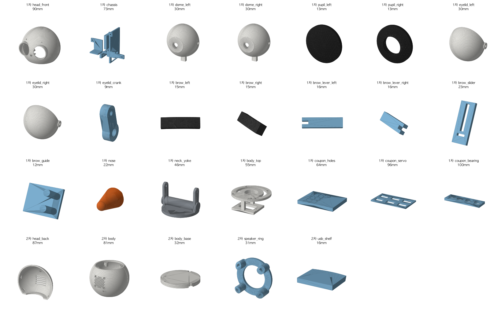

# 출력 주문표 (2026-10-26)

3D 설계(`05-cad-stages.md`)에서 만든 출력 파일을 업체에 맡기기 위한 표. 파일은 `print/` 폴더에 있다.
**출력은 두 번에 나눈다.** 1차로 가장 어려운 부분(얼굴·눈 기구·머리 안 틀·목)과 공차 시험 판을 뽑아 맞춰 보고, 그 결과로 숫자를 고친 뒤 2차를 뽑는다.

## 보낼 파일

| 묶음 | 폴더 | 개수 | 꽉 채울 때 PLA |
|---|---|---:|---:|
| 1차 (시험 + 그대로 쓸 부품) | `print/1_test/` | 21개 | 약 139 g (시험 판 49 g 포함) |
| 2차 (본) | `print/2_final/` | 5개 | 약 90 g |

- STL 은 조립 위치 그대로 들어 있다. 출력 방향은 아래 메모대로 업체에 부탁한다.
- 부품마다 크기·무게는 `print/parts.csv`.
- 파일을 다시 만들려면: `cd cad && .venv/bin/python print_kit.py` (설계 숫자를 바꾼 뒤).

## 1차 주문 (`print/1_test/`)

| 파일 | 색 | 크기 (mm) | 메모 |
|---|---|---|---|
| head_front | 흰색 | 90 × 64 × 75 | 앞 껍데기(얼굴·눈 테). **이음선 면을 바닥에.** 안쪽 기둥·탭·눈 테 아래 지지대 |
| chassis | 아무 색 | 73 × 46 × 60 | 머리 안 틀. 지지대 필요 |
| dome_left, dome_right | 흰색 | 25 × 13 × 30 | 흰자 돔 2개. 겉면 매끈하게 (층 0.12mm 권장) |
| pupil_left, pupil_right | 검정 (광택이면 좋음) | 13 × 3 × 13 | 검은자. 오른쪽은 렌즈 구멍 |
| eyelid_left, eyelid_right | 흰색 | 30 × 17 × 27 | **두께 1mm 곡면.** 실 출력이 거칠면 레진으로 |
| eyelid_crank | 아무 색 | 2 × 5 × 9 | 아주 작음 |
| brow_left, brow_right | 검정 | 15 × 12 × 5 | 눈썹 |
| brow_lever_left, brow_lever_right | 아무 색 | 16 × 11 × 4 | 눈썹 레버 |
| brow_slider, brow_guide | 아무 색 | 23 / 12 | 눈썹 슬라이더, 서보 위 안내 판(핀 2개) |
| nose | 주황 | 12 × 22 × 12 | 당근 코 |
| neck_yoke | 은색 또는 짙은 회색 | 46 × 44 × 39 | 회전판·요크·가로 원통 한 덩어리. 아래 허브 지지대 |
| body_top | 흰색 | 55 × 55 × 26 | 목 받침판(베어링 자리·좌우 서보 받침) |
| coupon_holes | 아무 색 | 64 × 48 × 6 | 공차 시험 판 A |
| coupon_servo | 아무 색 | 96 × 52 × 3 | 공차 시험 판 B |
| coupon_bearing | 아무 색 | 100 × 30 × 6 | 공차 시험 판 C |

## 2차 주문 (`print/2_final/`)

| 파일 | 색 | 크기 (mm) | 메모 |
|---|---|---|---|
| head_back | 흰색 | 87 × 33 × 73 | 뒤 덮개. 이음선 면을 바닥에 |
| body | 흰색 | 81 × 81 × 60 | 몸통. **위(넓은 면)를 바닥에 놓고 거꾸로** — 지지대 거의 없음 |
| body_base | 흰색 | 32 × 32 × 3 | 바닥판 |
| speaker_ring | 아무 색 | 31 × 11 × 31 | 스피커 누름 고리 |
| usb_shelf | 아무 색 | 16 × 13 × 2 | USB-C 선반 (몸통 안 뒤 벽에 붙임) |

1차에서 이상이 있으면 1차 부품 중 고친 것도 2차에 같이 넣는다.

## 원클릭팩토리 1차 주문 (2026-10-26 22:16 결제 완료 · 주문번호 2K951M)

원클릭팩토리는 **올린 방향 그대로** 출력하므로, 부품마다 출력 방향을 잡고 같은 색 작은 부품을 한 판으로 묶은 파일을 따로 만들었다.
파일: `print/oneclick/1_test/`, `print/oneclick/2_final/` (만드는 코드: `cad/oneclick_kit.py`). 방향 확인 그림: [oneclick-orient.png](assets/cad/oneclick-orient.png)

| 파일 | 들어 있는 부품 | 색 | 층 | 채움 | 출력비 |
|---|---|---|---|---|---:|
| head_front | 앞 껍데기 (이음선 면을 바닥에) | 화이트 | 0.20 | 15% | 2,442 |
| body_top | 목 받침판 (뒤집어서) | 화이트 | 0.20 | 30% | 1,000 |
| neck_yoke | 회전판·요크 | 블랙 | 0.20 | 30% | 1,000 |
| chassis | 머리 안 틀 (뒤 받침판을 바닥에) | 블랙 | 0.20 | 30% | 1,001 |
| white_eye_parts | 흰자 돔 2 + 눈꺼풀 2 | 화이트 | 0.12 | 15% | 1,000 |
| black_parts | 검은자 2 + 눈썹 2 | 블랙 | 0.12 | 15% | 1,000 |
| gray_small_parts | 크랭크·눈썹 레버 2·슬라이더·안내 판 | 블랙 | 0.12 | 30% | 1,000 |
| coupons | 공차 시험 판 3장 | 블랙 | 0.20 | 15% | 1,741 |
| **합계** | | | | | **상품 10,184 + 배송 3,700 = 13,884원** |

- 그레이·오렌지 필라멘트는 담을 때 고를 수 없었다(장착된 프린터 없음) → 그레이 부품은 블랙으로.
- **코(nose)는 아직 안 담음** — 오렌지가 풀리면 따로 주문. 회원이라 발송 전 주문이 있으면 묶음 배송(배송비 한 번).
- **결제 완료 (사용자, 2026-10-26 22:16).** 주문번호 2K951M, 8개 항목 13,884원(배송 포함). 상태: 모두 "대기 중" — 프린터가 비는 대로 자동 출력. 구매 조회: https://www.oneclickfactory.co.kr/orders
- 주문 내역 화면에는 색이 표시되지 않는다. 결제 직전 장바구니에서 위 표의 색(화이트·블랙)으로 담긴 것을 확인했다. 출력이 시작되면 실시간 영상으로 색을 확인한다.
- 2차 파일(`print/oneclick/2_final/`: 뒤 덮개·몸통·작은 부품)은 1차 시험 판 결과로 숫자를 고친 뒤 다시 만들어 주문.
- **2026-10-29 도착.** 사진으로 8개 항목이 모두 온 것을 확인했다. 작은 부품은 테두리(brim)에 붙어 있고, 지지대도 아직 붙어 있다.

## 업체에 전할 출력 설정 (시작값)

- 재료 PLA. 겉으로 보이는 흰색 부품은 무광.
- 층 높이: 얼굴·흰자·눈꺼풀·코 0.12~0.16mm (매끈하게), 나머지 0.2mm.
- 벽 3~4줄 이상, 속 채움 20~30%. 나사 기둥·탭은 꽉 채움.
- 지지대는 업체 판단. 겉면(얼굴 앞, 몸통 바깥)에 지지대 자국이 남지 않게 부탁.

## 업체에 물어볼 것

1. 흰색·검정·주황·은색(또는 짙은 회색) PLA 가 다 있는지. 색마다 따로 주문해야 하는지
2. 두께 1mm 곡면(눈꺼풀)을 실 출력으로 깨끗하게 뽑을 수 있는지. 안 되면 레진 가격
3. 작은 부품(9mm 크랭크 등) 여러 개를 한 주문으로 받는지
4. 지지대 제거·표면 정리를 해 주는지
5. 견적 기준(무게 / 부피 / 시간)과 걸리는 날

## 견적 비교 (2026-10-26, 자동 견적 — Claude 가 파일을 올려 확인)

같은 1차 파일 21개(아울팩토리는 한 번에 20개까지라 크랭크 제외)를 세 곳의 자동 견적에 올렸다. 주문·결제는 하지 않았다.

| 업체 | 1차 (21개) | 2차 (5개) | 가격 방식 | 특징 |
|---|---:|---:|---|---|
| **[원클릭팩토리](https://www.oneclickfactory.co.kr/print3D)** | **출력비 22,442원 + 배송 3,700원** | **출력비 7,274원 + 배송 3,700원** | 무게 기준 약 76원/g, 파일당 최소 1,000원 | 로그인 없이 주문. 1영업일 안에 출력, 출력 과정 실시간 영상. 색 11가지(화이트·블랙·그레이·오렌지 등), 색 따라 값 같음. 층 높이 0.08~0.28mm 고를 수 있음. **올린 방향 그대로 출력** |
| [아울팩토리](https://owlfactory.co.kr/FDM_auto) | 125,000원 (20개, 부가세 포함) | — | 부피·시간 기준, 파일당 약 6,000원 | 흰색 PLA 기준. 세부 견적은 카톡 상담 |
| [3DFARM](https://3dfarm.co.kr/quote/form/) | 155,000원 (기본료 5,000 포함) | — | 기본료 + 파일당 최소 약 6,000원 | 무광 PLA 46색(밀키 화이트·무광 블랙·오렌지·나르도 그레이 등), 실크 PLA. 가장 싼 방향 자동 선택. 일반 납기 7영업일, 운영자 24시간 내 확정 |

- 아울팩토리·3DFARM 은 작은 부품도 파일마다 약 6,000원이라 21개면 비싸다. 같은 색 작은 부품을 한 파일로 묶으면 크게 줄지만, 그래도 원클릭팩토리가 훨씬 싸다.
- [아이컨택](https://eyecontact.kr/)은 레진(SLA)·나일론 가루(SLS·MJF)·금속 출력 업체 — 완성품의 매끈한 겉 부품을 맡길 후보.
- 자동 견적은 예상가다. 원클릭팩토리는 결제 화면 금액이 최종으로 보이지만, 얼굴 부품을 0.12mm 로 고르면 오를 수 있다.

### 추천: 1차는 원클릭팩토리

싸고(약 2.6만 원) 빠르다(1영업일 출력). 1차는 맞춰 보는 시험이라 품질을 보면서 2차 업체를 정해도 된다.

주문 전에 할 일: 원클릭팩토리는 **올린 방향 그대로 출력**하므로, 지금처럼 조립 위치 그대로 올리면 지지대가 많이 붙는다. 부품마다 출력 방향을 잡은 파일을 따로 만들어 올린다.

## 공차 시험 판 쓰는 법

받으면 실물 부품을 끼워 보고 **꼭 맞는 크기**를 고른다. 고른 값을 코드 숫자에 넣고 `print_kit.py` 로 2차 파일을 다시 만든다.

| 판 | 끼워 볼 것 | 고르는 기준 | 고칠 숫자 |
|---|---|---|---|
| A 위 줄 (2.9 / 3.0 / 3.1 / 3.2) | M2 열압입 인서트를 인두로 | 똑바로 들어가고 나사를 조여도 돌지 않는 것 | `head_module.INSERT_D`, `body_module.INSERT_D` |
| A 둘째 줄 (2.2 / 2.4 / 2.6) | M2 나사 | 힘 없이 지나가는 가장 작은 것 | `SCREW_D` (두 파일) |
| A 셋째 줄 (2.0 / 2.15 / 2.3) | 황동봉 2mm | 부드럽게 돌고 덜컹거리지 않는 것 | `eye_module` 축 구멍 여유(지금 +0.3) |
| A 넷째 줄 (1.1 / 1.25 / 1.4) | 피아노선 1mm | 걸리지 않고 도는 것 | `eye_module.LINK_D` 구멍 여유 |
| B 위 줄 (+0.2 / +0.4 / +0.6) | MG90S 몸체 | 손으로 밀어 넣어지는 것 | 머리 안 틀·받침판 서보 창 여유 |
| B 아래 줄 | SG51R 몸체 | 같음 | 같음 |
| C (19.0 ~ 19.3) | 베어링 6800ZZ | 손가락으로 눌러 들어가고 빠지지 않는 것 | `neck_module.BRG_FIT` |

## 출력 뒤에 따로 살 것 (국내, 철물점·문구)

| 재료 | 쓰는 곳 | 양 |
|---|---|---|
| 황동봉 2mm | 눈꺼풀 축(약 70mm), 눈썹 축 2개(약 15mm) | **구매함 (10/29, 1m 정원봉)** |
| 피아노선 1mm | 눈꺼풀 연결 막대(약 20mm) | **있음** |
| M3 나사 또는 3mm 봉 | 끄덕임 반대쪽 핀 | 1개 |
| M24 평와셔 | 무게추 (약 97 g) | 3장 |
| 에폭시 접착제 | 와셔 고정, 눈썹 레버·크랭크를 축에 고정 | 1개 |
| 실리콘 미끄럼 방지 패드 | 바닥 (지름 46 이상, 시트를 잘라도 됨) | 1장 |

이미 산 것으로 되는 것: M2 인서트(필요 약 22개 / 50개 구매), M2 육각 나사 세트, 실리콘 전선, 수축튜브.
