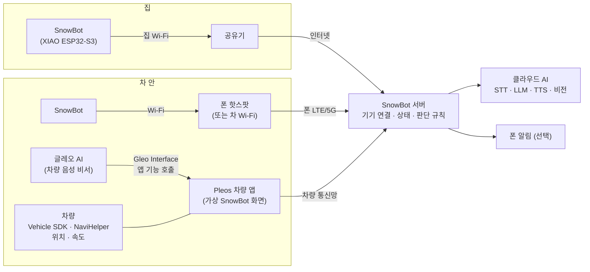
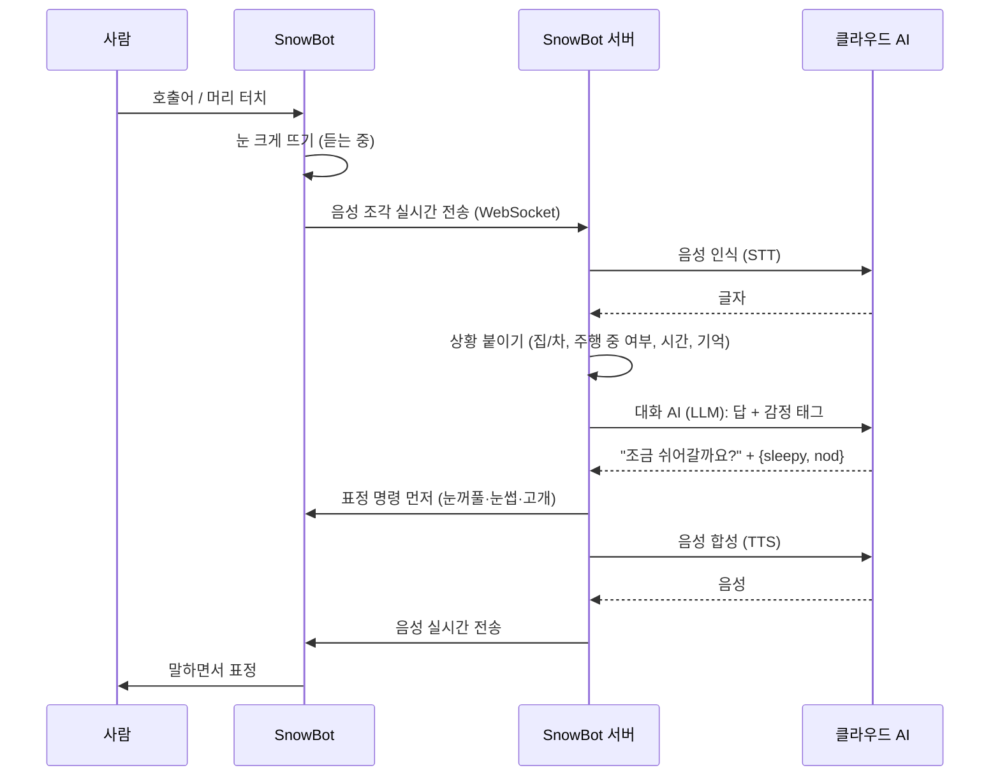
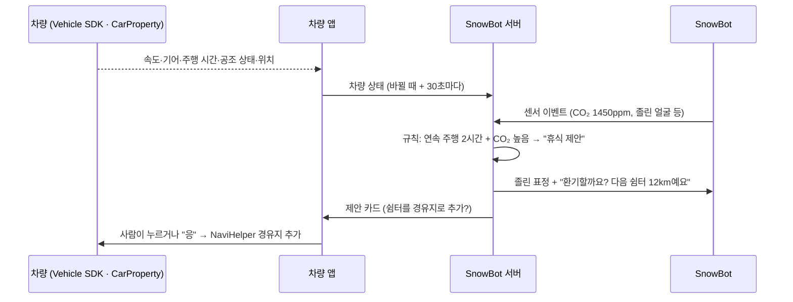
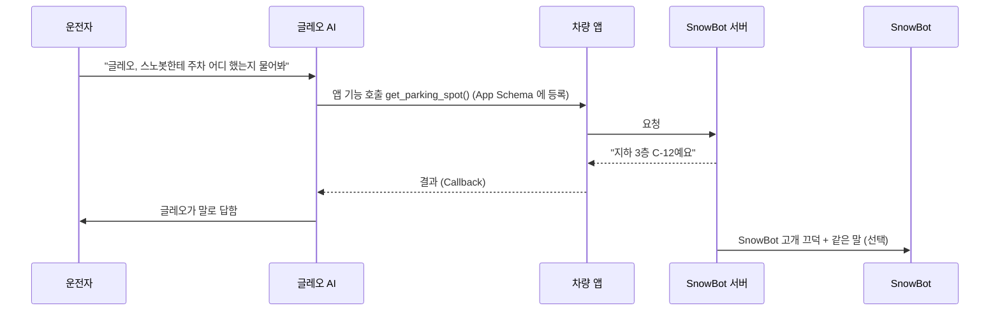
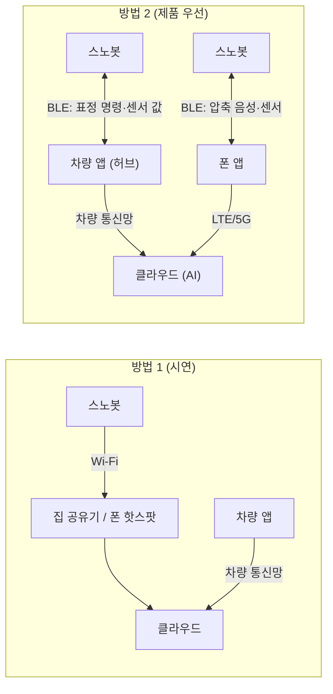

# 기기 간 통신과 AI 처리 과정 (2026-10-26 초안)

SnowBot 이 **집(책상)** 과 **차 안** 에서 어떻게 연결되고, 말을 듣고 대답하는지 정리한다.
근거: Pleos 개발 문서 확인([pleos/04-pleos-sdk.md](pleos/04-pleos-sdk.md)) — 에뮬레이터 블루투스 미지원, 앱용 LLM SDK 없음(대신 Gleo Interface), 시동 OFF 시 앱 정지.
"확인 필요"라고 적은 것은 아직 실제로 시험하거나 공식 답을 받지 않은 것이다.

## 1. 핵심 원칙

1. **SnowBot 은 차와 직접 연결하지 않는다.** SnowBot 과 차량 앱이 각자 인터넷으로 **SnowBot 서버**에 붙고, 서버가 둘을 잇는다.
   → SnowBot 이 어느 Wi-Fi(집·폰 핫스팟·차 Wi-Fi)에 붙어 있든 같은 방식으로 동작한다.
2. **AI 는 항상 서버에서 돈다.** 음성 인식(STT) → 대화 AI(LLM) → 음성 합성(TTS), 카메라 사진 이해. SnowBot 보드(XIAO ESP32-S3)는 소리·사진을 보내고, 받은 소리와 표정 명령을 실행만 한다.
3. **차 안에서 차량 앱이 하는 일:** 차량 데이터(속도·주행 시간·공조·위치)를 서버로 보내기, 글레오 음성 명령을 서버로 전달하기, 화면 속 가상 SnowBot 보여 주기.
4. **블루투스(BLE) 직접 연결은 나중 선택지.** 에뮬레이터가 지원하지 않고, 차량 앱의 외부 기기 연결 허용 여부가 문서에 없다(사무국 문의 중).

## 2. 전체 구성

| 구성 | 하는 일 | 연결 |
|---|---|---|
| **SnowBot** | 마이크로 듣고 스피커로 말함, 카메라 사진, 서보 4개로 표정·고개 | Wi-Fi(2.4GHz) → 인터넷 → 서버. **WebSocket**(연결을 계속 열어 두고 양쪽이 수시로 주고받는 방식) |
| **SnowBot 서버** | 기기 묶기(내 SnowBot ↔ 내 차량 앱), 상태 보관, 판단 규칙(졸음·공기질 등), AI 호출 중계 | 인터넷에 공개된 주소 필요 |
| **클라우드 AI** | STT · LLM · TTS · 사진 이해 | 서버만 호출 (API 키는 서버에만) |
| **Pleos 차량 앱** | 차량 데이터 보내기, 글레오 연동, 가상 SnowBot 화면, 제안(쉼터 경유지 등) 실행 | 차량 통신망 → 서버 (HTTPS · WebSocket) |
| **폰** | 핫스팟(밖에서 SnowBot 인터넷), 알림 받기(선택) | — |

## 3. 장소별 연결

| 장소 | SnowBot 인터넷 | 차량 앱 | 대화 시작 방법 |
|---|---|---|---|
| **집 (책상)** | 집 Wi-Fi | 없음 | SnowBot 에게 말하기 (호출어 또는 머리 터치) |
| **차 안** | **폰 핫스팟** (차 Wi-Fi 핫스팟이 있는 차는 그것도 — Pleos 차량 지원 여부 확인 필요) | 차량 통신망 | ① "글레오, 스노봇한테 …" (Gleo Interface) ② SnowBot 에게 직접 말하기 ③ 앱 화면 버튼 |
| **밖 (캠핑 등)** | 폰 핫스팟 | 없음 | 집과 같음 |
| **인터넷 없음** | — | — | **오프라인 모드:** 표정·고개만 (미리 정한 반응), "인터넷이 끊겼어요" 표정 |

### 폰 핫스팟에 대해

- **된다.** SnowBot 이 폰 핫스팟에 Wi-Fi 로 붙으면 폰의 LTE/5G 로 인터넷을 쓴다. 폰과 SnowBot 이 서로 직접 통신하는 것이 아니라, 폰이 공유기 역할을 한다.
- **2.4GHz 로 켜야 한다.** XIAO ESP32-S3 는 2.4GHz Wi-Fi 만 된다.
  아이폰: 설정 → 개인용 핫스팟 → **"호환성 최대화" 켜기**(2.4GHz). 안드로이드: 핫스팟 대역을 2.4GHz 로.
- **데이터 사용량 (추정):** 음성은 압축하면 한 번 대화(말 5초 + 답 5초)에 약 50~100KB, 사진 한 장 30~100KB. 하루 수십 번 대화해도 수 MB 수준. 실측 필요.
- **여러 Wi-Fi 기억:** SnowBot 이 집 Wi-Fi 와 폰 핫스팟을 둘 다 기억하고, 보이는 것에 자동으로 붙게 한다(ESP32 의 여러 AP 자동 연결 기능).
  Wi-Fi 이름·비밀번호 등록은 처음 한 번 폰으로(SnowBot 이 임시 Wi-Fi 를 열고 폰에서 입력하는 방식 등).

## 4. 음성 대화 처리 과정 (집·차 공통)

- **목표 응답 시간: 말 끝나고 3초 안에 첫 소리.** STT 0.5~1초 + LLM 1~2초 + TTS 첫 소리 0.3~0.5초. 각 단계를 조각 단위로 흘려보내(스트리밍) 줄인다.
  표정 명령을 소리보다 먼저 보내 기다리는 동안 "생각하는 표정"을 보인다. (AI API 후보 비교 — 응답 시간 측정은 남은 작업)
- **말하는 동안은 듣지 않는다**(자기 목소리를 다시 듣지 않게). 끼어들기는 나중에.
- **감정 태그 → 표정:** LLM 이 답과 함께 `{expr: happy|sleepy|worried|…, head: nod|shake|…}` 를 낸다 → 서버가 03 문서의 표정 명령(`express`)으로 바꿔 SnowBot 에 보낸다.

## 5. 차 안에서만 더해지는 것

### 5-1. 차량 데이터 → 판단 → 반응 (예: 졸음·공기질)

- **주행 중 규칙:** 차량 앱이 주행 규제 상태(`CarUxRestrictions`)와 속도를 서버로 보낸다 → 서버는 주행 중이면 답을 1~2문장으로, 잡담·퀴즈 끄기, 안전 알림 우선.
- **차 스피커 vs SnowBot 스피커:** 기본은 SnowBot 스피커(캐릭터 목소리). 단, 차 음악과 겹치는 문제가 있어 **차량 앱 TTS(차 스피커)로 보내는 선택**도 둔다 — 시험 후 결정.
- **공조 외기 전환 등 차량 제어**는 Vehicle 제어 SDK 가 "준비 중"이라 지금은 안내만 한다.

### 5-2. 글레오로 부르기 (Gleo Interface)

- 등록할 앱 기능 예: `ask_snowbot(질문)`, `get_parking_spot()`, `set_mode(펫·키즈·조용히)`, `snowbot_status()`.
- 글레오가 앱 기능을 고르고 답 문장을 만든다(LLM). 우리 서버의 LLM 은 SnowBot 캐릭터 대화용.

### 5-3. 하차 후

- **차량 앱은 시동을 끄면 멈춘다**(Suspend). 하차 뒤 기능은 차량 앱이 아니라 **SnowBot 이 스스로**(폰 핫스팟이 꺼지면 인터넷도 없음) 하거나 집으로 옮겨 이어 간다.
- 주차 위치처럼 **하차 순간에 저장할 것**은 시동 끄기 전 이벤트(기어 P + 시동 OFF 직전)에 차량 앱이 서버로 보낸다 — 시점 잡기는 실험 필요.
- 펫 지킴이(하차 후 감시)는 SnowBot 이 배터리·인터넷 없이 버틸 수 없어 **향후 기능**으로 둔다.

## 6. 메시지 (03 모듈 규격 재사용)

[pleos/03-module-protocol.md](pleos/03-module-protocol.md) 의 JSON 메시지(`hello` 기능 선언, `event` 센서 이벤트, `express` 표정 명령)를 그대로 쓰고, **전송 방식만 BLE 대신 WebSocket(서버 경유)** 으로 바꾼다.
더할 메시지: `audio_in`·`audio_out`(음성 조각), `vehicle_state`(차량 앱 → 서버), `suggestion`(서버 → 차량 앱).

## 7. 서버를 어디에 두나

**결정 (2026-10-26, 사용자): 클라우드 서버(C).** "클라우드에 있어야 누구나 쓸 수 있다." 공모전 시연도 같은 클라우드 서버로 한다(에뮬레이터 앱 → 클라우드 → SnowBot). 업체·사양은 개발 시작 때 정한다.

- 비용은 서버보다 **AI API 사용료**(STT·LLM·TTS)가 사용자 수에 따라 크게 는다 → 기획서 사업성(6번)에 사용자당 월 비용 추정을 넣는다.
- 공모전 이후 사용자가 늘면 기기 연결(WebSocket) 서버와 AI 처리 서버를 나눌 수 있게 처음부터 역할을 나눠 둔다.

(검토했던 선택지)

| 선택지 | 장점 | 단점 |
|---|---|---|
| A. 집 Mac 에서 중계 (지금 계획) | 이미 계획됨, 무료 | 차 안·밖에서 접속하려면 인터넷 공개 주소가 필요 (Tailscale Funnel 등) |
| B. 집 서버(home-mini, 우분투) | 늘 켜져 있음, PHP·서버 운영 경험 활용 | 위와 같음, 가정 회선 |
| C. 클라우드 서버(소형 VPS 등) | 어디서나 안정적, 공모전 "서비스" 설명에 맞음 | 월 비용 |

## 8. 기기 묶기 — 서버는 어떻게 "내 스노봇"과 "내 차"를 아나 (2026-10-26 추가)

스마트홈 기기(로봇청소기·스마트 전구)와 같은 방식: **고유 번호 + 계정**.

| 단계 | 하는 일 |
|---|---|
| 출고 | 스노봇마다 고유 번호(예: `SNW-01-A1B2`)와 기기 인증 키를 넣고, 바닥에 QR 스티커(고유 번호 + 등록 코드) |
| 처음 설정 | **폰 앱**으로 QR 을 찍는다 → 서버에 "이 스노봇 = 내 계정" 등록. 같은 때 집 Wi-Fi·폰 핫스팟 정보를 스노봇에 넘긴다 |
| 차량 앱 연결 | 차량 앱이 차 화면에 QR 을 띄운다 → 폰 앱으로 찍는다 → 차량 앱도 같은 계정. 차 화면 키보드 입력 없음(주행 규제상 로그인은 정차 중에만) |
| 평소 | 스노봇·차량 앱·폰 앱이 각자 서버와 **연결을 계속 열어 둔다**(WebSocket). 서버가 묻지 않고 바로 밀어 보낼 수 있다 |
| 메시지 전달 | 서버는 계정별 기기 목록을 갖고, **같은 계정의 기기에게만** 보낸다 |

### 차량 데이터는 스노봇에게 가지 않는다

판단(두뇌)이 서버에 있다. 차량 앱은 상태를 서버로, 스노봇은 센서·목소리를 서버로 보내고, **서버는 판단 결과(표정 명령·할 말)만 스노봇에 보낸다.** 스노봇은 차량 데이터를 몰라도 된다.

### 효율 — 서버를 거쳐도 되나

| 항목 | 정도 (추정, 실측 필요) |
|---|---|
| 데이터 양 | 차량 상태 1번 약 200바이트, 30초마다 → 1분 약 0.6KB. 음성(대화 1번 50~100KB)보다 훨씬 작다 |
| 지연 | **실측(2026-10-27, 프로토타입 서버):** 맥(유선) → 서버 → 가상 스노봇 → 서버 → 맥 왕복 중간 6ms. 서버 중계는 거의 0. 무선(Wi-Fi·LTE) 구간이 더해져도 대화 AI 대답(2~3초)에 묻힌다 — 실물로 다시 측정 |
| 같은 길 | 대화 AI 가 클라우드에 있어 **목소리는 원래 서버로 간다.** 차량 데이터는 같은 길을 탈 뿐 |
| **약점** | **지하주차장·터널에서 전파가 끊기면 차량 앱·스노봇 둘 다 서버와 끊긴다.** 주차 위치 기능이 바로 그 장소에서 쓰인다 |

### 그래서: 가까우면 직접, 아니면 클라우드 (하이브리드)

| 상황 | 경로 |
|---|---|
| AI 대화, 집·폰 연결 | 클라우드 |
| 같은 차 안의 차량 앱 ↔ 스노봇 (표정 명령·센서 값처럼 작은 신호) | **직접 연결을 먼저 시도** → 안 되면 클라우드. 후보: ① 둘 다 같은 폰 핫스팟에 붙어 있으면 그 네트워크 안에서 직접(기기 찾기는 mDNS 같은 같은 네트워크 검색) ② 블루투스(BLE) |
| 전파 없음 | 스노봇은 미리 정한 표정으로 반응(오프라인 모드). 저장할 것(주차 위치)은 **차량 앱이 갖고 있다가** 연결되면 서버에 올린다 |

확인할 것: Pleos 차량(헤드 유닛)이 폰 핫스팟에 Wi-Fi 로 붙을 수 있는지, 차량 앱이 같은 네트워크 기기와 직접 통신해도 되는지, BLE 허용 여부(사무국 문의).
공모전 시연은 클라우드 경로로 하고, 직접 연결은 "향후 개선"으로 적는다.

## 8-1. 연결 방법 1·2 (2026-10-26, 사용자와 정리)

사용자: "방법1 로 인터넷에 직접 연결하는 방법으로 시연하고, 방법2 로 차량 및 핸드폰에 직접 연결(개발한 앱)해서 인터넷을 이용하는 방식도 설명이 필요해."

| | 방법 1: 스노봇이 인터넷에 직접 (Wi-Fi) | 방법 2: 스노봇 ↔ 우리 앱(차량·폰) 직접 연결, 앱의 인터넷을 빌림 |
|---|---|---|
| 연결 | 집 Wi-Fi 또는 폰 핫스팟 → 클라우드 | 블루투스(BLE)로 차량 앱·폰 앱 → 앱이 클라우드로 중계 |
| 사용자 준비 | Wi-Fi 정보 입력, 차에서는 핫스팟 켜기 | 처음 한 번 짝 맺기만, 핫스팟 불필요 |
| 지하주차장·터널 | 둘 다 끊김 | **차량 앱 ↔ 스노봇은 계속 연결.** 차량 반응(졸음 등)은 앱이 직접 판단 |
| 차량 특화성 | 보통 | **높음** — 차량 앱이 모듈 허브 |
| 공모전 시연 | **에뮬레이터로 가능 → 시연은 방법 1** | 에뮬레이터 블루투스 미지원 |
| 확인할 것 | — | Pleos 차량 앱 블루투스 허용 (문의 중), 아이폰 백그라운드 BLE |

**방법 2 설계 원칙**
- **차 안에서는 차 마이크·스피커로 대화하고, 스노봇은 표정·센서만.** BLE 로는 작은 신호만 오가 넉넉하고, 차 음악과 목소리가 겹치는 문제(오디오 포커스)도 차량 규칙대로 해결된다.
- **폰 앱 경유**(밖)는 스노봇 마이크 음성을 압축(예: Opus 16~24kbps)해 BLE 로 보낸다. 사진은 가끔만(30~100KB 에 수 초).
- **시동 OFF → 차량 앱 정지** → 스노봇은 폰 앱(방법 2) 또는 Wi-Fi(방법 1)로 자동 전환.
- **메시지 형식은 하나**(03 모듈 규격), 전송 방법(WebSocket / BLE)만 바꾼다. XIAO ESP32-S3 는 Wi-Fi + BLE 5.0 둘 다 지원 → 펌웨어 하나.

**장소별 자동 선택 (추천)**

| 장소 | 우선 | 대체 |
|---|---|---|
| 집 | 방법 1 (집 Wi-Fi) | 폰 앱 (방법 2) |
| 차 | **방법 2 (차량 앱 BLE)** | 폰 핫스팟 (방법 1) |
| 밖 | 방법 2 (폰 앱) | 폰 핫스팟 (방법 1) |

### 진행 순서 — 방법 1 = 프로토타입, 방법 2 = 최종 목표 (2026-10-27 사용자 결정)

| 단계 | 언제 | 하는 일 |
|---|---|---|
| 1. 프로토타입 | 지금 ~ 12/3 PT | **방법 1.** 스노봇 Wi-Fi → 클라우드 ← 에뮬레이터 차량 앱. 메시지 형식(03 모듈 규격)을 여기서 확정 |
| 2. 폰 앱 블루투스 | 공모전 뒤 (Pleos 허가 불필요) | 스노봇 ↔ 안드로이드 폰 앱 BLE. 같은 메시지 형식을 BLE 로 보내 본다. 음성 압축·전송 시험 |
| 3. 차량 앱 블루투스 | Pleos BLE 허용 확인 뒤, 실차 | 스노봇 ↔ 차량 앱 BLE, 차량 앱이 허브. 차 마이크·스피커로 대화, 지하·터널 오프라인 동작 |
| 4. 자동 선택 | 제품 | 장소별 우선·대체 표대로 자동 전환. **방법 1 은 집 연결·대체 경로로 계속 쓴다** |

기획서 표현: "프로토타입은 방법 1 로 구현했고, 최종 목표는 차량 앱이 허브가 되는 방법 2 다. 메시지 형식이 같아 전송 방법만 바꾸면 되며, 폰 앱 연결부터 단계적으로 옮긴다."

## 8-2. 차 안 AI(로컬)를 쓸 수 있나 — AI 를 바꿔 끼우는 설계 (2026-10-26)

사용자: "만약 차량에 로컬 LLM 이 있다면 그것으로 동작해도 좋잖아?" — 맞다. 인터넷이 끊겨도 되고, AI 사용료가 없고, 대화가 차 밖으로 나가지 않는다.

| 차 안 AI | 지금 쓸 수 있나 | 근거 |
|---|---|---|
| 음성 인식·합성 (STT·TTS) | **된다** — `ON_DEVICE` 모드(차 안 엔진), 인터넷·앱 등록 불필요 | STT·TTS SDK 문서 |
| 차의 LLM (글레오 AI) | **간접적으로만** — 앱이 글레오에 질문을 보내 답을 받는 API 는 없다. 글레오가 우리 앱 기능을 부르고(function calling), 답 문장은 글레오가 만든다 | Gleo Interface 문서 |
| 글레오가 차 안에서 도는지 | **문서에 없음** — 확인 필요 | — |
| 우리 앱 안에 작은 LLM | 기술적으로 가능(1~3B 크기)하나 헤드 유닛 메모리·성능 규칙, 작은 모델의 한국어 품질, 앱 심사가 불확실 | 성능·리소스 지침 |

**설계: AI 엔진을 같은 모양의 인터페이스 뒤에 두고 상황에 따라 고른다** (01-concept 4-1 의 "나중에 로컬 모델로 교체" 원칙을 차에도 적용)

| 상황 | 듣기·말하기 | 생각하기 |
|---|---|---|
| 인터넷 있음 | 클라우드 또는 차 STT·TTS | 클라우드 LLM (스노봇 캐릭터 대화) |
| "글레오, 스노봇한테 …" | 차(글레오) | 글레오가 판단, 우리 앱은 데이터·기능 제공 |
| **인터넷 없음 (지하·터널)** | **차 안 엔진 STT·TTS** | **차량 앱 규칙 기반 판단** — "주차 어디야?" → 저장된 위치, 졸음 → 정해진 경고 |
| (향후) 차량 LLM 이 앱에 공개되면 | 차 안 엔진 | **차량 LLM 으로 교체** |
| **폰 앱 경유 (방법 2, 밖·집)** | **폰 안 음성 인식·합성** | **폰 온디바이스 LLM** — 아이폰: 애플 Foundation Models(iOS 26+, Apple Intelligence 지원 기기), 안드로이드: Gemini Nano(일부 최신 기기). 없거나 부족하면 클라우드 |

사용자 추가: "핸드폰도 로컬 LLM 이 있으면 그것으로 동작해도 좋고." → 폰 쪽은 앱이 온디바이스 LLM 을 직접 부를 수 있는 공식 기능이 있다. **기기별 지원·한국어 품질·응답 시간은 시험 필요.**
고르는 순서(제안): 폰·차 온디바이스 AI 가 있고 질문이 간단하면 기기 안에서 → 길거나 사진 이해가 필요하면 클라우드 → 인터넷이 없으면 기기 안 + 규칙.

방법 2(차량 앱 허브)와 합치면 지하주차장에서도: 차량 앱이 차 안 엔진으로 듣고 저장된 주차 위치를 말하고, 스노봇은 BLE 로 표정을 짓는다 → **인터넷 없이 핵심 기능 동작.**

## 9. 보안·개인정보

- 서버 연결은 암호화(wss/https). 기기마다 인증 키·토큰.
- **기기 묶기:** 위 8절 — QR(고유 번호 + 등록 코드)과 계정. 내 스노봇과 내 차량 앱만 연결.
- 카메라 사진은 처리만 하고 기본 저장 안 함. 차량·사용자 ID 는 서버에서 가명 처리, 운전 데이터는 마케팅에 쓰지 않음(Pleos 보안 지침).
- AI API 키는 서버에만 둔다(SnowBot·차량 앱에 넣지 않음).

## 10. 확인·시험할 것

- [ ] Pleos 차량이 폰 핫스팟에 Wi-Fi 로 붙는지, 같은 네트워크 직접 통신 허용 여부 (직접 연결 경로)
- [ ] 지하주차장에서 폰 핫스팟·차량 통신망 신호 (주차 위치 기능)

- [ ] 폰 핫스팟(2.4GHz)에서 SnowBot 연결·지연 시간 측정
- [ ] Pleos 차량에 Wi-Fi 핫스팟이 있는지
- [ ] 에뮬레이터 앱 → 중계 서버 → 실물 SnowBot 이 실제로 움직이는지 (시연 핵심)
- [ ] Gleo Interface App Schema 를 에뮬레이터에서 시험할 수 있는지 (사무국 문의)
- [ ] AI API 후보별 응답 시간 측정 (STT·LLM·TTS) — 목표 3초 안
- [ ] 차 음악과 SnowBot 목소리가 겹칠 때 처리
