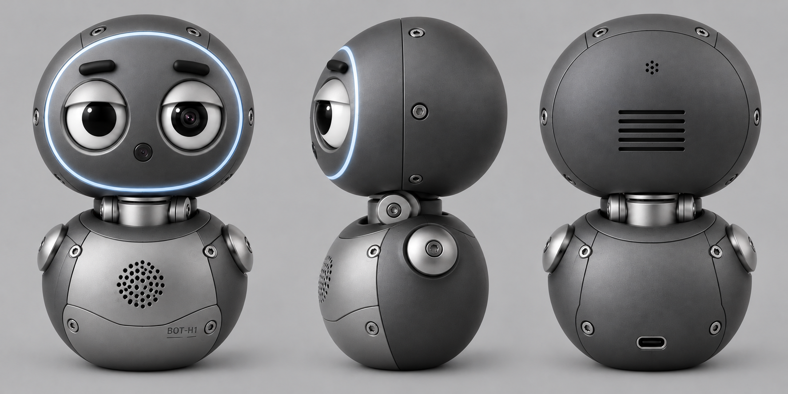
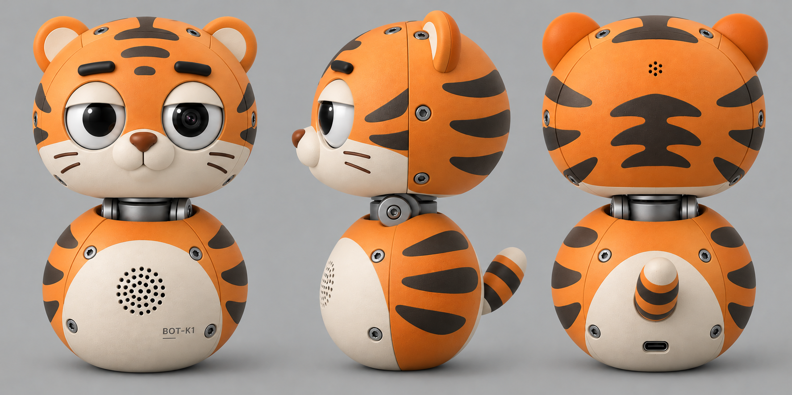

# 브랜드 캐릭터 봇 시안 (2026-10-26)

사용자 요청: "현대, 기아 캐릭터를 봇으로 하는 디자인도 추가. 현대는 아틀라스 로봇을 SD 로, 기아는 호랑이를 SD 로. 스노우맨 디자인과 유사한 느낌으로."
SD = 머리를 크게, 몸을 작게 줄인 귀여운 비율(super-deformed).

**핵심 아이디어: 속(기구)은 스노봇과 똑같고, 겉 껍데기만 바꾼다.** 눈 기구(눈 테·흰자·눈꺼풀·눈썹), 목 관절, 서보 4개, 보드·카메라·스피커는 그대로 쓰고 머리·몸통 껍데기와 코 부품만 다르게 출력한다.
→ 하나의 모듈 플랫폼에서 캐릭터를 갈아 끼우는 "브랜드 캐릭터 모듈"(기획서 6번 사업 모델).

그림: gpt-image(ChatGPT 구독), C 디자인 세 방향 그림을 참고 이미지로 붙여 같은 비율·디테일로 그렸다.

## 현대 — SD 휴머노이드 로봇 (BOT-H1)

| 부분 | 스노봇과 같음 | 다름 |
|---|---|---|
| 머리·눈 | 큰 둥근 머리, 눈 테 2개(오른쪽 검은자에 카메라), 반쯤 감긴 눈꺼풀, 짧은 눈썹, 이음선 육각 나사 | 짙은 그래파이트 무광 + 은색. 얼굴 둘레 **빛나는 고리**(전동 휴머노이드 로봇의 얼굴 링 느낌) |
| 코 | — | 당근 대신 작은 둥근 센서 점 |
| 목 | 은색 가로 원통 + 둥근 캡 | 같음 |
| 몸통 | 둥근 몸통, 점 구멍 스피커 그릴, 뒤 USB-C | 가슴 판 나눔선(로봇 몸체 느낌), **양옆 고정 어깨 캡**(팔은 없음), 각인 BOT-H1 |
| 목도리 | — | 없음 |

## 기아 — SD 호랑이 (BOT-K1)

| 부분 | 스노봇과 같음 | 다름 |
|---|---|---|
| 머리·눈 | 큰 둥근 머리, 눈 테 2개(카메라 눈), 눈꺼풀, 눈썹, 육각 나사 | 주황 + 크림 무광, 짙은 호랑이 줄무늬, **머리 위 둥근 귀 2개** |
| 코 | — | 당근 대신 **호랑이 코·주둥이 판**, 볼에 수염 홈 |
| 목 | 은색 가로 원통 + 둥근 캡 | 같음 |
| 몸통 | 둥근 몸통, 점 구멍 스피커 그릴, 뒤 USB-C | 배는 크림색, 등에 **짧은 줄무늬 꼬리**, 각인 BOT-K1 |
| 목도리 | — | 없음 |

## 만들 때 바뀌는 것 (스노봇 시제품 기준)

| 항목 | 현대 BOT-H1 | 기아 BOT-K1 |
|---|---|---|
| 새로 출력 | 머리 앞뒤 껍데기(색), 몸통(어깨 캡 포함), 센서 점 코 | 머리 앞뒤 껍데기(귀 포함), 몸통(꼬리 포함), 주둥이 부품 |
| 기구 | 그대로 | 그대로 |
| 색 | 짙은 회색·은색 출력 또는 도색 | 줄무늬는 **여러 색 출력 또는 도색·데칼** |
| 추가 부품 | 얼굴 빛 고리를 살리려면 **LED 띠** 필요 — 스노봇은 LED 를 넣지 않기로 했으므로 선택 사항(없으면 회색 고리로) | 없음 |
| 주의 | 어깨 캡이 고개 좌우 회전(±90°) 때 머리와 닿지 않는지 확인 | 귀가 끄덕일 때 다른 것에 닿지 않는지, 꼬리가 넘어짐 계산에 미치는 영향 |

## 주의: 실제 브랜드 자산

- **아틀라스는 보스턴 다이내믹스(현대자동차그룹 계열)의 로봇, 호랑이는 기아 디자인의 상징**이다. 공모전 유의사항은 "제3자 권리(초상권·저작권·디자인권 등) 침해 금지"를 요구한다.
- 그래서 시안에는 **로고·상표·실제 제품 이름을 넣지 않았다**(그림 속 글자는 BOT-H1·BOT-K1 뿐).
- 기획서에는 **"브랜드 캐릭터 모듈 확장 예시(제휴 전제)"** 로만 쓰고, 실제 이름("아틀라스")은 쓰지 않는 것을 권한다. 넣을지 여부는 사용자 결정.
