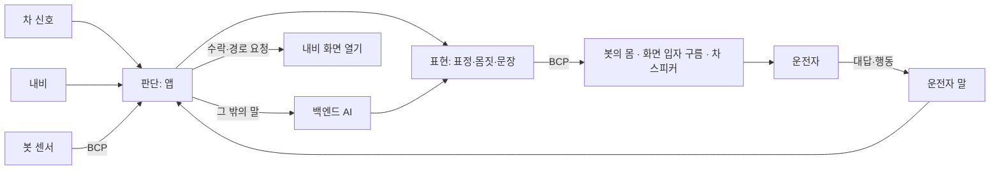
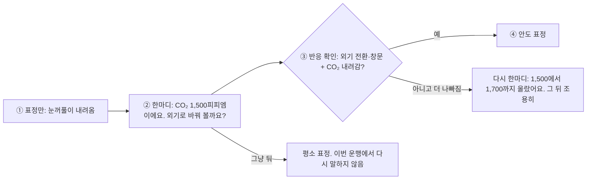
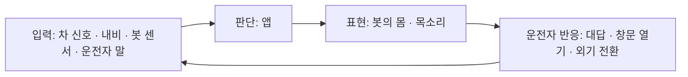

# 기획서 — 접수양식 2장 "앱 프로젝트 소개" 8개 항목 (2026-11-04 개정 4판, 2026-11-09 구현에 맞춰 고침)

공식 접수양식([contest-application-consent.docx](contest-application-consent.docx)) 2장의 8개 항목 순서 그대로 쓴다. 확정되면 11/12 DOCX 칸에 옮긴다. **2장에는 이름·연락처·소속을 쓰지 않는다**(양식 규칙). 참가: 개인, 일반 부문.

검토 페이지: [proposal-review.html](proposal-review.html) (아티팩트 https://claude.ai/artifact/6vk85SxedQfXYzS564Hccp). 근거: [03 봇 커넥트 규약](03-module-protocol.md) · [07 개발 기획](07-dev-plan.md) · [모의 심사](review-2026-11-01-mock-judging.md) · [05 차량 데이터](05-vehicle-data.md) · [AI 비교](../10-ai-services.md) · [응답 시간](../12-latency-measurements.md)

상태: ✅ 동작(에뮬레이터·서버에서 확인) · 단위 시험만(코드 시험으로 확인, 에뮬레이터 확인 전) · 미확인(아직 못 봄) · 🔧 11/15 목표(아직 안 됨) · PT까지(12/3 전) · 이후(선정 뒤). 숫자: (실측) (가정) (목표) (추정).

## 검토용 메모 (DOCX에 옮기지 않음)

**11/4 결정:** 앱 이름 스노봇 커넥트, 규약 이름 봇 커넥트 규약(BCP), 시연용 두 번째 봇 LED 큐브. 이 앱은 감성 봇을 차에 연결하는 커넥트 앱이고, 심사 때도 그렇게 소개하고 시연한다. 중심 기능은 차와 봇이 정보와 기능을 주고받는 연결 규약이다: ① 연결 ② 봇 설명(몸 부위·센서) ③ 차가 주는 정보 + 봇이 주는 정보를 AI 로 해석 ④ 봇의 몸에 맞는 피드백. 봇이 하는 일은 차 살피기·운전자 살피기·공감하기. 차선 변경·회전 때 조용히(11/9 뺐다)·말수·성격은 추가 기능 고려사항으로만 둔다. **→ 11/8 바뀜:** 핵심은 차 살피기·운전자 살피기와 공감하기이고, 연결 규약은 그것을 어떤 봇에서든 되게 하는 토대다. 자유 대화도 추가 기능으로 내렸다.

### 3판에서 바뀐 것

- *(바뀜)* **앱의 정체:** "말할 때를 고르는 동승자"에서 **"감성 봇을 차에 연결하는 커넥트 앱 + 열린 연결 규약"**으로 바꿨습니다.
- *(바뀜)* **기능표:** 커넥트(규약) → 봇이 하는 일 3가지(차·운전자·공감) → 안전 규칙 순서로 다시 짰습니다.
- *(바뀜)* **규약 v0.3:** 봇 설명을 몸 부위와 범위로, 봇이 주는 정보(카메라·습도 등)와 AI 해석, 피드백 3단계(의도·몸짓·부위)로 넓혔습니다.
- *(바뀜)* **수다 단계·성격·차선 변경·회전 때 조용히:** 추가 기능 고려사항으로 내렸습니다(조용히는 11/9 뺐다).
- *(바뀜)* **시나리오:** 몸이 다른 두 봇(스노봇, LED 큐브)이 같은 차 상황에 각자 반응하는 장면, 새 봇이 규약으로 붙는 장면을 더했습니다.
- *(바뀜)* **왜 몸이 있는 감성 봇인가 (11/8):** "글레오가 대신할 수 없는 자리"처럼 글레오와 겨루는 말투를 "보이지 않는 AI에 얼굴을"로 바꿨습니다. 몸이 신뢰를 높인다는 연구 2편(Waytz 2014, Li 2015)을 근거로 더했습니다.
- *(바뀜)* **3장 앱 주요 기능 (11/8):** "규약 / 봇이 하는 일"로 나눴던 것을 **누가 무엇을 하는지**로 다시 짰습니다. 판단은 커넥트 앱만 하고(A: 모으기·판단·표현 고르기·전하기, 차 살피기·운전자 살피기·공감하기), 스노봇은 느끼고 표현만 하며(B: 카메라·마이크·공기 센서 / 고개·눈꺼풀·눈썹·스피커), 규약은 형식만 정합니다. 실시간 피드백이 도는 방식(C: 빠른 길·대화 길)을 더했습니다.
- *(바뀜)* **화면 속 AI 모습 (11/8):** 화면 속 스노봇 대신 **입자 구름**으로 바꿨습니다. 봇이 없으면 입자가 빛 방울로 모이고, 봇을 연결하면 그 봇의 모양으로 모입니다(스노봇을 붙이면 스노봇, 타이거봇을 붙이면 타이거봇). 봇의 모양은 봇 설명의 새 항목 `look`(외곽선 그림)으로 봇이 알려 줍니다.
- *(바뀜)* **11/8 구현:** 앱 화면 입자 구름(빛 방울 ↔ 봇 모양) ✅, 봇 시험기(6항목, 가상 봇 두 대 통과) ✅, 경고등 통역 ✅(권한 이름이 `PRIVATE_CAR_SAFETY`였던 문제 해결), 출발·하차 점검 ✅. 시나리오 A-5·C를 ✅ 동작으로 바꿨습니다.
- *(바뀜)* **핵심 기능 (11/8):** 한 줄 소개를 "연결하는 앱"에서 **"차와 운전자를 살피고 봇의 표정과 목소리로 전하는 앱"**으로 바꿨습니다. 연결 규약은 그 토대로 둡니다. 3장 A의 공감하기 첫 줄을 자유 대화에서 "사람 말로 전하기"로 바꾸고, 자유 대화와 기억은 추가 기능으로 내렸습니다.
- *(바뀜)* **경고등 문장 (11/8):** 44개 문장이 "다음 휴게소에서 봐요"처럼 어디로 가라·무엇을 하라까지 말하던 것을 **어떤 경고등이 켜졌는지만** 알리도록 바꿨습니다. 고속도로인지, 목적지가 어딘지 앱이 모르기 때문입니다. 바로 위험한 넷만 세우라는 말을 붙이고, "어떡해?"는 AI 대화가 켜진 경고등을 알고 답합니다.
- *(바뀜)* **앱의 판단 방식 (11/8):** 권유(답답함·김서림)를 "표정 → 한마디 → 따랐는지 확인 → 안도 표정"의 고리로 다루는 절을 3장 A에 더했습니다. 처음 안(5단계)은 구현·교차 검수와 레드팀 검토를 거쳐 고쳤습니다: 차선 변경·회전 때 움직이지 않기(11/9 뺐다), 고개 돌리기 단계 빼기, 안전 알림은 고리 밖, 무시 기록으로 경고 줄이기는 하지 않기. "단계형 알림"·"표정 먼저"는 선례가 많아 차별점으로 내세우지 않습니다.
- *(바뀜)* **사업성:** 봇 제조사를 두 번째 고객으로 더하고, 규약 인증·연결을 수익원으로 넣었습니다.
- *(바뀜)* **바쁜 정도 (11/9):** 바쁜 정도 판단과 그에 따른 말 끊기를 뺐습니다(`DrivingLoad`, `car.busy`, 방향지시등·핸들·크루즈 구독, 약 4ms 측정 줄). 안전 알림은 바로 말합니다. 와이퍼·전조등·밤은 대조·김서림에 쓰므로 남겼습니다.
- *(바뀜)* **앱의 정체 (11/9):** 운전자와 말을 주고받으며 차 상태를 보고·권고·실행하는 앱이라고 분명히 썼습니다.
- *(바뀜)* **3장 구조 (11/9):** 네 단계(모으기·판단하기·표현 고르기·전하기)를 입력 → 판단 → 표현으로 다시 짰습니다. 운전자 말을 입력에 넣었습니다.
- *(바뀜)* **판단 (11/9):** 스스로 알림, 권유, 여러 출처 대조, 수치 변화·회복 보고, 운전자 말 처리 다섯 가지로 정리하고 각각 상태를 적었습니다.
- *(바뀜)* **시나리오 (11/9):** "이대로면 못 가요", "지금 차 어때", "그냥 둬" 세 장면을 4장 맨 앞에 더했습니다.
- *(바뀜)* **차별점 (11/9):** 여러 출처 대조, 운전자의 결정, 수치 보고, 몸이 있는 봇으로 적었습니다. 확인하지 않은 다른 제품과의 비교는 뺐습니다("양산차 경고는 알리고 끝나지만").
- *(바뀜)* **실시간 표 (11/9):** 실측이 있는 값으로 고치고, 재지 않은 것은 재지 않았다고 적었습니다.
- *(바뀜)* **SDK 표 (11/9):** 실제로 쓰는 것으로 고쳤습니다. 내비는 화면 열기만 확인했고, 목적지 값은 시험 명령, 길 안내 중 이벤트·실제 정체 값은 미확인입니다. 차 제어 SDK 는 준비 중이라 안내까지만 합니다.
- *(바뀜)* **용어 (11/9):** 앱, 백엔드, 입력, 판단, 표현, 상황, 종류, 전달 방식, 반응 확인, 근거 숫자, 제안 대기로 맞췄습니다.
- *(바뀜)* **사실 고침 (11/9):** 김서림 조건에서 창문 닫힘을, 답답함 예에서 내기 순환 30분을 뺐습니다. 코드는 습도 + 비·밤, CO₂ 값으로 판단합니다.
- 그대로: Pleos 음성, 포그라운드 서비스(11/4 동작), 하드웨어 위험, 1명당 운영 비용.

## 앱명 / 프로젝트명

스노봇 커넥트(SnowBot Connect) — 차와 감성 봇을 잇는 앱

## 1. 앱 한 줄 소개 *(바뀜)*

차와 운전자를 살피고, 운전자와 말을 주고받으며 차 상태를 보고·권고·실행하는 앱. 차 신호·내비·봇이 느낀 실내 공기·운전자 말을 함께 읽어 앱이 판단하고, 대시보드 위 감성 봇의 표정과 목소리로 전한다. 열린 연결 규약으로 어떤 봇이든 그 몸이 된다. 첫 번째 봇은 눈사람 로봇 스노봇이다.

## 2. 기획 배경

### 주목한 순간: 혼자 운전할 때

| 혼자 운전할 때 생기는 일 | 옆자리에 사람이 있으면 |
|---|---|
| 졸음이 와도 혼자서는 모르고 버팁니다. 고속도로 사망사고의 절반 이상이 졸음·전방주시 태만입니다(서울시 미디어허브) | "너 졸려 보여, 쉬었다 가자" |
| 계기판에 낯선 경고등이 켜지면 뭔지 모릅니다. 확인하려면 화면이나 설명서를 봐야 하고, 주행 중 화면 조작은 그 자체로 위험합니다 | "방금 켜진 거, 타이어 공기압 경고등이야" |
| 내릴 때 창문을 열어 두거나 뒷좌석 물건을 두고 내립니다 | "창문 열려 있어", "뒤에 가방 챙겨" |
| 긴 운전이 지루하고, 힘든 날 퇴근길은 외롭습니다 | 말동무, "오늘 고생했어" |

### 왜 몸이 있는 감성 봇인가 — 보이지 않는 AI에 얼굴을 *(바뀜)*

- **글레오는 이미 똑똑합니다. 다만 보이지 않습니다.** LLM 기반 글레오 AI는 차량 제어, 지식 검색, 여행 일정 추천, 대화까지 해냅니다. 그러나 운전자에게 글레오는 스피커에서 들리는 목소리일 뿐, 눈을 마주칠 상대가 없습니다. 형태가 없는 AI는 막연하고, 막연한 상대에게는 마음도 신뢰도 쉽게 가지 않습니다.
- **사람은 얼굴을 보고 마음을 엽니다.** 눈을 맞추고 고개를 끄덕이고 표정을 짓는 상대에게서 우리는 저절로 감정을 읽고 말을 건넵니다. 스노봇은 차의 AI에 얼굴과 몸짓을 입혀, 보이지 않던 지능을 **마주 보는 동승자**로 바꿉니다.
- **몸이 생기면 믿음이 생깁니다.** ① 자율주행차에 이름과 목소리만 줘도 운전자의 신뢰가 높아지고, 돌발 상황에서 심박이 더 안정됐습니다(Waytz 외, 2014, Journal of Experimental Social Psychology). ② 같은 공간에 실제로 있는 로봇은 화면 속 캐릭터보다 더 설득력 있고 더 좋게 평가받았습니다(Li, 2015, International Journal of Human-Computer Studies, 실험 33편 검토). ③ 대시보드 위 로봇은 스마트폰보다 부담을 줄이고 친밀감을 높였습니다(MIT AIDA, VW 협력 시뮬레이터 연구).
- **믿음은 안전으로 이어집니다.** "쉬었다 가자"는 같은 말도 화면 알림보다 걱정하는 얼굴로 들을 때 더 와닿습니다. 감성은 장식이 아니라, AI의 조언이 운전자에게 실제로 닿게 하는 통로입니다.
- **글레오가 두뇌라면, 스노봇은 표정입니다.** 차 안 캐릭터의 인기는 NIO NOMI가 이미 보여 줬지만, NOMI는 한 회사 차에 붙박인 내장형입니다. 스노봇은 글레오를 대신하지 않고, Pleos의 AI가 운전자와 교감하는 창구를 하나 더 엽니다("글레오, 스노봇한테 물어봐").

### 왜 커넥트 앱 + 연결 규약인가

- **봇은 차를 직접 읽을 수 없습니다.** Pleos는 앱만 플랫폼 API로 차에 접근하게 합니다(하드웨어 직접 접근 금지). 봇이 차와 운전자를 살피려면 차 데이터를 받아 줄 **앱**이 필요합니다.
- **봇은 앞으로 다양해집니다.** 캐릭터 로봇, 센서 모듈, 카메라 큐브, 브랜드 굿즈 봇이 나올 수 있습니다. 봇마다 앱을 따로 만들면 운전자도 제조사도 힘듭니다. **앱 하나와 규약 하나로 여러 봇이 Pleos 차 데이터를 안전하게** 쓰게 합니다.
- **차와 봇은 서로의 빈자리를 채웁니다.** 차는 앱에 실내 CO₂·습도·미세먼지 값과 실내 카메라 영상을 주지 않습니다. 봇의 센서가 그 감각을 더하고, 앱이 차 정보와 합쳐 판단합니다. 예: 습도(봇) + 비·밤(차) → "습도가 78퍼센트라 유리에 김 서릴 것 같아요."
- **그래서 정해야 할 것은 주고받는 약속, 곧 규약입니다.** 봇이 자기 몸을 어떻게 설명하고, 차와 봇의 정보를 어떤 말로 주고받고, 해석한 결과를 봇의 몸에 어떻게 돌려줄지를 하나의 규약으로 정합니다.

### 2-1. 비슷한 선례와 다른 점 *(바뀜)*

| 선례 | 하는 일 | 다른 점 |
|---|---|---|
| NIO NOMI (중국) | 대시보드 위 동그란 머리가 말하는 사람 쪽으로 돌고 LLM으로 대화 | NOMI는 한 회사 차에 붙박인 장치입니다. 이 앱은 **Pleos 차 데이터를 열린 규약으로 여러 봇에 나눠 주는 앱**이고, 앱만으로도(화면 속 입자 구름) 동작합니다 |
| Toyota Kirobo Mini (2016~17) | 컵홀더 크기 대화 로봇, 폰 블루투스 연결. 기사 평가는 "묻는 말에 답하는 수준" | (위와 같음) |
| MIT AIDA (VW 협력 연구) | 대시보드 로봇이 스마트폰보다 부담을 줄이고 친밀감을 높였다는 결과 | (위와 같음) |

## 3. 앱 주요 기능 및 차량 특화 요소 *(바뀜)*

스노봇 커넥트는 **운전자와 말을 주고받으며 차 상태를 보고하고, 권고하고, 실행하는 앱**입니다. 앱은 입력을 받아 판단하고, 판단 결과를 봇의 표정과 목소리로 표현합니다.

실행은 내비 화면을 여는 데까지입니다. 앱이 장소를 검색해 경로를 바꾸는 기능은 없습니다. 내비 검색 화면을 열면 운전자가 고릅니다. 차를 직접 움직이는 SDK(Vehicle Control)는 Pleos 에서 "준비 중"이라, 차 조작은 운전자에게 안내합니다.

**판단하는 것은 앱 하나뿐입니다.**

| 누구 | 하는 일 | 판단 |
|---|---|---|
| 차 (Pleos SDK) | 신호를 줍니다: 기어·경고등·문·창문·안전벨트·공조·주행 가능 거리·와이퍼·전조등·내비 | 하지 않음 |
| 운전자 | 말합니다: 묻고, 수락하고, 거절하고, 요청합니다. 권유를 받을지는 운전자가 정합니다 | 하지 않음 (결정함) |
| **앱** | 입력을 모아 판단하고, 봇의 몸에 맞는 표현을 골라 보냅니다 | **함 (유일)** |
| 백엔드 (AI) | 앱이 직접 답하지 않는 말에 대답합니다. 말투와 맥락을 맡습니다 | 상황은 정하지 않음 |
| 봇 (스노봇 등) | 느끼고(센서) 표현합니다(몸) | 하지 않음 |
| 봇 커넥트 규약(BCP) | 앱과 봇이 주고받는 메시지의 형식과 순서 | 하지 않음 |

### A. 앱이 하는 일 (핵심): 입력 → 판단 → 표현

**입력: 네 곳에서 받습니다**

| 입력 | 무엇을 받나 | 차량 특화 | 상태 |
|---|---|---|---|
| 차 신호 | 기어, 경고등, 문·창문·안전벨트·좌석, 내기 순환·에어컨·성에 제거, 주행 가능 거리·배터리·연료, 와이퍼(비로 봄), 전조등 | 봇은 차를 직접 읽을 수 없습니다. 앱이 Pleos SDK 로 읽습니다 | ✅ 동작 (11/8~9 에뮬레이터). 연료는 에뮬레이터에 속성이 없어 미확인 |
| 봇 센서 | 실내 CO₂·습도·온도. 카메라 결과는 이후 | 차가 앱에 주지 않는 값을 봇이 더합니다 | ✅ 동작 (가상 봇) / 실물 센서 추가 예정 |
| 내비 | 목적지까지 남은 거리·시간, 앞 정체 | 내비가 없는 차에서는 내비 조건만 쉽니다 | SDK 연결·값 조회 ✅ 동작 (11/9 에뮬레이터). 목적지 값은 시험 명령으로 넣어 확인. 길 안내 중 이벤트·실제 정체 값은 미확인 |
| 운전자 말 | 차 안 Pleos 듣기 엔진이 적은 글자. 목소리는 서버로 가지 않습니다 | 백엔드로 보내기 전에 앱이 먼저 읽습니다 | ✅ 동작 (11/9 에뮬레이터, 글자 시험 명령) |

**판단: 입력에서 상황을 정합니다**

판단 결과는 아래 다섯 가지입니다. 판단은 문장·표정·봇의 몸을 모릅니다. 그것은 표현이 정합니다.

| 판단 결과 | 뜻 | 예 |
|---|---|---|
| 상황 | 무슨 일인지 | 주행 가능 거리 부족, 김서림 우려, 경고등 켜짐 |
| 종류 | 안전 / 권유 / 인사. 겹치면 이 차례입니다. 권유끼리는 20초 간격을 두고, 안전을 말한 직후 5초 안의 인사는 건너뜁니다. 안전은 운전자가 끌 수 없습니다 | 경고등은 안전, 김서림은 권유, 출발은 인사 |
| 전달 방식 | 표정만 / 한마디 / 다시 한마디 / 안도 / 평소로 | 김서림 값이 오르기 시작하면 표정만 |
| 근거 숫자 | 문장에 넣을 값. 못 읽은 값은 0 으로 바꾸지 않고, 그 숫자가 없는 문장을 고르거나 말하지 않습니다 | 주행 가능 거리 38km, 목적지까지 52km |
| 제안 대기 | 수락하면 내비 화면을 여는 제안. 30초 동안 "응"을 기다립니다 | 주유소·충전소·쉴 곳·다른 길 |

판단이 하는 일은 다섯 가지입니다.

| 판단이 하는 일 | 내용 | 예 |
|---|---|---|
| ① 스스로 알림 | 안전과 인사는 묻기 전에 알립니다 | "타이어 공기압 경고등이 켜졌어요." |
| ② 권유 | 표정 → 한마디 → 반응 확인 → 안도 | "CO₂ 1,500피피엠이에요. 외기로 바꿔 볼까요?" |
| ③ 여러 출처 대조 | 차·내비·봇의 값을 맞춰 보고, 한 곳만 봐서는 안 보이는 것을 찾습니다 | "남은 거리 38킬로미터, 목적지까지 52킬로미터예요. 충전소 찾아볼까요?" |
| ④ 수치 변화·회복 보고 | 값이 어떻게 바뀌었는지, 문제가 풀렸는지 말합니다 | "타이어 공기압 경고등 꺼졌어요." |
| ⑤ 운전자 말 처리 | 상태 질문, 수락, 거절, 조작 요청 불가 보고, 경로 요청을 앱이 직접 처리합니다 | "아직 제가 직접 못 움직여요. 창문은 직접 해 주셔야 해요." |

**① 스스로 알림과 ② 권유: 차 살피기 · 운전자 살피기 · 공감하기**

| 목적 | 기능 | 종류 | 하는 일 | 입력 (차 · 봇) | 상태 |
|---|---|---|---|---|---|
| **차 살피기** | 경고등 통역 | 안전 | 새 경고등이 켜지면 어떤 경고등인지 말로 알림: "타이어 공기압 경고등이 켜졌어요." 어디로 가라는 말은 하지 않음(고속도로인지·목적지를 모름). 바로 위험한 넷(엔진 오일 압력·엔진 과열·전원 저하·수소 누출)만 "안전한 곳에 세워 주세요"를 붙임 | Safety 경고등 (SDK 98종 중 44종 통역, 나머지는 조용히) | ✅ 동작 (11/8 에뮬레이터) |
| | 출발·하차 점검 | 인사 | 출발 때 안전벨트·주행 가능 거리, 내릴 때 창문·문·뒷좌석 | Seat · Odometer · EvBattery · Door · Window | ✅ 동작 (11/8 에뮬레이터) |
| | 공기질 | 권유 | 봇의 CO₂ 값이 1,500ppm 이상이면 졸린 표정 + 환기 권유: "CO₂ 1,500피피엠이에요." 내기 순환이 켜져 있으면 "외기로 바꿔 볼까요?", 아니면 "창문을 조금 열어 볼까요?" | 봇 CO₂ + HVAC 내기 순환 | ✅ 동작 |
| | 김서림 우려 | 권유 | 습도가 높고 비·밤이면 "습도가 78퍼센트라 유리에 김 서릴 것 같아요. 에어컨 켜 볼까요?"(에어컨이 켜져 있으면 성에 제거를 권함). 창문·에어컨·성에 제거를 켜고 습도가 내려가면 안도 | 봇 습도 + Wiper · 시각 | ✅ 동작 |
| **운전자 살피기** | 휴식 권유 | 안전 | 2시간째부터 1시간마다 졸린 표정으로 쉬자고 함: "벌써 2시간째 운전 중이에요. 쉼터에서 잠깐 쉬어 가요." "그냥 둬"로 꺼지지 않음 | Gear로 잰 연속 운전 시간 | ✅ 동작 (11/9 에뮬레이터) |
| | 주의 경고 | 안전 | 차가 운전자 주의 경고를 띄우면 걱정 표정 + 쉼터 권유 | Safety DRIVER_ATTENTION | ✅ 동작 (시험 명령. VC 에 이 경고등 카드가 없음) |
| | 졸음 신호 | 안전 | 카메라가 있는 봇이 눈 감김·하품을 알리면 운전자 쪽을 보며 쉬자고 함 | 봇 카메라 결과 + 운전 시간 | 이후 (카메라 봇) |
| | 대화로 피로 살피기 | 권유 | 오래 운전하면 가볍게 말을 걸고, 대답이 늦거나 짧아지면 쉬자고 함 | 운전 시간 + 대화 반응 | PT까지 (근거 확인 필요) |
| **공감하기** | 사람 말로 전하기 | 안전 | 경고음 대신 봇이 걱정 표정으로 "타이어 공기압 경고등이 켜졌어요."라고 말해 줌. 운전자가 "어떡해?" 하고 물으면 AI 가 켜진 경고등을 알고 대답함(어디로 가라고 단정하지 않음) | 위에서 판단한 상황 + 봇의 몸 설명 | ✅ 동작 |
| | 출발·도착 인사 | 인사 | "출발해요! 오늘도 안전하게 가요." / 오래 달렸으면 "푹 쉬어요" | Gear P↔D | ✅ 동작 |

**② 권유: 표정 → 한마디 → 반응 확인 → 안도** *(바뀜)*

경고등·주의 경고·휴식처럼 안전과 닿은 알림은 정해 둔 문장으로 바로 알립니다. 답답함·김서림 같은 **권유**는 아래 순서로 다룹니다. 앱은 운전자가 권유를 따랐는지와 그 효과까지 차 신호와 봇 센서로 확인하고 표정으로 답합니다.

| 전달 방식 | 봇이 하는 것 | 언제 |
|---|---|---|
| 표정만 | 말 없이 표정만 바뀜 | 값이 오르기 시작 (CO₂ 1,350ppm, 습도 73%) |
| 한마디 | 근거 숫자를 넣어 권유 | 값이 기준을 넘음 (CO₂ 1,500ppm, 습도 75%) |
| 다시 한마디 | 변화를 말하고 다른 방법을 권함. 그 뒤 상황이 풀릴 때까지 조용히 | 한마디 뒤 10분이 지났고, 그때보다 나빠짐 (CO₂ 150ppm, 습도 3% 넘게) |
| 안도 | 말 없이 안도 표정 | 운전자가 차를 만졌고, 값이 실제로 내려감 |
| 평소로 | 말 없이 평소 표정 | 값이 저절로 풀림, 또는 운전자가 "그냥 둬"라고 함 |

- **행동과 결과를 둘 다 봅니다.** 외기로 바꿨어도 CO₂가 내려가지 않으면 안도하지 않습니다. 차 신호만으로는 운전자가 다른 이유로 창문을 열었는지 알 수 없기 때문입니다.
- **운전자가 정합니다.** "그냥 둬"라고 하면 지금 권유를 끝내고 이번 운행에서 그 상황은 말하지 않습니다.
- **권유끼리 겹치지 않게 합니다.** 김서림과 답답함이 같은 순간이면 김서림(시야)을 먼저 말하고, 답답함은 20초 뒤에 말합니다.
- **안전 알림은 이 순서 밖에 둡니다.** 무시한다고 경고를 줄이거나 멈추지 않습니다.
- **숫자는 시작 값입니다.** 1,500ppm 외에는 근거가 약해, 실물 센서로 1·2·4명 탑승 곡선을 재서 맞춥니다.
- 상태: ✅ 동작 (11/8 에뮬레이터): 표정만 → 한마디 → 외기 전환만으로는 안도하지 않고, CO₂가 내려가자 안도 표정. 김서림은 VC 로 에어컨을 켜고 습도가 내려가자 안도, 두 권유가 겹치면 20초 간격. "다시 한마디"는 10분이 걸려 단위 시험으로만 확인. 표정이 운전자에게 닿는지와 CO₂ 실측은 아직입니다. 검증 기록: [13 판정](13-ladder-review.md) (구현·교차 검수, 레드팀 검토).

**③ 여러 출처 대조** *(바뀜)*

| 맞춰 보는 것 | 출처 | 앱이 하는 말 | 종류 | 상태 |
|---|---|---|---|---|
| 주행 가능 거리보다 목적지까지 거리가 김 | 차 + 내비 | "남은 거리 38킬로미터, 목적지까지 52킬로미터예요. 충전소 찾아볼까요?" (전기차가 아니면 주유소). 제안 대기 | 권유 | ✅ 동작 (11/9 에뮬레이터, 목적지 값은 시험 명령) |
| 운전 시간 + 남은 시간이 2시간 이상 | 차 + 내비 | "2시간째가 돼요. 도착까지 40분 남았어요. 쉬어 갈까요?" 제안 대기 | 권유 | 단위 시험만 |
| 앞 경로 정체 | 내비 | "이 앞 3킬로미터 정체예요. 다른 길 볼까요?" 제안 대기 | 권유 | 단위 시험만. 실제 정체 값 미확인 |
| 비(와이퍼) + 창문 열림 | 차 + 차 | "비 오는데 창문이 열려 있어요." | 권유 | ✅ 동작 (11/9 에뮬레이터) |
| 밤 + 주행 + 전조등 꺼짐 | 시각 + 차 | "밤인데 전조등이 꺼져 있어요." | 안전 | ✅ 동작 (11/9 에뮬레이터) |
| 주행 + 문 열림 | 차 + 차 | "주행 중인데 문이 열려 있어요." | 안전 | 단위 시험만 |
| CO₂ + 내기 순환 | 봇 + 차 | "CO₂ 1,500피피엠이에요. 외기로 바꿔 볼까요?" | 권유 | ✅ 동작 |
| 습도 + 비·밤 | 봇 + 차·시각 | "습도가 78퍼센트라 유리에 김 서릴 것 같아요." | 권유 | ✅ 동작 |

- 조건이 **새로 성립한 순간만** 말합니다. 풀렸다가 다시 생겨야 또 말합니다.
- 모르는 값이 든 조건은 보지 않습니다. 내비가 없는 차에서는 내비 조건이 조용합니다.
- 멈춰 있을 때는 대조하지 않습니다. 주차 중 창문·문은 하차 점검이 맡습니다.

**④ 수치 변화·회복 보고** *(바뀜)*

| 언제 | 앱이 하는 말 | 상태 |
|---|---|---|
| 권유·대조를 말할 때 | 근거 숫자를 문장에 넣고, 화면에 그 숫자를 5초 크게 보입니다: "38km / 목적지 52km" | ✅ 동작 (11/9 에뮬레이터, 주행 가능 거리). CO₂·습도 문장은 단위 시험 |
| 값이 더 나빠졌을 때 | "1,500에서 1,700까지 올랐어요. 잠깐 환기하고 가요." | 단위 시험만 |
| 경고등이 꺼졌을 때 | "타이어 공기압 경고등 꺼졌어요." 밝은 표정으로 한 번 | ✅ 동작 (11/9 에뮬레이터) |
| 주행 가능 거리가 100km·50km 아래로 처음 내려갈 때 | "갈 수 있는 거리가 48킬로미터 남았어요." 운행마다 지점당 한 번. 출발 때 이미 아래면 말하지 않음 | 단위 시험만 |

**⑤ 운전자 말 처리** *(바뀜)*

앱은 차의 듣기 엔진이 적은 글자를 백엔드로 보내기 전에 먼저 읽습니다. 아래 말은 앱이 인터넷 없이 처리합니다.

| 운전자 말 | 뜻 | 앱이 하는 일 | 상태 |
|---|---|---|---|
| "지금 차 어때" | 상태 질문 | 차 요약에서 문제를 급한 것부터 두 개까지 말함: "안전벨트 안 맨 자리가 있어요." 문제가 없으면 "지금은 다 괜찮아요."에 값 하나를 붙임 | ✅ 동작 (11/9 에뮬레이터) |
| "멀쩡한 게 뭐야" | 상태 질문 | 정상인 것 하나를 말함: "공조는 완전 멀쩡해요." | ✅ 동작 (11/9 에뮬레이터) |
| "얼마나 더 갈 수 있어" | 상태 질문 | 주행 가능 거리와 목적지까지 거리를 말함. 둘 다 모르면 "지금은 남은 거리를 못 봐요." | 단위 시험만 |
| "응 해줘" | 수락 (제안 대기 중일 때만) | 내비 화면을 열고 "내비 화면 열었어요." | ✅ 동작 (11/9 에뮬레이터) |
| "그냥 둬" | 거절 (제안 대기 중이거나 권유 뒤 1분 안일 때만) | 평소 표정으로 끝내고 이번 운행에서 그 상황은 말하지 않음. 안전은 꺼지지 않음 | ✅ 동작 (11/9 에뮬레이터) |
| "창문 열어줘" | 조작 요청 | 못 한다고 보고: "아직 제가 직접 못 움직여요. 창문은 직접 해 주셔야 해요." | ✅ 동작 (11/9 에뮬레이터) |
| "주유소 알려줘" | 경로 요청 | 내비 검색 화면을 열고 "내비 화면 열었어요." 장소는 운전자가 고름 | ✅ 동작 (11/9 에뮬레이터) |
| 그 밖의 말 | 대화 | 백엔드 AI 가 차 요약을 알고 대답함. 대답이 없으면 "지금 인터넷이 끊겨서 대화는 어려워요. 차 상태는 볼 수 있어요." | ✅ 동작 (11/9 에뮬레이터, 비행기 모드 포함) |

- **잘못 알아듣지 않게 합니다.** 차의 듣기는 글자를 틀리게 적고, 잡담에도 같은 낱말이 섞입니다. 그래서 짧은 문장에서만 맞춰 보고, 긴 말은 백엔드로 넘깁니다. 수락·거절은 문장 전체가 그 말이거나 그 말로 시작하고 짧은 꼬리말만 붙었을 때만 맞습니다. "반응이 왜 그래"의 "응"에 걸리지 않습니다.
- **끌 것이 없으면 거절로 읽지 않습니다.** 권유가 없을 때 "괜찮아"는 그냥 하는 말이므로 백엔드 AI 가 대답합니다.

**표현: 판단 결과를 봇의 몸에 맞게 전합니다**

| 단계 | 하는 일 | 차량 특화 | 상태 |
|---|---|---|---|
| 표현 고르기 | 판단 결과로 감정·몸짓·문장을 고릅니다. 연결된 봇의 몸 설명을 보고 그 봇이 할 수 있는 표현을 고릅니다. 1단계 의도(감정·강도) · 2단계 몸짓(끄덕임, 운전자 쪽 보기) · 3단계 부위 직접 제어 + 말하기·듣기 | 같은 상황도 봇마다 다르게: 스노봇은 눈썹과 목소리, LED 큐브는 빛과 효과음 | 1단계 ✅ 동작 (모든 봇에 각자 몸에 맞게) / 2·3단계 🔧 |
| 전하기 | 고른 표현을 봇 커넥트 규약으로 봇에 보냅니다. 연결된 봇이 없거나 봇에 없는 능력이면 앱 화면의 입자 구름이 대신 표현합니다 | 심사·에뮬레이터에서도 전부 동작 | ✅ 동작 (입자 구름, 11/8) |
| 화면: 차 상태 패널 | 경고등·주행 가능 거리·목적지까지·운전 시간·문·창문·안전벨트·공조·CO₂·습도·인터넷의 값과 주의 표시를 보입니다. 못 읽은 값은 "—"로 둡니다 | 말과 같은 차 요약을 화면에 씁니다 | ✅ 동작 (11/9 에뮬레이터) |

**차별점** *(바뀜)*

| 차별점 | 무엇을 하나 | 예 |
|---|---|---|
| 여러 출처 대조 | 차 신호·내비·봇 센서를 맞춰 보고, 한 곳만 봐서는 안 보이는 것을 찾습니다 | 주행 가능 거리 38km와 목적지까지 52km를 견줌 |
| 운전자의 결정 | 앱은 제안하고 운전자가 "응"이나 "그냥 둬"로 정합니다. 안전 알림만 끌 수 없습니다 | "응 해줘" → 내비 화면, 운전자가 고름 |
| 수치 보고 | 왜 말했는지 근거 숫자로 말합니다. 못 읽은 값은 만들지 않습니다 | "1,500에서 1,700까지 올랐어요." |
| 몸이 있는 봇 | 대시보드 위 봇이 표정과 목소리로 전합니다. 규약을 지키면 어떤 봇이든 같은 앱에 붙습니다 | 스노봇은 눈썹과 목소리, LED 큐브는 빛과 효과음 |

**봇 커넥트 규약(BCP): 앱이 봇과 말하는 언어**

- **규약이 정하는 것:** ① 연결(봇 바닥 QR로 짝 맺기, 놓인 자리, 차 1대에 봇 여러 대, 블루투스·클라우드·같은 Wi-Fi 어느 것이든 같은 메시지) ② 봇 설명(몸 부위와 움직이는 범위, 센서) ③ 정보 메시지의 형식(차 정보 주제, 봇 센서 결과, 상황 이름) ④ 피드백 명령의 형식(의도·몸짓·부위·말하기·듣기). 그리고 개인정보 약속: 봇은 허락받은 정보만 받고, 카메라·마이크는 원본이 아닌 결과만 보냅니다.
- **규약이 정하지 않는 것:** 언제 어떤 상황이라고 볼지, 무엇을 말할지. 이것은 앱이 정합니다. 그래서 앱의 판단이 좋아져도 봇은 바꿀 필요가 없고, 봇 제조사는 몸과 센서에만 집중합니다.
- 봇 제조사가 규약을 지키는지 스스로 확인하는 **봇 시험기**(MCP Inspector 같은 도구) ✅ 동작 (11/8): 봇 설명·의도·몸짓·관찰·연결·반응 시간 6항목을 ✅/❌로 알려 줍니다. 가상 봇 두 대(스노봇, LED 큐브) 모두 통과. 메시지 이름은 5-3에 정리했습니다.

**화면 속 AI 모습: 입자 구름** *(바뀜)*

- **AI는 하나, 몸은 여럿.** 앱 화면의 AI는 작은 빛 입자 수백 개가 모인 구름입니다. 정해진 캐릭터가 없고, 연결된 봇에 따라 입자가 모이는 모양이 바뀝니다.
- **봇이 없을 때:** 입자가 모여 숨 쉬듯 커졌다 작아지는 빛 방울이 됩니다. 말할 때는 목소리에 맞춰 가장자리가 출렁이고, 들을 때는 운전자 쪽으로 모이고, 생각할 때는 천천히 소용돌이칩니다. 감정은 색과 움직임의 빠르기로 보여 줍니다.
- **봇을 연결하는 순간:** 빛 방울이 흩어졌다가 그 봇의 모양으로 다시 모입니다. 스노봇을 연결하면 스노봇, 타이거봇을 연결하면 타이거봇이 됩니다. 연결이 끊기면 봇 모양이 흩어져 빛 방울로 돌아갑니다. 보이지 않던 AI가 몸을 얻는 순간을 앱이 그대로 보여 줍니다.
- **봇의 모양은 봇이 알려 줍니다.** 봇이 봇 설명에 외곽선 그림(`look`)을 담아 보내면, 앱이 그 선 위로 입자를 모읍니다. 앱이 봇마다 그림을 따로 갖지 않아도 되고, 다른 제조사의 봇도 연결하는 순간 자기 모양을 얻습니다. 모양을 알리지 않은 봇이면 빛 방울 그대로 둡니다.
- **실물 봇이 있으면 화면은 한발 물러섭니다.** 연결 순간에만 크게 모여 봇 모양이 되고, 그 뒤에는 작고 차분하게 줄어 실물 봇의 표정을 따라 보여 주는 정도로 남습니다. 운전자의 눈이 대시보드와 화면 두 곳으로 갈리지 않게 하려는 것입니다. 봇이 없는 심사·에뮬레이터 환경에서는 화면 속 봇 모양이 모든 표현을 맡습니다.
- **봇 모양일 때의 표정:** 모양·색·출렁임이 기본이고, 눈과 눈썹 자리의 입자를 움직여 졸린 눈·걱정 같은 몇 가지를 더합니다.
- **주행 중에는 줄입니다.** 주행 중에는 입자 수와 움직임을 줄여 시선을 끌지 않고, 크게 모이는 변신은 정차·출발·연결 순간에만 합니다. 차 화면에서 얼마나 부드럽게 도는지는 에뮬레이터에서 확인합니다.
- 상태: ✅ 동작 (11/8 에뮬레이터). 빛 방울 → 봇 연결 시 부풂·소용돌이·봇 모양(`look`) → 끊기면 빛 방울. 감정은 색·빠르기로, 끄덕임은 머리 입자로, 주행 중에는 입자 수와 움직임을 줄임. 약 60fps.

### B. 스노봇(하드웨어)이 하는 일: 느끼고 표현한다

스노봇은 판단하지 않습니다. 앱이 판단할 재료를 느끼고, 앱이 고른 표현을 몸으로 보여 줍니다. 아래는 첫 번째 봇인 스노봇의 몸입니다.

| 구분 | 부품 | 하는 일 | 상태 |
|---|---|---|---|
| **감각 · 카메라** | XIAO ESP32S3 Sense 보드의 카메라 (한쪽 눈동자 자리) | 눈 감김·하품, 뒷좌석 물건을 봇 안에서 알아보고 결과만 보냄. 영상은 봇 밖으로 나가지 않음 | 이후 |
| **감각 · 마이크** | 같은 보드의 마이크 | 소리 결과(부르는 소리 등). 대화 듣기는 지금 차 안 Pleos 음성 인식이 맡음 | 이후 |
| **감각 · 공기 센서** | CO₂·습도·온도 센서 (차량용 보완) | 차에 없는 실내 공기 값 | ✅ 동작 (가상 봇) / 실물 센서 추가 예정 |
| **표현 · 고개** | MG90S 서보 2개 | 좌우로 돌아 운전자 쪽 보기, 끄덕임 | 조립 중 |
| **표현 · 눈꺼풀·눈썹** | SG51R 초소형 서보 2개 | 졸린 눈, 걱정하는 눈썹, 눈웃음 | 조립 중 |
| **표현 · 목소리** | 28mm 스피커 + 앰프 | 앱이 정한 말을 봇 목소리로 | 조립 중 |

몸이 다른 봇도 같은 앱에 붙습니다. LED 큐브는 빛·효과음·습도 센서로, 다른 제조사의 봇은 자기 몸을 규약의 봇 설명으로 알리면 앱이 그 몸에 맞춰 표현을 고릅니다.

### C. 실시간 피드백: 이렇게 돈다

봇이 "살핀다"는 말은 차와 봇이 느끼는 것을 값이 바뀔 때 받아 판단하고, 운전자의 반응이 다시 다음 입력이 된다는 뜻입니다.

- **예:** 내기 순환(차) + CO₂ 1,600ppm(봇) → 앱이 답답함으로 판단 → 스노봇이 눈꺼풀을 내리고 "CO₂ 1,600피피엠이에요. 외기로 바꿔 볼까요?" → 운전자가 외기로 바꾸면 앱이 바뀐 신호를 받습니다. 외기로 바꾸고 CO₂가 실제로 내려가면 봇이 안도하는 표정으로 돌아옵니다 ✅ 동작 (11/8, 위 "② 권유").
- **판단은 두 곳에서 합니다.** 앱이 직접 답할 수 있는 것은 앱 안 규칙으로, 그 밖의 말은 백엔드 AI 로 처리합니다.

| 어디서 | 무엇을 | 인터넷 | 빠르기 |
|---|---|---|---|
| **앱 안 규칙** | 스스로 알림, 권유, 대조, 수치 보고, 상태 질문, 수락, 거절, 조작 요청, 경로 요청 | 필요 없음 | 아래 표. 대부분 아직 재지 않음 |
| **백엔드 AI** | 그 밖의 말: 말투·맥락, 자유 대화 | 필요 | 운전자 말 끝 → 봇 첫 소리 보통 1.5초 (실측) |

**지금 잰 값과 목표**

| 무엇 | 지금 | 목표 |
|---|---|---|
| 경고등 켜짐 → 앱이 말함 | ✅ 동작. 5.1초 (실측) (11/8 에뮬레이터, TPMS 1번, 말한 시각 기준). 구독으로 받고 5초마다 조회로 다시 맞춤 | 실차 권한을 확인한 뒤 다시 잼 |
| 기어 바뀜 → 출발·도착 인사 | ✅ 동작. 구독으로 받음. 지연은 아직 재지 않음 | 측정해 기록 |
| 운전자 주의 경고 → 쉼터 권유 | ✅ 동작 (시험 명령. 11/8 권한 이름 문제 `PRIVATE_CAR_SAFETY` 해결). 지연은 아직 재지 않음 | 실차에서 이 권한을 받을 수 있는지 Pleos 문의 |
| "지금 차 어때" → 앱의 대답 | ✅ 동작 (11/9 에뮬레이터). 지연은 아직 재지 않음 | 측정해 기록 |
| 운전자 말 끝 → 글자 확정 | 차 안 엔진 약 0.4초 (실측). 예전 서버 음성 경로 0.2~0.35초 (실측) (10/28, 13번) | — |
| 말하기 요청 → 차 목소리 시작 | TTS 시작 0.10초 (실측) | — |
| 운전자 말 끝 → 봇 첫 소리 (백엔드 대답) | 보통 1.5초 (실측) (10/28, 예전 서버 음성 경로, 중간값 1.46초, 17번 중 1.31~2.54초) | Pleos 음성 경로에서 1.5초 이하 (목표) |
| 앱 명령 → 실물 봇 움직임 | 아직 재지 않음 (실물 스노봇 조립 뒤) | 측정해 기록 |

백엔드에 말을 보내고 8초 안에 대답이 없으면 앱이 "지금 인터넷이 끊겨서 대화는 어려워요."라고 말합니다. 8초는 잰 값이 아니라 시작 값입니다.

### 추가 기능 고려사항

핵심 기능이 끝난 뒤 더할 것들입니다.

- **자유 대화** ✅ 동작: 말하기 버튼 → Pleos 음성 인식(차 안) → AI 대답 → 표정 + Pleos 목소리. AI 는 차 요약(경고등·주행 가능 거리·운전 시간 등)을 알고 수치를 인용해 대답합니다. 주행 중 두 문장, 주차 중 세 문장입니다.
- **기억** (PT까지): "아까 피곤하다고 했죠?"처럼 이어서 말함.
- 운전자가 봇의 말의 양과 성격을 고르는 옵션.

## 4. 주요 사용 시나리오 *(바뀜)*

### 먼저: 운전자와 말을 주고받는 장면 ✅ 동작 *(바뀜)*

앱이 차 상태를 보고하고, 권고하고, 운전자의 결정을 실행하는 세 장면입니다. 11/9 에뮬레이터에서 확인했습니다(목적지 값은 시험 명령으로 넣음).

**"이대로면 못 가요"**

1. 주행 중입니다. 차가 주는 주행 가능 거리는 38km, 내비가 주는 목적지까지 거리는 52km입니다.
2. 앱이 둘을 맞춰 봅니다. 상황은 주행 가능 거리 부족, 종류는 권유, 근거 숫자는 38과 52입니다.
3. 봇이 걱정 표정으로 말합니다: "남은 거리 38킬로미터, 목적지까지 52킬로미터예요. 충전소 찾아볼까요?" 화면에 "38km / 목적지 52km"가 5초 크게 보입니다. 앱은 제안 대기로 들어갑니다.
4. 운전자가 "응 해줘"라고 합니다 → "내비 화면 열었어요." 내비의 주변 충전소 화면이 앞으로 나옵니다. 어디로 갈지는 운전자가 고릅니다.

**"지금 차 어때"**

1. 운전자가 "지금 차 어때"라고 묻습니다. 앱이 백엔드로 보내지 않고 차 요약으로 답하므로 인터넷이 없어도 됩니다.
2. 문제가 있으면 그것부터 말합니다: "안전벨트 안 맨 자리가 있어요." 문제가 없으면 "지금은 다 괜찮아요."에 주행 가능 거리를 붙입니다.
3. "멀쩡한 게 뭐야"라고 물으면 "공조는 완전 멀쩡해요."처럼 정상인 것 하나를 말합니다.

**"그냥 둬"**

1. 봇이 권유합니다. 운전자가 "그냥 둬"라고 합니다.
2. 봇은 말 없이 평소 표정으로 돌아옵니다. 같은 조건이 다시 생겨도 이번 운행에서는 그 상황을 말하지 않습니다.
3. 안전 알림은 꺼지지 않습니다. 2시간 운전 뒤의 쉼터 권유는 "그냥 둬"라고 해도 3시간째에 다시 말합니다.

### A. 금요일 밤 고속도로 퇴근길 (스노봇)

1. 기어 D → 스노봇이 끄덕이며 "출발해요! 오늘도 안전하게 가요." ✅ 동작
2. 2시간째 → 졸린 표정으로 "벌써 2시간째 운전 중이에요. 쉼터에서 잠깐 쉬어 가요." ✅ 동작
3. 차가 운전자 주의 경고를 띄움 → 걱정 표정으로 "많이 피곤한가 봐요. 쉼터에서 잠깐 쉬었다 가요." ✅ 동작
4. 비가 오는 밤, 봇이 습도 78%를 알림 → "습도가 78퍼센트라 유리에 김 서릴 것 같아요. 에어컨 켜 볼까요?" ✅ 동작
5. 계기판에 타이어 경고등 → 걱정 표정으로 "타이어 공기압 경고등이 켜졌어요." ✅ 동작
6. 기어 P → "도착! 오래 운전했으니 푹 쉬어요." ✅ 동작

### B. 몸이 다른 두 봇, 같은 순간 (규약 시연)

대시보드에 스노봇(눈꺼풀·눈썹·목·스피커·CO₂ 센서)과 LED 큐브(빛·효과음·습도 센서)가 함께 연결되어 있습니다. ✅ 동작 (가상 봇 2개)

| 상황 | 정보가 온 곳 | 해석 | 스노봇 | LED 큐브 |
|---|---|---|---|---|
| 출발 | 차: 기어 P→D | 출발 | 눈웃음 + 끄덕, "출발해요!" | 노란빛 두 번 깜빡 |
| 김서림 우려 | 큐브: 습도 78% + 차: 비·밤 | `fog_risk` | 눈썹 처짐 + "유리에 김 서릴 것 같아요" | 주황빛 숨쉬기 + 효과음 |
| 답답함 | 스노봇: CO₂ 1,600ppm + 차: 내기 순환 | `stuffy` | 눈꺼풀 내림 + "CO₂ 1,600피피엠이에요. 외기로 바꿔 볼까요?" | 파란빛 느리게 |
| 경고등 | 차: 타이어 경고등 | `warning_tire` | 걱정 표정 + 경고등 통역 | 주황빛 깜빡 |

정보는 어느 봇이 느꼈든 앱에 모이고, 피드백은 각 봇의 몸에 맞게 갑니다. 말은 스피커가 있는 스노봇(또는 차 스피커)이 하고, 큐브는 빛과 효과음으로 같은 감정을 보여 줍니다.

### C. 새 봇이 규약으로 붙는 순간 (봇 제조사 시점) ✅ 동작

1. 제조사가 규약대로 봇 설명(`hello`: 몸 부위·범위·센서·모습)을 보내는 봇을 만들고, 봇 시험기로 6항목 통과를 확인합니다.
2. 운전자가 봇 바닥 QR을 찍으면 앱에 "연결된 봇"으로 나타나고, 화면의 빛 방울이 부풀었다가 그 봇의 모양으로 모입니다.
3. 앱은 봇의 센서 정보를 해석에 더하고, 봇의 몸에 맞춰 피드백합니다. AI도 그 봇이 할 수 있는 몸짓 안에서 고릅니다. 제조사는 차 데이터를 직접 다루지 않고도 Pleos 차에 맞는 봇을 만듭니다.

### D. 주차장에서 잠깐 (정차 중 대화) ✅ 동작

- "오늘 회사에서 힘들었어" → 주차 중이라 조금 길게: "오늘 많이 힘드셨군요. 잠깐 숨 고르세요. 얘기하고 싶으면 들을게요."
- "너 글레오보다 똑똑해?" → "글레오는 척척박사 비서고, 저는 옆자리 눈치 담당이에요."

### E. 대형마트 지하주차장 (이후)

카메라가 있는 봇이 기어 P 순간 기둥 표지를 읽어 "B3 C-12"를 보냅니다(`event camera`). 장을 보고 와서 "차 어디 있어?" → "지하 3층 C-12예요."

## 5. 개발 계획

### 5-1. 지금까지 만든 것 (2026-11-09, 에뮬레이터·서버에서 확인)

| 부분 | 내용 |
|---|---|
| 커넥트 앱 (Kotlin, Pleos Connect Emulator) | 짝 맺기, 화면 대역(입자 구름: 빛 방울 ↔ 봇 모양), 포그라운드 서비스(화면을 닫아도 동작), Vehicle SDK 신호(기어·와이퍼·전조등·경고등·공조·문·창문·좌석·주행 가능 거리·배터리)를 봇이 알아듣는 주제로 번역, 경고등 통역·출발·하차 점검, 입력 → 판단 → 표현 구조, 권유(표정 → 한마디 → 반응 확인 → 안도), 여러 출처 대조, 수치 변화·회복 보고, 운전자 말 처리, 차 요약·차 상태 패널. 앱 단위 시험 175개 |
| 내비 (NaviHelper 3.0.5) | SDK 연결, 목적지·경로 상태 조회, 내비 화면 열기. 목적지 값은 시험 명령으로 넣어 확인. 길 안내 중 이벤트·실제 정체 값은 미확인 |
| Pleos 음성 | SpeechToText·TextToSpeech 차 안 엔진(ON_DEVICE), 권한 한 줄로 동작. TTS 시작 0.10초 (실측). STT 최종 결과 말 끝 약 0.4초 뒤 (실측), 녹음 21번 시험에서 이름 "스노봇"을 "스노프"로 6번 들어 앱에서 고쳐 받음 |
| 봇 커넥트 규약 v0.3 | 봇 설명·허락·차 정보 보내기(6주제)·봇 정보 받기·해석 규칙 2가지·모든 봇에 몸에 맞는 표정·AI에 봇의 몸 알려 주기 동작(11/4). 가상 봇 2개(스노봇, 브라우저 LED 큐브), 앱 "연결된 봇" 화면·봇 추가. 봇 시험기(6항목, 가상 봇 두 대 통과, 11/8). 남음: 2·3단계 피드백 |
| 백엔드: 클라우드 중계·AI (FastAPI WebSocket, TLS) | 앱 ↔ 봇 중계, 대답 생성(Claude Haiku 5.5, 문장 단위로 흘려 보냄), 앱이 보낸 차 요약을 알고 대답, 대답 길이(주행 두 문장 · 주차 세 문장), 봇용 목소리. 서버 자동 시험 48개 |
| 응답 시간 | 말 끝 → 첫 소리 보통 1.5초 (실측) (10/28, 서버 음성 경로 17번 중간값). Pleos 음성 경로는 마이크를 마련한 뒤 다시 잽니다 |
| 스노봇 (첫 번째 봇) | 3D 설계 완료(서보 4개: 눈꺼풀·눈썹·고개), 1차 3D 출력 주문, 부품 11/7 도착 → 조립. 가상 스노봇으로 규약 시험 중 |
| 개인정보 | 녹음 저장 안 함. 목소리는 차 안에서 글자로 바뀌고 서버로 가지 않음. 서버 기록에 말 내용 없음. 봇에는 허락한 맥락만, 위치는 기본 미제공 |

### 5-2. 구조: 앱·봇·백엔드

입력(차 신호·내비·봇 센서·운전자 말) → 앱: 판단 → 표현 → 규약 → 봇들: 각자 몸으로 표현 / 백엔드(AI): 앱이 직접 답하지 않는 말의 대답

> 판단의 중심은 차 안의 앱입니다. 입력을 모으고, 스스로 알림·권유·대조·수치 보고와 운전자 말 처리를 앱 안 규칙으로 정하므로 인터넷이 끊겨도 동작합니다. 듣기와 말하기는 차 안의 Pleos 음성 엔진이 합니다. AI는 말투와 맥락을 해석하고, 연결된 봇의 몸 설명 안에서 피드백을 고릅니다. 봇은 받은 피드백을 자기 몸으로 표현합니다.

- **인터넷이 끊기면:** 앱 안 규칙으로 하는 말은 정해 둔 문장을 Pleos 목소리로 합니다. 상태 질문에도 답합니다. 자유 대화만 쉬고, 그때는 "지금 인터넷이 끊겨서 대화는 어려워요. 차 상태는 볼 수 있어요."라고 말합니다.
- **봇 연결 방식:** 프로토타입은 봇이 Wi-Fi로 클라우드 중계에 붙습니다. 최종 목표는 블루투스로 커넥트 앱에 바로 붙는 방식입니다. 규약 메시지는 같고 전송 방법만 바뀝니다.
- **차량 LLM이 앱에 공개되면** 클라우드 AI 대신 그것을 씁니다.

### 5-3. 봇 커넥트 규약(BCP) 요약 *(바뀜)*

| 부분 | 내용 |
|---|---|
| ① 연결 | 찾기(블루투스 광고·QR) → 짝 맺기(등록 코드 → 토큰) → 자리 정하기 → 봇 설명 `hello` / 허락 `welcome` → `ping`으로 연결 확인. 전송: 블루투스(차 안 기본)·클라우드·같은 Wi-Fi, 메시지는 같음 |
| ② 봇 설명 | 모습(`look`: 외곽선 그림, 화면 입자 구름이 이 모양으로 모임), 몸 부위(`eyelid` `brow` `neck` `light` `screen` `speaker` `microphone`…)와 움직일 수 있는 범위, 센서(`env` `vision` `audio_event` `touch` `imu`), 표현할 수 있는 감정·몸짓, 고유 동작 |
| ③ 정보와 해석 | 차가 주는 정보(`car.motion` `car.warning` `car.cabin` `car.outside` `car.energy` `trip` `driver.state`) + 봇이 주는 정보(`observe`, `state`) → 규칙·AI로 상황(`stuffy` `fog_risk` `drowsy` `item_left`…) |
| ④ 피드백 | 1단계 의도 `express`(공통 감정 7가지, 최소 4개 필수) · 2단계 몸짓 `gesture`(끄덕임, `look at driver`) · 3단계 부위 직접 `pose` · 말하기 `say` · 듣기 `listen` |
| 개인정보 | 봇은 허락받은 정보만 받음, 위치는 기본 미제공, 카메라·마이크는 결과만 |
| 확장 | 제조사 고유 기능 `x-회사.이름`, 버전 필드 `bcp` |

### 5-4. SDK·API 사용 계획

| SDK / API | 쓰는 곳 | 상태 |
|---|---|---|
| Vehicle 2.3.2 — Gear | 출발·도착(`trip`), 운전 시간(`car.motion`) | ✅ 동작 |
| Vehicle — Wiper · Light | 비(김서림·창문 대조), 전조등(밤 대조) (`car.outside`) | ✅ 동작 (11/9 에뮬레이터) |
| TextToSpeech · SpeechToText 3.3.1 | 차 안 엔진으로 듣기·차 스피커 말하기. 차가 적은 글자가 운전자 말 입력이 됨 | ✅ 동작 |
| Vehicle — Safety 경고등 | DRIVER_ATTENTION → 쉼터 권유 / 경고등 통역(`car.warning`). 권한 `PRIVATE_CAR_SAFETY` 필요(에뮬레이터는 일반 권한, 실차 확인 중) | ✅ 동작 |
| Vehicle — HVAC 내기 순환·에어컨·성에 제거 | 실내 상태(`car.cabin`), 답답함·김서림 판단, 권유를 따랐는지 반응 확인 | ✅ 동작 |
| Vehicle — Seat · Door · Window · Odometer · Fuel/EvBattery | 출발·하차 점검, 창문 열림, 주행 가능 거리·배터리(`car.energy`). Fuel 은 에뮬레이터(전기차)에 속성이 없음 | ✅ 동작 |
| AAOS CarUxRestrictions · 차속 | 주행 중 설정 화면 숨김, 정차·고속 판단 | 🔧 11/15 |
| NaviHelper 3.0.5 — 화면 열기 | "응"·경로 요청 때 내비 화면을 엶: 장소 검색(`SearchPlace`), 주변 충전소(`NearbyChargingStations`), 다른 길 고르기(`RouteOptionList`) | ✅ 동작 (11/9 에뮬레이터, 장소 검색·주변 충전소). 다른 길 고르기는 미확인 |
| NaviHelper — 값 조회 | 목적지까지 남은 거리·시간, 앞 정체 → 대조 | SDK 연결·조회 응답 ✅ 동작 (11/9 에뮬레이터). 대조 시험의 목적지 값은 시험 명령. 길 안내 중 이벤트(`onNavigationStatus`·`onDrivingInfo`)·실제 정체 값 미확인 |
| Vehicle Control (차 제어) | 쓰지 않음. SDK 가 "준비 중"이라 조작 요청에는 못 한다고 보고하고 안내까지만 함 | 공개 대기 |
| Gleo Interface | "글레오, 스노봇한테 물어봐" — 글레오가 연결된 봇 기능을 부름 | PT까지 |
| FusedLocation | 주차 위치 | 공개 대기 |

모든 Vehicle 사용은 조회 권한만 씁니다. 내비 권한(`NAVI_ROUTE`·`NAVI_ROUTE_SEARCH`·`NAVI_CUSTOM_MAP`)도 같습니다. 매니페스트 선언만으로 되고 별도 신청이 필요 없습니다. 앱이 장소를 검색해 경로를 바꾸는 API 는 없어, 내비 검색 화면을 열고 운전자가 고르게 합니다.

### 5-5. 범위와 일정

| 시기 | 범위 |
|---|---|
| 접수(11/15)까지 | 규약 v0.3 구현(봇 설명·허락·차 정보 보내기·봇 정보 받기·해석 규칙 3가지·피드백), 두 번째 가상 봇(LED 큐브, 습도 센서), "연결된 봇" 화면, 봇 시험기 + **시연 영상 + GitHub(소스·APK·규약 문서)** |
| PT(12/3)까지 | 실물 스노봇을 규약으로 연결해 시연, 대화로 피로 살피기, 기억, 내비 길 안내 중 값 확인, Gleo Interface |
| 이후 | 블루투스 직접 연결, 규약 공개 v1·봇 인증, 다른 제조사 봇 |

### 5-6. 하드웨어 위험과 대처

| 위험 | 내용 | 대처 |
|---|---|---|
| 내열 | 시제품 재료(PLA)는 여름 대시보드 온도에서 물러질 수 있습니다 | 차량용은 내열 재료(ASA·PC 계열)로 바꾸고 고온 시험 |
| 고정·안전 | 급제동 때 떨어지거나 에어백 전개 구역·시야를 가리면 안 됩니다 | 에어백 구역과 시야 밖에 두고, 고정 마운트 낙하·진동 시험. 규약에 봇 설치 안내 항목을 둠 |
| 인증 | Wi-Fi·블루투스 봇이라 전파 인증(KC)이 필요합니다 | 인증받은 무선 모듈 사용. 다른 제조사 봇도 규약 인증 조건에 넣음 |
| 양산 원가 | 스노봇 시제품 부품비는 13~17만 원입니다 (실측) | 양산 설계 후 다시 산정. **앱은 봇 없이 완전히 동작**하므로 봇 일정이 늦어도 앱 출시는 막히지 않습니다 |

## 6. 기대효과 및 발전 가능성

### 운전자에게 주는 가치

- 혼자 운전해도 옆에서 **차와 나를 같이 살펴 주는** 동승자가 생깁니다.
- 화면을 보지 않고 봇의 표정과 짧은 말로 상황을 압니다. 차가 모르는 실내 공기·김서림까지 봇이 알려 줍니다.
- 궁금하면 말로 묻고 숫자로 답을 듣습니다. 권유를 받을지는 "응"이나 "그냥 둬"로 직접 정합니다.
- 봇이 없어도 앱 화면의 입자 구름(빛 방울)으로 시작하고, 마음에 드는 봇을 붙이면 입자가 그 봇의 모양으로 모입니다.

### 봇 제조사에 주는 가치 *(바뀜)*

- 차 데이터를 직접 다루지 않고 **규약 하나로 Pleos 차에 맞는 봇**을 만들 수 있습니다.
- 차 정보 번역과 해석은 앱이 맡으므로, 제조사는 봇의 몸·표정·센서에 집중합니다.

### 현대차그룹에 주는 가치

- Pleos 생태계가 앱 마켓을 넘어 **차 안 하드웨어(봇) 생태계**로 넓어집니다. 규약을 지키는 봇은 모두 Pleos 차 데이터를 쓰고, 봇의 센서 정보는 거꾸로 차가 모르던 실내 상황을 알려 줍니다.
- **글레오의 미리보기 실험실:** 차에 바로 넣기엔 검증이 더 필요한 기능(말 거는 때, 휴식 권유 말투, 새 센서)을 원하는 사용자에게 봇으로 먼저 시험하고, 동의한 사용자의 익명 통계로 효과를 확인해 검증된 것만 글레오로 넘깁니다.
- 차에 센서를 더하기 전에 봇 센서로 쓸모를 미리 확인합니다.

### 타깃 고객

1. 출퇴근·장거리를 혼자 운전하는 Pleos 차량 운전자 (졸음·경고등·말동무)
2. 운전자 모니터링 같은 고급 감지 기능이 없는 트림의 차주 (봇으로 기능 확장)
3. 캐릭터·감성 제품을 좋아하는 운전자 (봇 수집·꾸미기)
4. 봇·센서·캐릭터 굿즈를 만드는 하드웨어 제조사 (규약 참여)

### 예상 이용자: 3안

앱(화면 속 입자 구름 포함)은 무료로 누구나 쓰고, 실물 봇은 선택입니다. 그래서 이용자는 봇 구매자보다 넓게 잡습니다.

|  | 낮음 | 기준 | 높음 |
|---|---|---|---|
| 앱 설치율 (가정) | 2% | 5% | 10% |
| 설치자 중 월 1회 이상 사용 (목표) | 40% | 40% | 40% |
| 2027년 말 MAU (국내 Pleos 차량 30만 대 (가정)) | 2,400 | **6,000** | 12,000 |
| 2030년 MAU (국내 200만 대 (가정)) | 16,000 | **40,000** | 80,000 |

가정의 바탕: 현대·기아·제네시스 국내 판매 연 약 125만 대(2025년), Pleos Connect는 2026년 그랜저부터 확대, 2030년 글로벌 약 2,000만 대 목표.

### Retention

**30일 재사용률 35% 이상** (목표). 근거는 세 가지입니다. ① 매일 출발·도착에 봇이 먼저 말을 걸어 앱을 일부러 열 필요가 없습니다(포그라운드 서비스, ✅ 동작). ② 대시보드 위에 몸이 있는 봇은 정이 붙습니다(MIT AIDA). ③ 대화를 기억하고 이어서 말합니다(PT까지). 가정용 로봇 사용이 2~4주 뒤 크게 준다는 연구가 있어, 긴 잡담보다 반복되는 계기와 기억에 기댑니다.

### 1명당 운영 비용

| | 내용 | 월 금액 |
|---|---|---|
| 앱만 쓰는 사람 | 듣기·말하기는 차 안 Pleos 엔진이라 0원. 대답 생성 1회 약 0.0002달러 (추정) × 하루 10회 | 약 80원 |
| 봇도 쓰는 사람 | 봇 스피커 목소리 합성이 더해져 1회 약 0.003달러 (추정) × 하루 10회 | 약 1,200원 |

2026-10 공개 단가 기준. 출발·도착·경고 한마디는 앱 안에 정해 둔 말이라 AI 비용이 들지 않습니다. 무료 사용자가 많아도 운영 비용이 크게 늘지 않는 구조입니다.

### 사업 모델 *(바뀜)*

| 수익원 | 내용 |
|---|---|
| 앱 | 기본 무료. 화면 속 입자 구름, 차 살피기·운전자 살피기 기본 기능 |
| 봇 판매 | 스노봇(첫 번째 봇), 센서 태그, 카메라 큐브 |
| 규약 인증·연결 | 다른 제조사 봇의 규약 인증, 앱 안 "봇 고르기"에서 판매 수수료 |
| 구독 (선택) | AI 대화 무제한, 집 연동, 주행 기록 요약 |
| 시범 기능 협력 | 현대차그룹과 시범 기능 검증·익명 통계 보고 |

### 확대 계획

1. **2027:** 국내 Pleos 차량, 커넥트 앱 + 스노봇, 규약 v1 공개
2. **2028:** 다른 제조사 봇 2~3종 연결(캐릭터·센서·카메라), 블루투스 직접 연결, 검증된 시범 기능을 글레오로 이관
3. **2029~:** 해외 Pleos 차량, 집에서도 같은 봇(폰 앱·스마트홈)

## 7. 참고자료 (선택 · 가산점)

- **봇 커넥트 규약 v0.3 문서** (GitHub 저장소에 포함) 🔧 11/13~14
- 앱 화면 (에뮬레이터): 출발·2시간 휴식·주의 경고·도착, 대화 ✅ 있음. "연결된 봇" 화면 🔧 11/15 목표
- 시스템 구조도: 앱·봇·백엔드 구조로 다시 그림 🔧 11/12
- 스노봇 기준 디자인·설계 그림 ✅ 있음
- **시연 영상** 2~3분, 실제 에뮬레이터 화면: 두 봇이 같은 상황에 각자 몸으로 반응(김서림·답답함·경고등), 차와 봇 정보를 합친 해석 🔧 11/9~10 녹화
- **GitHub 저장소** (소스 + `apk/` release APK + 규약 문서 + 가상 봇·봇 시험기, README 필수 항목) 🔧 11/13~14
- 공유 링크·첨부에 이름·계정·서버 주소가 보이지 않게 확인

## 8. 숏폼 링크 (선택)

**유튜브 쇼츠 시리즈 「스노봇과 함께 타는 순간」**의 1편 "비 오는 밤, 김 서린 유리"(20~40초, 세로). 비 오는 밤 퇴근길, 대시보드 위 스노봇이 습도를 느끼고 걱정스러운 눈썹으로 "유리에 김 서릴 것 같아요" 하고 알려 주고, 옆의 LED 큐브는 주황빛으로 숨쉽니다. 마지막 3~5초는 같은 동작을 실제 에뮬레이터 화면으로 보여 줍니다. (#HMG차량용앱개발공모전 #PleosAppMarket)

사람과 캐릭터가 함께하는 짧은 순간으로 보여 주는 방식은 NIO NOMI 공식 영상을 참고했습니다. 2편부터는 접수 뒤 PT·전시 기간에 이어 올립니다. 계획: [08-shorts-plan.md](08-shorts-plan.md)

## 번외: 향후 추가 제안 · 브랜드 캐릭터 봇

같은 규약 위에서 차량 브랜드의 캐릭터 봇이 대시보드에서 같은 방식으로 표정을 짓고 말할 수 있습니다. 신차 출고 선물·한정판·캐릭터별 목소리로 확장할 수 있습니다. 실제 브랜드 자산 사용은 주최사와 협의를 전제로 하며, 이번 제출에는 그림을 넣지 않습니다.

## 제출 전 확인할 것

- [x] 앱명·규약 이름 확정 (11/4: 스노봇 커넥트 / 봇 커넥트 규약)
- [ ] 11/12 DOCX로 옮길 때 🔧 11/15 목표 항목을 실제 결과대로 ✅ 동작 / PT까지로 고치기
- [ ] Pleos 음성 경로 응답 시간 실측 (마이크 마련 후)
- [ ] 시연 영상·GitHub 링크를 7번에 채우기
- [ ] 접수양식 1장(참가신청서)·3·4장(동의·서명)은 직접 작성
- [ ] 2장 본문·첨부에 이름·소속·서버 주소가 없는지
- [x] 입자 구름 화면 구현 (11/8, 시연 영상 전)
- [ ] Pleos 문의: 실차에서 `PRIVATE_CAR_SAFETY`(경고등 조회·구독) 권한을 일반 앱이 받을 수 있는지 — 안 되면 경고등 통역을 "실차 확인 중"으로 표시
- [ ] 경고등 통역 문장 44개(`app/.../CarWarnings.kt`) 사용자 검토
- [ ] 내비: 목적지를 넣어 길 안내를 시작한 뒤 이벤트(`onNavigationStatus`·`onDrivingInfo`)와 정체 값이 오는지 확인

원본 검토 페이지: proposal-review.html
