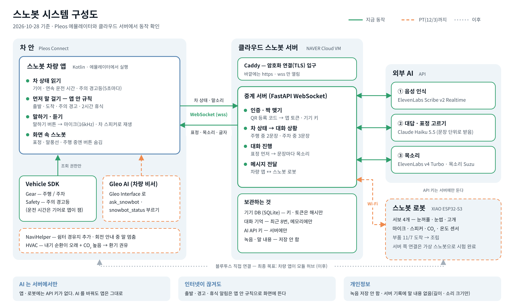

# 기획서 — 접수양식 2장 "앱 프로젝트 소개" 8개 항목 (2026-10-28 개정)

공식 접수양식([contest-application-consent.docx](contest-application-consent.docx)) 2장의 8개 항목 순서 그대로 쓴다. 확정되면 DOCX 칸에 옮긴다.
**2장에는 이름·연락처·소속을 쓰지 않는다**(양식 규칙). 참가: 개인, 일반 부문.
근거 문서: [00 요강](00-contest-rules.md) · [02 리서치](02-research.md) · [04 Pleos SDK](04-pleos-sdk.md) · [05 차량 데이터](05-vehicle-data.md) · [통신·AI 구조](../07-communication-ai.md) · [AI 비교·실측](../10-ai-services.md) · [대화 설계](../11-conversation-design.md)
숫자 중 **(가정)·(목표)·(추정)** 표시가 있는 것은 확인된 사실이 아니다. **(실측)** 은 2026-10-27~28 에 직접 잰 값이다.
검토용 슬라이드: [01-proposal.pptx](01-proposal.pptx)

**10-26 초안에서 바뀐 것**
- 차별점을 "도로를 보는 동승자"(차 상태를 보고 말할 때·길이를 고른다)로 앞에 세웠다 — [대화 설계](../11-conversation-design.md) 결론.
- 실제로 만든 것(대화·차량 데이터·서버)과 실측 지연을 넣었다.
- SDK 계획을 실제 확인 결과로 고쳤다: 차량에서 **실내 CO₂·졸음 수준 값은 받을 수 없다**(→ 모듈 센서·운전 시간·주의 경고등으로), TTS·STT·FusedLocation SDK 는 **"준비 중"**.
- 브랜드 캐릭터 모듈은 사업 모델 표에서 빼고 맨 끝 **번외 "향후 추가 제안"** 으로 옮겼다.
- (사용자 제안, 10-28) **"글레오가 있는데 왜 스노봇인가"** 에 대한 답을 세웠다: 스노봇은 **글레오의 미리보기 실험실** — 차에 바로 넣기엔 검증이 더 필요한 기능을 먼저 경험시키고, 동의한 사용자의 익명 데이터로 효과를 확인해 글레오에 넘긴다(2-1절, 6절).

---

**앱명 / 프로젝트명:** 스노봇(SnowBot) — 도로를 보는 눈사람 동승자

## 1. 앱 한 줄 소개

차의 신호(기어·운전 시간·주의 경고)를 읽고 **말할 때와 길이를 스스로 고르는** 눈사람 동승자. 화면 대신 **표정과 짧은 목소리**로 졸음·공기·주차를 챙기고, 차에서 내리면 **책상 위 로봇으로 이어진다.**

## 2. 기획 배경

**주목한 순간**
- **졸음:** 고속도로 사망사고의 절반 이상이 졸음·전방주시 태만이다(서울시 미디어허브). 서울–춘천 37km 처럼 휴게소가 먼 구간도 있다. 졸음 경고는 일부 고급 트림의 운전자 모니터링 카메라에 기댄다.
- **화면 조작의 위험:** 주행 중 화면을 보고 누르는 것 자체가 주의 분산이다. Pleos 도 주행 중 키보드·설정·영상을 막는다.
- **음성도 공짜가 아니다:** 차량 음성 시스템의 인지 부담은 평균 3.34/5로 라디오(1.2)보다 훨씬 높았다(AAA 재단, Strayer 외 2015). 긴 음성 안내는 단기 기억을 방해한다.
- **그런데 옆자리 동승자와의 대화는 전화보다 덜 위험하다.** 동승자는 도로를 보고 위험할 때 말을 멈추기 때문이다(동승자·통화 비교 연구). → **말할 때를 고르는 것**이 핵심이다.
- **지하주차장 층 기억:** "몇 층에 세웠지?" — 커뮤니티에 폰 기압계로 층을 재는 실험 글까지 있다. 반층·게이트별 층 표기 차이로 위치만으로는 잘 안 된다.
- **차에서 내리면 끝나는 경험:** 차 안 AI 는 하차와 함께 끊긴다.

**왜 지금, 왜 앱 + 모듈인가**
- Pleos Connect 가 전 차종으로 확대된다(2030년 약 2,000만 대 목표). 앱으로 기능을 더할 수 있게 됐다.
- 하지만 **차가 앱에 주는 데이터에는 실내 CO₂·졸음 수준 값이 없다**(Vehicle SDK 확인). 운전 시간·주의 경고등·기어는 있다. → 앱은 차 데이터로 **때를 고르고**, 작은 모듈이 **차에 없는 감각(공기 센서·표정)** 을 채운다.
- 차 안 음성 비서(글레오 AI)는 이미 있다. **글레오는 묻는 말에 답하는 비서, 스노봇은 차 상태를 보고 말할지·얼마나 말할지 정하는 동승자**다. 차량 조작·검색은 글레오, 졸음·공기·주차·"나"에 대한 기억은 스노봇이 맡고, 글레오가 스노봇 기능을 부를 수 있게 한다(Gleo Interface).

### 2-1. 글레오가 있는데 왜 스노봇인가

무엇이든 글레오에 더할 수는 있다. 하지만 **모든 차에 들어가는 글레오는 검증된 기능만 담아야 한다.** 말 거는 때, 휴식 권유의 말투, 새 센서처럼 "효과가 있을지 아직 모르는" 기능은 차에 바로 넣기 어렵다. 스노봇은 그 앞단을 맡는다.

1. **역할이 다르다.** 글레오 = 묻는 말에 답하는 비서, 스노봇 = 차 상태를 보고 말할 때를 고르는 동승자.
2. **글레오의 미리보기 실험실.** 차에 넣기 전 시범 기능을 원하는 사용자에게 먼저 경험시키고, 데이터로 효과를 확인해 **검증된 것만 글레오로 넘긴다.**
3. **차에 없는 감각을 먼저 더한다.** CO₂·카메라 같은 센서를 모듈로 먼저 달아 보고, 쓸모가 증명되면 차에 센서를 넣을 근거가 된다.

**순환:** ① 시범(스노봇에서 새 기능) → ② 데이터(동의한 사용자의 익명 통계) → ③ 검증(효과 있는 것만) → ④ 글레오·차량에 반영 → 다시 ①

| 쌓는 데이터 (동의한 사용자만, 익명) | 예 | 글레오·차량에 주는 것 |
|---|---|---|
| 기능 반응 | 휴식 권유를 받아들였나, 꺼 버렸나, 경유지를 넣었나 | 어떤 권유가 실제로 행동을 바꾸는지 |
| 대화 호흡 | 언제 말 걸면 대답하고 언제 무시했나, 대답 길이·지연·되묻기 | 말 거는 때·길이 기준 (주행 상태별) |
| 추가 센서 | 실내 CO₂·온도 × 운전 시간 × 내기 순환 | 실내 공기 센서·자동 환기의 효과 근거 |
| AI 기능 | 어떤 질문을 하나, 어디서 틀리나 | 글레오에 더할 기능의 우선순위 |

목소리 원본·대화 내용은 저장하지 않는다(지금도 서버 기록에 말 내용 없음). 통계는 사용자가 켠 경우에만, 개인을 알 수 없는 형태로 모은다.

결국 **글레오와 스노봇은 서로를 채운다** — 글레오는 검증된 기능을 모든 차에, 스노봇은 새 기능을 먼저 원하는 사람에게.

## 3. 앱 주요 기능 및 차량 특화 요소

| 기능 | 하는 일 | 차량 특화 (모바일로는 안 되는 이유) | 상태 |
|---|---|---|---|
| **① 상황을 보고 말하는 대화** | 말하기 버튼 → 음성 인식 → AI 대답(표정 + 목소리). **주행 중엔 짧은 두 문장(30자 안팎), 주차 중엔 세 문장까지.** 주의 경고가 켜졌거나 2시간 넘게 달렸으면 무슨 말에든 쉬자는 말이 먼저 | Vehicle SDK 의 기어·경고등(과 기어로 잰 운전 시간)이 **대화의 길이와 내용**을 바꾼다 | ✅ 동작 |
| **② 먼저 말 거는 순간** | 출발 인사, 도착 인사(오래 달렸으면 "푹 쉬어요"), **주의 경고등 → 쉼터 권유**, **2시간째부터 1시간마다 휴식 권유** | 기어 P↔D 전환, 운전자 주의 경고(DRIVER_ATTENTION) — 차에서만 오는 신호. **앱 안 규칙이라 인터넷이 끊겨도 표정·말풍선은 뜬다**(목소리는 지금 서버가 만든다) | ✅ 동작 |
| **③ 표정 동반자** | 화면 속 스노봇(+ 대시보드 위 실물 스노봇)이 눈꺼풀·눈썹·고개로 기분을 보인다(7가지 표정 + 고개 4방향) | 주행 중에는 글 대신 **한눈에 읽히는 표정**. 주행 중에는 시험용 버튼을 숨긴다 | ✅ 화면 / 🔧 실물 제작 중 |
| **④ 공기질 케어** | 모듈 CO₂ 1,500ppm 이상 → 걱정 표정 + 환기 제안. 대화에서 "공기 어때?"에 센서 값으로 답한다 | 차가 주지 않는 실내 CO₂ 를 **모듈 센서**로 더한다 | ✅ 동작(가상 모듈) |
| **⑤ 쉼터 경유지 · 회전 구간 침묵** | "응, 쉼터 넣어 줘" → 경유지 추가. 회전 안내 구간에서는 듣는 표정만 짓고 지나간 뒤 대답 | NaviHelper(경유지 요청·회전 안내) — **"도로를 보는 동승자"** 를 가장 짧게 보여 주는 장면 | PT까지 |
| **⑥ 글레오 연동** | "글레오, 스노봇한테 주차 어디 했는지 물어봐" — 글레오가 스노봇 기능을 부른다 | Gleo Interface(App Schema 등록) | PT까지(시험 가능 여부 확인 중) |
| **⑦ 주차 위치 기억** | 기어 P 순간 위치 저장, 모듈 카메라가 기둥 표지("B3 C-12")를 읽어 층·구역까지 | 기어 P 시점 + FusedLocation(공개 대기) | 이후 |
| **⑧ 집으로 이어짐** | 같은 스노봇이 집 책상에서 대화·알림을 이어 간다 | 스노봇 1대에 차량 앱·폰 앱 여러 개를 짝지을 수 있다 | 🔧 서버 짝 맺기 완료, 대화 이어 가기·폰 앱은 이후 |

**주행 상태별 규칙 (구현)**

| 상태 | 스노봇 |
|---|---|
| 주행 중 (기어 D·R·N) | 짧은 두 문장, 표정 위주, 시험 버튼 숨김 |
| 주의 경고 켜짐 / 2시간 이상 | 쉬자는 말 먼저 (농담을 청해도 "쉼터에서 쉬면서 들려줄게요") |
| 주차 중 (기어 P) | 세 문장까지, 수다·위로 허용 |
| 출발·도착 순간 | 먼저 인사 (말하는 중이면 건너뜀) |

말하는 중에도 안전 알림(주의 경고·휴식)은 하고, 인사는 건너뛴다. 주의 경고는 10분에 한 번, 휴식 권유는 2시간째부터 1시간에 한 번, 공기 알림은 CO₂ 가 1,500ppm 을 넘으면 한 번, 1,200ppm 아래로 내려간 뒤에야 다시 알린다.

## 4. 주요 사용 시나리오

**A. 금요일 밤 퇴근길 (졸음) — 지금 에뮬레이터에서 동작하는 흐름**
1. 기어 D → 스노봇: "출발해요! 오늘도 안전하게 가요." (인사 표정)
2. 2시간째 운전 → 졸린 표정으로 "벌써 2시간째 운전 중이에요. 쉼터에서 잠깐 쉬어 가요."
3. 차가 운전자 주의 경고등을 켬 → 걱정 표정으로 "많이 피곤한가 봐요. 쉼터에서 잠깐 쉬었다 가요."
4. 운전자: "괜찮아, 그냥 갈래." → "주의 경고등이 켜져 있어서 조금 걱정돼요. 다음 쉼터에서 잠깐 쉬어 가요." (주행 중이라 짧게)
5. (PT까지) "응, 쉼터 넣어 줘" → NaviHelper 로 경유지 추가, 스노봇이 끄덕인다.
6. 기어 P → "도착! 오래 운전했으니 푹 쉬어요."

**B. 주차장에서 잠깐 (정차 중 대화)**
- "오늘 회사에서 힘들었어" → 주차 중이라 조금 길게: "오늘 회사에서 많이 힘드셨군요. 잠깐 숨 고르세요. 얘기하고 싶으면 들을게요."
- "아재개그 하나 해줘" → "눈사람이 제일 무서워하는 과일은? 천도복숭아요, 천 도라니까요!"
- "너 글레오보다 똑똑해?" → "글레오는 척척박사 비서고, 저는 옆자리 눈치 담당이에요."

**C. 대형마트 지하주차장 (주차, 이후)**
1. 기어 P → 위치 저장, 모듈 카메라가 기둥 표지를 읽어 "B3 C-12".
2. 장을 보고 와서: "스노봇, 차 어디 있어?" → "지하 3층 C-12예요."
3. 다음 날 아침 책상 위 스노봇: "어제 차는 집 주차장 B1 에 있어요."

**D. 글레오와 함께 (PT까지)**
- "글레오, 스노봇 기분 어때?" → 글레오가 스노봇 기능을 부르고, 스노봇이 웃는 표정과 함께 오늘 주행 요약을 한 문장으로 말한다.

## 5. 개발 계획

**5-1. 지금까지 만든 것 (2026-10-28, 에뮬레이터·서버에서 동작 확인)**

| 부분 | 내용 |
|---|---|
| 차량 앱 (Kotlin, Pleos Connect Emulator) | 짝 맺기(기기 번호 + 등록 코드), 가상 스노봇 표정, 말하기 버튼(마이크 PCM 16kHz), 차 스피커 재생(오디오 포커스 빌리고 돌려주기), **Vehicle SDK(기어·주의 경고등) + 기어로 잰 연속 운전 시간**, 먼저 말 걸기 4종, 주행 중 버튼 숨기기 |
| 클라우드 서버 (FastAPI WebSocket, TLS) | 앱 ↔ 스노봇 중계, 음성 인식 → 대답 → 목소리, 차 상태 반영. 자동 시험 20개 통과 |
| 대화 AI | 음성 인식 ElevenLabs Scribe v2 Realtime → 대답·표정 Claude Haiku 5.5(문장 단위로 흘려 보냄) → 목소리 ElevenLabs v4 turbo. **말이 끝나고 첫 소리까지 보통 1.5초**(17번 실측 중간값, 1.3~2.5초), 글자 확정 0.2~0.35초 ([실측 기록](../12-latency-measurements.md)) |
| 스노봇 시제품 | 3D 설계 완료(눈꺼풀·눈썹·고개 서보 4개), 1차 3D 출력 주문, 부품 11/7 도착 예정 → 조립 |
| 개인정보 | 녹음 저장 안 함, 서버 기록에 말 내용 없음(길이·소리 크기만), 최근 대화 8번만 서버 메모리에 |

**5-2. 구조** (그림 3장: [시스템 구조도](06-system-architecture.md) · 자세히: [통신·AI 구조](../07-communication-ai.md))

- Pleos 차량 앱 ↔ **클라우드 스노봇 서버** ↔ 스노봇 모듈(ESP32-S3). 대화 AI 는 서버에서. 차량 앱은 차 상태를 서버에 알리고, 서버는 그 상태에 맞춰 대답 길이·내용을 정한다.
- **연결 방법 두 가지:** ① 프로토타입 — 스노봇이 Wi-Fi 로 인터넷에 직접(집 공유기·폰 핫스팟) ② 최종 목표 — 스노봇이 차량 앱·폰 앱에 블루투스로 붙어 앱의 인터넷을 빌림(차량 앱이 모듈 허브). 메시지 형식은 하나, 전송 방법만 바꾼다.
- **AI 엔진 바꿔 끼우기:** 인터넷이 있으면 클라우드 AI, 글레오 호출 시 글레오, **인터넷이 없으면 앱 안 규칙**(출발·도착·경고·휴식 한마디 — 이미 구현)과 차 안 음성 엔진(TTS·STT SDK 공개 시)으로 핵심 기능을 유지한다. 차량 LLM 이 앱에 공개되면 그것으로 교체한다.

**5-3. SDK·API 사용 계획**

| SDK / API | 쓰는 곳 | 상태 |
|---|---|---|
| Vehicle SDK — Gear (`registerGearSelection`) | 주행/주차 판단 → 출발·도착 인사, 대화 길이 | ✅ 구현 |
| Vehicle SDK — Odometer (트립 운전 시간) | 연속 운전 시간 → 휴식 권유. 지금은 단위가 문서에 없어 구독만 해 두고, 휴식 권유는 기어가 P 에서 바뀐 순간부터 앱이 잰 시간으로 한다 | 🔧 구독만 (단위 실측 후 사용) |
| Vehicle SDK — Safety (`getTelltalesInfo`, DRIVER_ATTENTION) | 운전자 주의 경고 → 걱정 표정·쉼터 권유 | ✅ 구현(5초 간격 조회) |
| NaviHelper | 쉼터 경유지 추가, 회전 안내 → 말 멈춤, 도착 예정 시각 | PT까지 (신청 불필요) |
| Vehicle SDK — HVAC (내기 순환) | 내기 순환이 오래 + CO₂ 높음 → 환기 권유 | PT까지 |
| AAOS CarUxRestrictions | 주행 규제 상태에 맞춰 화면 요소 줄이기 (지금은 기어로 대신) | PT까지 |
| Gleo Interface | App Schema: `ask_snowbot`, `get_parking_spot`, `snowbot_status` | PT까지 (에뮬레이터 시험 가능 여부 확인 중) |
| TextToSpeech · SpeechToText SDK | 차 안 엔진으로 오프라인 대화 | Pleos "준비 중" → 공개되면 |
| FusedLocation SDK | 주차 위치 저장 | Pleos "준비 중" → 공개되면 |

모든 Vehicle SDK 사용은 조회 권한(`CAR_DRIVE`·`CAR_SAFETY`)만 쓴다 — 매니페스트 선언만으로 되고 별도 신청이 필요 없다.

**5-4. 개발 범위와 일정**

| 시기 | 범위 |
|---|---|
| 접수(11/15)까지 | 지금 상태(5-1) + **시연 영상 + GitHub(소스·APK)** 제출 (가산점) |
| PT(12/3)까지 | NaviHelper 쉼터 경유지·회전 구간 침묵, Gleo App Schema, 주행 규제 대응, 대화 기억("지난번에 피곤하다고 했죠?"), **실물 스노봇과 연결 시연**(에뮬레이터 앱 → 서버 → 실물 로봇) |
| 이후 | 블루투스 연결(차량 앱 = 모듈 허브), 주차 위치, 모듈 규격 공개, 차량 제어 SDK 공개 시 공조 외기 전환 직접 실행 |

## 6. 기대효과 및 발전 가능성

**현대차그룹에 주는 가치**
- 글레오에 넣기 전 **새 기능을 실제 운전자에게 먼저 시험**해 볼 수 있다(2-1절의 순환).
- 차에 센서를 더하기 전, 모듈로 **쓸모를 미리 확인**한다.
- 글레오와 겹치지 않고, Gleo Interface 로 글레오가 스노봇 기능을 부른다.

**사용자 가치**
- 화면을 보지 않고 **표정과 짧은 말**로 상황을 안다. 스노봇은 **위험할 때 말을 줄이고, 쉬어야 할 때 먼저 말한다.**
- 하위 트림에서도 졸음·공기질 같은 **감지 기능**을 모듈로 얻는다.
- 차와 집을 잇는 하나의 동반자 → 매일 쓰는 이유가 생긴다.

**타깃 고객**
1. 출퇴근·장거리 운전이 잦은 Pleos 차량 운전자 (졸음·공기질)
2. 고급 감지 기능이 없는 트림의 차주 (모듈로 기능 확장)
3. 대형마트·아파트 지하주차장을 자주 쓰는 운전자 (주차)
4. (향후) 반려동물·아이 동승 가족

**예상 이용자 (국내, 모두 가정)**

| | 2027년 말 | 2030년 |
|---|---:|---:|
| 국내 Pleos 적용 차량 누적 (가정) | 30만 대 | 200만 대 |
| 앱 설치율 (가정) | 5% | 5% |
| 설치자 중 월 1회 이상 사용 (목표) | 40% | 40% |
| **예상 MAU** | **약 6,000** | **약 40,000** |

- 가정의 바탕: 현대·기아·제네시스 국내 판매 연 약 125만 대(2025년), Pleos Connect 는 2026년 그랜저부터 아반떼·투싼으로 확대, 기아는 2027년부터로 보도됨(미확정), 2030년 글로벌 약 2,000만 대 목표.
- **Retention (목표):** 30일 재사용률 35% 이상. 근거: **출발·도착이라는 매일 반복되는 계기에 스노봇이 먼저 말을 건다**(이미 구현). 앱을 일부러 열 필요가 없게 만드는 것이 목표다(지금 시제품은 앱 화면이 열려 있을 때만 먼저 말을 건다).

**사업 모델**

| 수익원 | 내용 |
|---|---|
| 앱 | 기본 무료 (가상 스노봇, 출발·도착·휴식·경고 기본 기능은 인터넷 없이도 표정·말풍선으로) |
| 모듈 판매 | 스노봇 로봇, CO₂ 센서 태그·카메라 큐브 등. 시제품 부품비 약 13~17만 원 — 양산 단가는 검토 후 |
| 구독 (선택) | AI 대화 무제한, 집 연동, 주행 기록 요약 |
| 모듈 플랫폼 | 공개 모듈 규격 → 다른 하드웨어 업체 참여, 인증·판매 수수료 |
| 시범 기능 협력 | 현대차그룹과 시범 기능 검증·익명 통계 보고 (글레오 반영 후보 선별) |

**운영 비용 (추정)** — 대화 1번(듣기 + 대답 + 목소리) 약 **0.003달러**. 하루 10번 대화하는 사용자는 월 약 0.9달러(약 1,200원), 비용의 대부분은 목소리 합성(2026-10 공개 단가 기준, 지연은 실측). 출발·도착·경고 한마디는 앱 안에 정해 둔 말이라 AI 비용이 들지 않는다. 구독료로 충분히 감당할 수준을 목표로 한다.

**확대 계획**
1. 2027: 국내 Pleos 차량, 스노봇 모듈 + 졸음·공기·주차·글레오
2. 2028: 모듈 규격 공개, 카메라 큐브(펫·아이 동승 케어), 차량 제어 SDK 로 공조 직접 제어, **검증된 시범 기능을 글레오로 이관**
3. 2029~: 해외 Pleos 차량, 집 스마트홈 연동, (번외) 브랜드 캐릭터 모듈

## 7. 참고자료 (선택 · 가산점)

- 앱 화면 (에뮬레이터, 2026-10-28): 출발·2시간 휴식·주의 경고·도착, 농담 대화 — `docs/assets/app/2026-10-28-*.png`
- 스노봇 기준 디자인·설계 그림 — `docs/assets/design-tech/c2-hero.png`, `c2-turnaround.png`
- 시스템 구조도 3장 (2026-10-28) — 구성도 · 대화 처리 순서 · 차 상태 흐름: `docs/assets/architecture/01~03-*.png` ([설명](06-system-architecture.md))
- **시연 영상** (에뮬레이터 화면 + Virtual Console 녹화) — 접수 전 제작
- **GitHub 저장소** (소스 + `apk/` release APK, README 필수 항목) — 접수 전
- 공유 링크·첨부에 이름·계정·서버 주소가 보이지 않게 확인

## 8. 숏폼 링크 (선택)

- 스노봇 실물이 눈을 깜빡이고 고개를 돌리며 "출발해요!" 하는 30초~1분 세로 영상 (#HMG차량용앱개발공모전 #PleosAppMarket) — 실물 조립(11/7~) 후 촬영, 마감 전 가능하면

---

## 번외 — 향후 추가 제안: 브랜드 캐릭터 모듈

본 제안의 범위 밖에서, 같은 기구(눈꺼풀·눈썹·고개)에 **겉모습만 바꾼 캐릭터 봇**을 제안한다. 차량 브랜드의 캐릭터가 대시보드 위에서 같은 방식으로 표정을 짓고 말한다.

| 예시 시안 | 모습 | 그림 |
|---|---|---|
| 현대 — SD 휴머노이드 로봇 | 둥근 헬멧형 머리, 큰 눈 | [../assets/design-brand/hyundai-atlas-sd.png](../assets/design-brand/hyundai-atlas-sd.png) |
| 기아 — SD 호랑이 | 둥근 얼굴, 줄무늬 | [../assets/design-brand/kia-tiger-sd.png](../assets/design-brand/kia-tiger-sd.png) |

- 기대효과: 브랜드 굿즈 + 차량 모듈, 신차 출고 선물·한정판, 캐릭터별 목소리·말투.
- **예시 시안일 뿐이다.** 실제 브랜드 자산·로고·상표 사용은 주최사와 협의를 전제로 한다. 시안에는 로고를 넣지 않았다.
- 자세히: [../08-brand-character-bots.md](../08-brand-character-bots.md)

---

## 제출 전 확인할 것

- [ ] 10/28 설명회 답변(하드웨어 동반 시연, 외부 AI 서버 경유, TTS·STT·Gleo 사용 가능 여부) 반영
- [ ] MAU·Retention·비용 숫자 재검토 (가정 표시 유지)
- [x] 시스템 구조도 그려 7번에 넣기 (2026-10-28)
- [ ] 시연 영상·GitHub 준비 후 7번 링크 채우기
- [ ] 접수양식 DOCX 1장(참가신청서)·3·4장(동의·서명) — 개인 정보는 사용자가 직접
- [ ] 2장 본문·첨부에 이름·소속·서버 주소가 없는지
