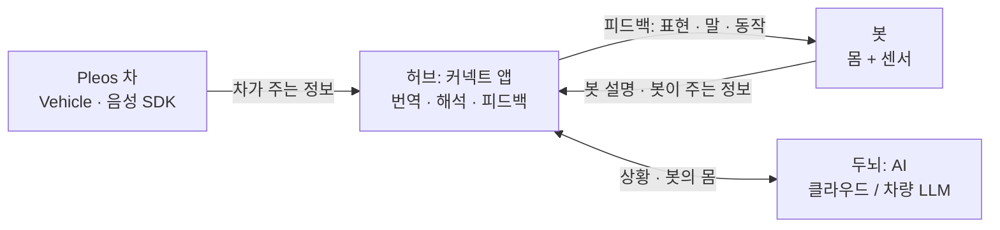
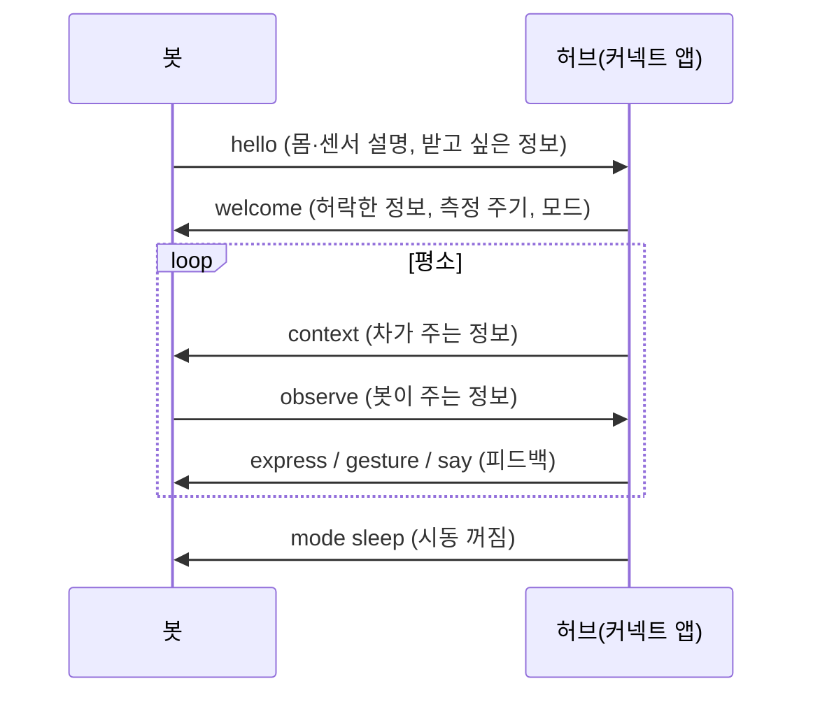
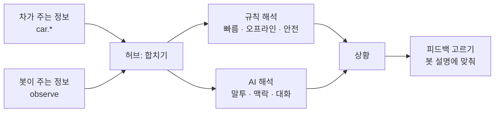

# 봇 커넥트 규약 (Bot Connect Protocol) v0.3 (2026-11-04)

차(Pleos)와 대시보드 위 감성 봇이 **정보와 기능을 주고받는 약속**이다. 모양과 몸이 달라도 이 규약을 지키면 같은 앱(허브)에 붙는다. 스노봇은 이 규약을 따르는 첫 번째 봇이다.
이름은 **봇 커넥트 규약(Bot Connect Protocol, BCP)** 으로 정했다(11/4). 여러 봇을 위한 규약이라 스노봇 이름을 넣지 않았다. 메시지의 버전 필드는 `bcp`. 시연용 두 번째 봇은 **LED 큐브**(얼굴 없이 빛·효과음·습도 센서)다.

규약이 정하는 것은 네 가지다.

| 부분 | 정하는 것 | 절 |
|---|---|---|
| **① 연결** | 봇과 차(허브)가 서로 찾고, 짝을 맺고, 말을 주고받는 길 | 2 |
| **② 봇 설명** | 봇의 몸(눈꺼풀·눈썹·목·LED·스피커·마이크…)과 센서를 허브가 이해하는 형식 | 3 |
| **③ 정보와 해석** | 차가 주는 정보 + 봇이 주는 정보 → 허브와 AI 가 상황으로 해석 | 4, 5 |
| **④ 피드백** | 해석한 상황을 봇의 몸에 맞는 표현·말·동작으로 돌려주는 방법 | 6 |

v0.2에서 바뀐 것: 봇 설명을 감정 목록에서 **몸 부위와 움직일 수 있는 범위**로 넓혔다. 봇이 주는 정보(카메라·습도 등)를 정보 모델에 넣고 **해석 흐름**을 정의했다. 피드백을 의도·몸짓·부위 직접 제어 세 단계로 나눴다. 안전 규칙·성격은 13절 고려사항으로 옮겼다.

---

## 0. 원칙

1. **봇은 몸과 감각을, 허브는 차와 해석을 맡는다.** 봇은 자기 몸으로 표현하고 자기 센서로 느낀다. 허브(Pleos 커넥트 앱)는 차를 읽고, 차와 봇에서 온 정보를 합쳐 해석하고, 피드백을 보낸다. 문장과 미묘한 해석은 AI(두뇌)가 돕는다.
2. **차 데이터는 허브만 읽는다.** Pleos 는 앱만 플랫폼 API 로 차에 접근하게 한다(하드웨어 직접 접근 금지). 봇은 허브가 번역해 준 정보만 받는다.
3. **봇은 차에 없는 감각을 더한다.** 차는 앱에 실내 CO₂·습도·미세먼지 값과 실내 카메라 영상을 주지 않는다([05](05-vehicle-data.md)). 봇의 센서가 그 빈자리를 채운다.
4. **봇의 몸을 설명받아 그 몸에 맞게 피드백한다.** 허브와 AI 는 봇이 선언한 부위와 범위 안에서만 명령한다. 봇을 바꾸면 피드백도 바뀐다.
5. **원본은 봇 안에, 결과만 밖으로.** 카메라·마이크가 있는 봇은 처리한 결과("눈 감김 2초", "B3 C-12")만 보낸다. 원본 영상·소리는 운전자가 따로 허락할 때만.
6. **전송과 상관없다.** 같은 메시지를 블루투스·클라우드·같은 Wi-Fi 로 보낸다.

## 1. 구성과 MCP 대응



| MCP | 이 규약 |
|---|---|
| 서버가 자기 도구(tools)를 설명 | **봇이 자기 몸과 센서를 설명** (3절 봇 설명) |
| 클라이언트가 자원(resources)을 제공 | **허브가 차 정보를 봇이 알아듣는 주제로 제공** (4-1) |
| 서버가 알림을 보냄 | **봇이 관찰 결과를 보냄** (4-2) |
| 모델이 도구 설명을 보고 호출 | **AI 가 봇 설명을 보고 그 몸에 맞는 피드백을 고름** (6절) |
| `initialize` 로 능력 협상 | `hello`(봇 설명) → `welcome`(허락한 정보·적용 규칙) |
| 전송(stdio·HTTP)과 무관 | 블루투스 · 클라우드 · 같은 Wi-Fi |

## 2. 연결

### 2-1. 찾기와 짝 맺기

| 단계 | 방법 |
|---|---|
| 찾기 | 블루투스: 봇이 규약 서비스로 광고, 허브가 목록에 보여 줌. 클라우드: 봇 바닥 QR 의 기기 번호로 찾음 |
| 짝 맺기 | 봇 바닥 QR(기기 번호 + 등록 코드)을 앱에서 찍음 → 허브가 그 봇 전용 토큰을 받음. 봇은 자기 키로 자신을 증명 |
| 자리 정하기 | 처음 연결할 때 봇이 놓인 자리(대시보드 가운데·조수석 쪽·뒷좌석)와 정면 방향을 정한다 → "운전자 쪽 보기"(6-2) 계산에 씀 |
| 여러 대 | 차 1대에 봇 여러 대, 봇 1대에 허브 여러 개(차 앱·폰 앱). 말은 한 번에 한 곳(스피커 봇 하나 또는 차 스피커)으로 |

### 2-2. 전송

| 이름 | 방법 | 쓰는 때 | 상태 |
|---|---|---|---|
| T1 블루투스 | 봇 ↔ 허브 직접. 쓰기 특성 하나 + 알림 특성 하나에 같은 JSON 을 나눠 싣는다 | **차 안 기본** — 봇이 따로 인터넷을 잡지 않아도 됨 | 예정 (에뮬레이터 블루투스 미지원) |
| T2 클라우드 | 허브·봇이 각자 `wss://…/ws` 에 붙고 중계 서버가 건넴. 첫 메시지 `auth` | 프로토타입·심사 시연, 집 | 동작 |
| T3 같은 Wi-Fi | 봇 ↔ 폰 앱 직접 | 집 | 선택 |

### 2-3. 메시지 봉투

모든 메시지는 JSON 객체 하나이고 공통 필드를 가진다.

```json
{ "bcp": "0.3", "type": "observe", "id": 120, "ts": 1793767450123, "bot": "SNW-01-A1B2" }
```

| 필드 | 뜻 |
|---|---|
| `type` | 메시지 종류 (아래 표) |
| `id` | 답이 필요한 메시지의 번호. 받는 쪽이 `ack` 로 같은 `id` 를 돌려준다 |
| `ts` | 보낸 시각(ms). 연결 때 허브 시각에 맞춘다 |
| `bot` | 여러 봇이 있을 때 대상·출처 |

소리는 바이너리로 따로 보낸다(T2: `audio_start` → PCM 16kHz 16비트 모노 조각들 → `audio_end`).

| 방향 | 메시지 |
|---|---|
| 봇 → 허브 | `hello`(봇 설명), `observe`(관찰), `state`(봇 상태), `heard`(봇 마이크로 들은 글자), `ack` |
| 허브 → 봇 | `welcome`, `context`(차 정보), `express`(의도), `gesture`·`pose`(몸짓·부위 제어), `say`·`listen`(말하기·듣기), `action`(고유 동작), `mode`, `ack` |
| 양쪽 | `ping`/`pong`(5초마다, 15초 없으면 끊긴 것으로) |

### 2-4. 세션 순서



- 끊기면: 허브는 화면 속 대역(가상 스노봇)으로 같은 피드백을 이어 가고, 봇은 중립 자세로 기다렸다가 다시 붙으면 `hello` 부터.
- 모드: `drive`(주행) · `park`(주차) · `home`(집) · `sleep`(시동 꺼짐). 봇은 모드에 따라 움직임 크기와 센서 주기를 바꿀 수 있다.

## 3. 봇 설명 (`hello`)

봇은 연결하자마자 **자기 몸과 감각**을 설명한다. 허브와 AI 는 이것만 보고 피드백을 만든다.

### 3-1. 스노봇 예

```json
{
  "bcp": "0.3", "type": "hello",
  "bot": { "id": "SNW-01-A1B2", "model": "SnowBot SNW-01", "maker": "snowbot", "fw": "0.3.0", "name": "스노봇" },
  "place": { "where": "dashboard_center", "facing": "cabin", "power": "usb" },
  "parts": [
    { "id": "eyelid", "kind": "eyelid", "count": 2, "axes": { "open": [0, 1] }, "fastest_ms": 120 },
    { "id": "brow",   "kind": "brow",   "count": 2, "axes": { "lift": [-1, 1], "tilt": [-1, 1] } },
    { "id": "head",   "kind": "neck",   "axes": { "pan": [-40, 40], "tilt": [-15, 20] }, "unit": "deg", "max_dps": 120 },
    { "id": "spk",    "kind": "speaker", "voice": "hub_stream" },
    { "id": "mic",    "kind": "microphone", "listen": "hub_stream" }
  ],
  "sensors": [
    { "id": "env", "measures": [ { "name": "co2", "unit": "ppm" }, { "name": "temp", "unit": "C" } ], "period_s": 10 }
  ],
  "expressions": {
    "emotions": ["neutral", "happy", "greet", "worried", "sleepy", "alert", "guard"],
    "gestures": ["nod", "shake", "look_left", "look_right", "look_up", "look_down"]
  },
  "actions": [],
  "wants": ["car.motion", "car.cabin", "car.warning", "driver.state", "trip"]
}
```

### 3-2. 몸 부위 (`parts`)

| `kind` | 축과 범위 | 예 |
|---|---|---|
| `eyelid` | `open` 0(감음)~1(뜸) | 졸린 표정, 깜빡임 |
| `brow` | `lift` -1(내림)~1(올림), `tilt` -1(안쪽 내림=화남)~1(바깥 내림=걱정) | 걱정·놀람 |
| `neck` | `pan` 좌우(도), `tilt` 상하(도), `max_dps` 최대 속도 | 운전자 쪽 보기, 끄덕임 |
| `light` | `leds` 개수, `color` rgb, `patterns` (solid·breathe·blink·spin) | 감정 색, 알림 |
| `screen` | `size`, `face` 그리기 가능 여부 | 화면 얼굴 봇 |
| `speaker` | `voice`: `hub_stream`(허브가 소리를 만들어 보냄) / `bot_tts`(글자를 받아 봇이 읽음) / `chime`(효과음만) | 말하기 |
| `microphone` | `listen`: `hub_stream`(소리를 허브로) / `bot_stt`(봇이 글자로 바꿔 보냄) | 듣기 |
| `motor` 등 | 제조사가 `x-회사.이름` 으로 더함 | 귀·꼬리·팔 |

범위는 봇마다 다르다. 허브는 선언된 범위를 넘는 값을 보내지 않고, 봇은 넘는 값이 오면 범위 안으로 자른다.

### 3-3. 센서 (`sensors`)

| `id` 예 | 측정 | 비고 |
|---|---|---|
| `env` | co2(ppm) · temp(°C) · humidity(%) · pm2_5(µg/m³) · light(lux) | 차에 없는 실내 공기 정보 |
| `vision` | 결과만: `face_present` · `eyes_closed` · `yawn` · `gaze_off` · `pet` · `child` · `object_left` · `sign_text` | 원본 영상은 보내지 않음. `view`: cabin_driver / rear / exterior |
| `audio_event` | 결과만: `baby_cry` · `bark` · `siren` | 원본 소리는 보내지 않음 |
| `touch` | 머리·버튼 | 쓰다듬기, 확인 |
| `imu` | 기울어짐·넘어짐·충격 | 봇이 떨어졌는지 |

### 3-4. 몸이 다른 봇 예: LED 큐브 (시연용 가상 봇)

```json
{
  "bcp": "0.3", "type": "hello",
  "bot": { "id": "LED-01-0001", "model": "LED Cube (sim)", "maker": "demo", "fw": "sim", "name": "큐브" },
  "place": { "where": "dashboard_right", "facing": "cabin", "power": "usb" },
  "parts": [
    { "id": "ring", "kind": "light", "leds": 12, "color": "rgb", "patterns": ["solid", "breathe", "blink", "spin"] },
    { "id": "buzz", "kind": "speaker", "voice": "chime" }
  ],
  "sensors": [
    { "id": "env", "measures": [ { "name": "humidity", "unit": "%" }, { "name": "temp", "unit": "C" } ], "period_s": 10 }
  ],
  "expressions": { "emotions": ["neutral", "happy", "worried", "alert", "sleepy"], "gestures": [] },
  "actions": [ { "id": "glow", "params": { "color": "string", "pattern": "string" } } ],
  "wants": ["car.motion", "car.cabin"]
}
```

## 4. 정보 모델: 누가 무엇을 주는가

### 4-1. 차가 주는 정보 (허브 → 봇·AI, `context`)

허브가 Pleos SDK 로 읽은 신호를 **봇이 알아듣는 주제**로 바꾼다. 봇은 `welcome` 에서 허락받은 주제만 받는다.

| 주제 | 데이터 | Pleos 출처 | 상태 |
|---|---|---|---|
| `car.motion` | 기어, 연속 운전 분, (속도) | Gear, 앱이 잰 시간, (AAOS 차속) | 허브 안 동작 |
| `car.busy` | 운전이 바쁜 정도 0~3 | TurnSignal · SteeringWheel · Gear(R) · Wiper · Light · DrivingMode | 허브 안 동작 |
| `car.warning` | 켜진 경고등: 종류, 상태(ON/BLINK), 급함, 사람 말 설명 | Safety 경고등 37종 | 계획 (에뮬레이터 조회 권한 오류 확인 중) |
| `car.cabin` | 문·창문 열림, 내기 순환, 설정 온도·실내 온도, 탑승 좌석·안전벨트 | Door · Window · HVAC · Seat | 계획 |
| `car.outside` | 비(와이퍼), 밤(전조등), (바깥 온도) | Wiper · Light · (AAOS) | 허브 안 동작 |
| `car.energy` | 주행 가능 거리, 연료·배터리 | Odometer · Fuel · EvBattery | 계획 |
| `trip` | 출발 · 도착 · (휴게소 진입) | Gear P↔D, (NaviHelper) | 허브 안 동작 |
| `driver.state` | 주의 경고, 피로 0~3(허브가 합친 값) | Safety DRIVER_ATTENTION + 운전 시간 + 봇 관찰 | 일부 |

위치는 기본으로 주지 않는다. "허브 안 동작"은 허브가 이미 판단에 쓰지만 아직 `context` 로 봇에 보내지는 않는다는 뜻이다.

### 4-2. 봇이 주는 정보 (봇 → 허브, `observe` · `state`)

```json
{ "bcp": "0.3", "type": "observe", "sensor": "env", "data": { "co2": 1620, "temp": 27.5, "humidity": 78 } }
{ "bcp": "0.3", "type": "observe", "sensor": "vision", "data": { "kind": "eyes_closed", "ms": 1800, "conf": 0.86 } }
{ "bcp": "0.3", "type": "observe", "sensor": "vision", "data": { "kind": "object_left", "where": "rear_seat", "conf": 0.7 } }
{ "bcp": "0.3", "type": "state", "data": { "battery": null, "temp_c": 52, "tilted": false } }
```

`state` 는 봇 자신의 상태다. 대시보드 위는 여름에 뜨거워지므로 봇 온도(`temp_c`)와 넘어짐(`tilted`)을 알린다.

## 5. 해석: 정보를 상황으로

허브는 차 정보와 봇 정보를 합쳐 **상황**을 만든다. 안전과 바로 관련된 것은 허브의 규칙이 정해진 대로 빠르게(인터넷 없이) 판단하고, 말투·미묘한 해석은 AI 가 돕는다.



**상황** 형식 (허브 안, AI 에 주는 값):

```json
{ "situation": "fog_risk", "severity": "guide", "evidence": ["obs.env.humidity=78", "car.cabin.recirc=true", "car.outside.night=true"],
  "suggest": "외기로 바꾸거나 에어컨 켜기" }
```

| 차 정보 | 봇 정보 | 해석 (상황) | 피드백 예 (스노봇) |
|---|---|---|---|
| 내기 순환 30분 이상 | CO₂ 1,500ppm 이상 | `stuffy` 답답함 → 졸음 위험 | 졸린 표정 + "공기가 답답해요. 외기로 바꿔 볼까요?" |
| 창문 닫힘, 비(와이퍼), 밤 | 습도 75% 이상 | `fog_risk` 앞유리 김서림 우려 | 걱정 표정 + "유리에 김 서릴 것 같아요. 에어컨 켜 볼까요?" |
| 주행 중, 운전 90분 | 눈 감김 1.5초 이상 | `drowsy` 졸음 | 놀란 눈 + 운전자 쪽 보기 + "잠깐! 졸리면 쉬었다 가요." (급함 최고) |
| 경고등 TIRE_PRESSURE 켜짐 | — | `warning_tire` | 걱정 표정 + "타이어 바람이 빠졌대요. 다음 휴게소에서 봐요." |
| 도착(P), 뒷좌석 탑승했었음 | 뒷좌석 물건 | `item_left` | 뒤돌아보기 + "뒷자리에 가방 있어요." |
| 주차 중, 실내 온도 높음 | 봇 온도 55°C | `bot_hot` | 처진 눈 + (폰 알림) "차 안이 너무 뜨거워요." |
| 출발, 안전벨트 미착용 좌석 | — | `belt_open` | 고개 끄덕 + "뒷자리 벨트 아직이에요." |

봇이 바뀌면 같은 상황이라도 피드백이 바뀐다. LED 큐브라면 `fog_risk` 는 주황빛 숨쉬기와 짧은 효과음이다.

## 6. 피드백: 봇의 몸에 맞게 돌려주기

피드백은 세 단계다. 봇은 **1단계는 반드시** 처리하고, 2·3단계는 선언한 부위만 처리한다.

| 단계 | 메시지 | 허브가 정하는 것 | 봇이 정하는 것 |
|---|---|---|---|
| 1 의도 | `express` | 감정·강도·이유 | 어느 부위를 어떻게 움직일지 전부 |
| 2 몸짓 | `gesture` | 정해진 몸짓 이름 또는 짧은 순서 | 몸짓을 자기 속도로 |
| 3 부위 직접 | `pose` | 부위별 목표값과 시간 | 범위 자르기, 부드럽게 잇기 |

### 6-1. 의도 (`express`)

```json
{ "bcp": "0.3", "type": "express", "emotion": "worried", "intensity": 0.7, "reason": "fog_risk", "hold_ms": 4000 }
```

공통 감정 어휘 (봇은 최소 `neutral`·`happy`·`worried`·`alert` 를 표현해야 한다):

| 감정 | 쓰는 때 | 스노봇 | LED 큐브 |
|---|---|---|---|
| `neutral` | 기본 | 눈 보통, 정면 | 흰빛 은은하게 |
| `happy` | 기쁨, 도착 | 눈웃음, 눈썹 올림 | 노란빛 밝아짐 |
| `greet` | 인사, 출발 | 눈웃음 + 끄덕 | 노란빛 두 번 깜빡 |
| `worried` | 걱정, 경고등, 답답함 | 눈썹 처짐 | 주황빛 숨쉬기 |
| `sleepy` | 졸림, 오래 운전 | 눈꺼풀 내림 | 파란빛 느리게 |
| `alert` | 놀람, 급한 알림, 듣는 중 | 눈 크게, 눈썹 올림 | 흰빛 빠르게 깜빡 |
| `guard` | 삐짐(장난) | 눈 가늘게, 고개 돌림 | 보랏빛 |

없는 감정이 오면 봇이 가까운 것으로 바꾼다(`greet`→`happy`, `sleepy`·`guard`→`neutral`).

### 6-2. 몸짓 (`gesture`)과 보기 방향

```json
{ "bcp": "0.3", "type": "gesture", "name": "nod" }
{ "bcp": "0.3", "type": "gesture", "name": "look", "at": "driver" }
{ "bcp": "0.3", "type": "gesture", "steps": [ { "part": "head", "pan": -30, "ms": 300 }, { "part": "head", "pan": 0, "ms": 400 } ] }
```

`look` 의 `at` 은 `driver` · `passenger` · `rear` · `road` · `center`. 봇은 2-1의 자리 정보로 각도를 계산한다. 같은 "운전자 쪽 보기"도 대시보드 가운데 봇과 조수석 쪽 봇은 다른 각도가 된다.

### 6-3. 부위 직접 (`pose`)

```json
{ "bcp": "0.3", "type": "pose", "targets": { "eyelid.open": 0.4, "brow.tilt": 0.6, "head.tilt": -8 }, "ms": 500 }
{ "bcp": "0.3", "type": "pose", "targets": { "ring.color": "#FF8A00", "ring.pattern": "breathe" }, "ms": 0 }
```

### 6-4. 말하기·듣기 (`say` · `listen`)

```json
{ "bcp": "0.3", "type": "say", "id": 41, "text": "유리에 김 서릴 것 같아요. 에어컨 켜 볼까요?", "urgency": "guide" }
{ "bcp": "0.3", "type": "listen", "id": 42, "max_ms": 8000 }
```

- `say`: 봇의 `speaker.voice` 에 따라 허브가 소리를 보내거나(`hub_stream`), 글자만 보내거나(`bot_tts`), 효과음만 낸다(`chime`). 스피커가 없으면 차 스피커(Pleos TTS)로.
- `listen`: 차 안에서는 보통 차의 마이크(Pleos STT)로 듣는다. 봇 마이크로 들을 때는 봇이 소리를 보내거나(`hub_stream`) 글자(`heard`)를 보낸다.

### 6-5. AI 에 봇의 몸 알려 주기

허브는 연결된 봇의 `parts`·`expressions`·`actions` 를 AI 가 고를 수 있는 **도구 목록**으로 바꿔 준다(MCP 에서 도구 설명이 모델에게 가는 것과 같다). 예: 스노봇이 붙어 있으면 AI 는 "눈썹을 내리고 운전자 쪽을 본다"를, LED 큐브만 있으면 "주황빛으로 숨쉰다"를 고른다.

## 7. 허락 (`welcome`)

```json
{ "bcp": "0.3", "type": "welcome", "hub": "Pleos Connect", "granted": ["car.motion", "car.cabin", "trip"],
  "denied": ["driver.state"], "mode": "drive", "observe_period_s": { "env": 10 } }
```

- 운전자는 앱에서 봇마다 **받는 정보**를 보고 끌 수 있다(앱 권한과 같은 방식). 예: "이 봇은 운전 상황·실내 상태를 받습니다. 위치는 받지 않습니다."
- 카메라·마이크 결과를 보내는 봇은 연결할 때 운전자가 따로 허락해야 한다.

## 8. 확장과 버전

- 새 부위·센서·감정은 규약 버전을 올려 더한다.
- 제조사 고유 기능은 `x-회사.이름`(예: `x-snowbot.scarf_wave`)으로 선언한다. 허브는 몰라도 AI 에 이름과 설명을 넘길 수 있다.
- v0.2 호환: `express` 의 `expr`(= `emotion`)·`head`(= `gesture`), `event`(= `observe`), `capabilities`(= `parts`·`sensors`)를 계속 받아들인다.

## 9. 적합성 시험 (봇 시험기)

봇을 만드는 사람이 규약을 지키는지 스스로 확인하는 도구(MCP Inspector 같은 것).

| 항목 | 통과 기준 |
|---|---|
| 봇 설명 | 필수 필드, 부위 범위, 최소 감정 4개 |
| 의도 | 7가지 감정에 모두 `ack`, 없는 감정은 바꿔서 표현 |
| 몸짓·부위 | 선언한 몸짓 실행, 범위 밖 값은 잘라서 처리 |
| 관찰 | 선언한 주기대로 `observe`, 단위 일치 |
| 연결 | `ping` 응답, 끊었다 다시 붙으면 `hello` 부터 |
| 반응 시간 | `express` → `ack` 300ms 안 (목표) |

## 10. 지금 구현 (2026-11-04)

| 부분 | 상태 |
|---|---|
| 연결 T2 클라우드, QR 짝 맺기, 봇 여러 대·허브 여러 개 | 동작 (`server/`) |
| 봇 설명 | v0.1 `hello`(감정·고개 목록, 센서) 동작. v0.3 부위·범위·자리는 계획 |
| 차가 주는 정보 | 허브 안에서 기어·운전 시간·바쁜 정도·비·밤 판단 동작. `context` 로 봇에 보내기는 계획 |
| 봇이 주는 정보 | CO₂·온도 `event` 동작(가상 스노봇). 습도·카메라 결과는 계획 |
| 해석 | 규칙: 출발·도착·휴식·주의 경고·CO₂. AI: 대화 대답 + 표정 고르기 |
| 피드백 | 1단계 의도(`express` expr·head) 동작. 2·3단계, `look at` 은 계획 |
| 화면 속 대역 | 동작 |

## 11. 구현 계획 (11/15 접수까지)

| 날짜 | 할 일 |
|---|---|
| 11/6~7 | 봇 설명 v0.3(`parts`·`sensors`·`place`)과 `welcome`, `context` 주제 보내기, `observe`(v0.2·v0.1 호환). 가상 스노봇을 v0.3 으로 |
| 11/7~8 | 해석 규칙 3가지(`stuffy`·`fog_risk`·`warning_*`)와 상황 → 피드백, AI 에 봇 설명 넘기기, 두 번째 가상 봇 LED 큐브(습도 센서 포함), 앱 "연결된 봇" 화면 |
| 11/8 | 봇 시험기(최소 항목) |
| 11/9~10 | 시연 영상: 같은 상황에 스노봇·LED 큐브가 각자 몸으로 반응 |
| 11/13~14 | GitHub 에 규약 문서·가상 봇·시험기 공개(심사용 비공개 저장소) |

## 12. 열린 항목

- 블루투스 서비스·특성 UUID, 나눠 싣기 크기, 재연결
- 봇 인증 제도, 펌웨어 업데이트
- 소리 형식(지금 PCM 16kHz → 압축 검토)
- 카메라 결과 항목의 표준 목록과 정확도 표시 방식

## 13. 추가 기능 고려사항

핵심 규약이 끝난 뒤 더할 것들이다. 지금은 방향만 적어 둔다.

- **안전 규칙:** 운전이 바쁜 순간(차선 변경·회전)에는 허브가 봇에 조용히 하라고 알리고(`quiet`), 급한 정도(안전 > 안내 > 재미)로 피드백 순서를 정한다. 허브에는 판단 기능이 이미 있다(11/4, [07](07-dev-plan.md)).
- **말수·성격:** 운전자가 봇의 말수와 성격을 고르는 옵션.
