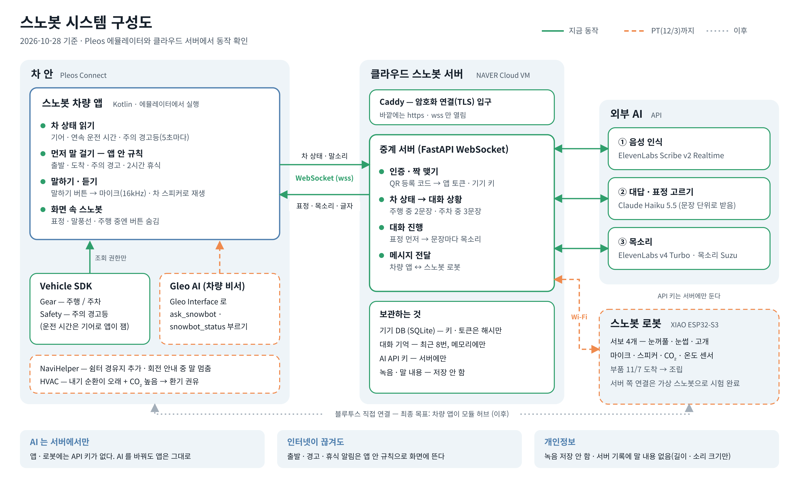
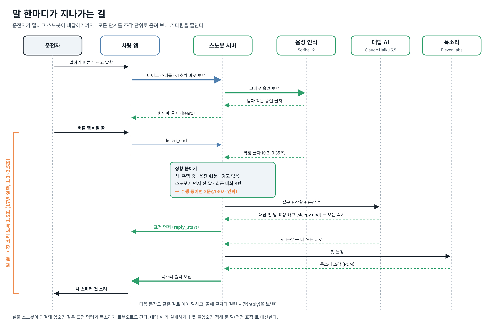
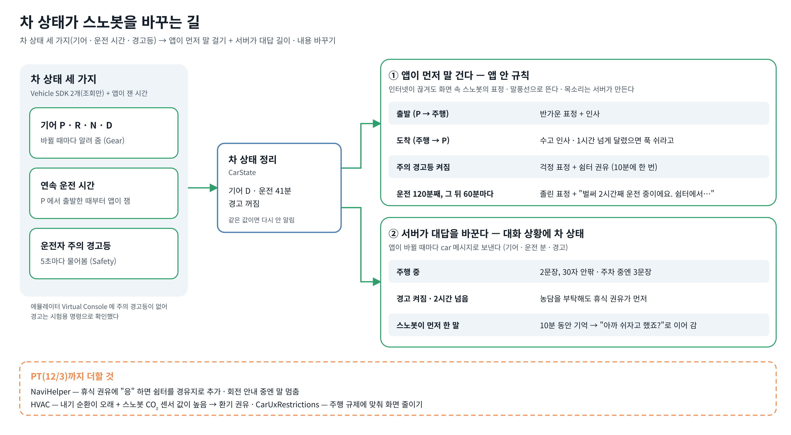

# 시스템 구조도 (2026-10-28)

기획서 5-2절·7번(참고자료)과 GitHub README 에 넣는 그림 3장. 지금 코드(서버 `server/`, 앱 `app/`)에서 실제로 동작하는 것만 실선으로 그렸다.
그림 선의 뜻: **초록 실선 = 지금 동작**, **주황 점선 = PT(12/3)까지**, **회색 점선 = 이후**.

| 그림 | 파일 | 보여 주는 것 |
|---|---|---|
| 1. 시스템 구성도 | [01-system-overview.png](../assets/architecture/01-system-overview.png) | 차 안(차량 앱·Vehicle SDK·Gleo) ↔ 클라우드 서버 ↔ 외부 AI · 스노봇 로봇 |
| 2. 말 한마디가 지나가는 길 | [02-conversation-flow.png](../assets/architecture/02-conversation-flow.png) | 말하기 버튼 → 음성 인식 → 상황 붙이기 → Claude → 목소리, 걸린 시간 |
| 3. 차 상태가 스노봇을 바꾸는 길 | [03-car-data-flow.png](../assets/architecture/03-car-data-flow.png) | 기어·운전 시간·주의 경고 → 앱이 먼저 말 걸기 + 서버가 대답 길이 바꾸기 |

[기획서 PPT](01-proposal.pptx) 에는 1번이 15장 "전체 구성 한눈에"로 들어가 있다.

**발표용 PPT (8장):** [06-system-architecture.pptx](06-system-architecture.pptx) — 그림 3장을 PPT 도형으로 다시 그려 글자를 키웠다(편집 가능).
표지 · 한눈에 · 서버 안쪽 · 말 한마디가 지나가는 길 · 걸린 시간 · 차 상태 흐름 · 구조로 지키는 세 가지 · 진행 상태.
아이콘은 NAVER Cloud Platform 공식 서비스 아이콘과 Pleos UI 디자인 가이드 아이콘을 썼다(출처: [vendor/README.md](../assets/architecture/vendor/README.md)).
다시 만들기: [`../assets/architecture/build-deck.js`](../assets/architecture/build-deck.js) (pptxgenjs · react-icons · sharp 필요).

## 1. 시스템 구성도

- **차량 앱**이 Vehicle SDK 에서 차 상태를 읽고(조회 권한만), 서버에 WebSocket(wss)으로 붙는다.
  올려 보내는 것: 차 상태(`car`), 말소리(PCM). 받는 것: 표정, 목소리, 받아 적은 글자.
- **서버**는 Caddy 가 암호화 연결을 받고, 안쪽 중계 서버(FastAPI)가 짝 맺기·대화·메시지 전달을 한다. AI API 키는 서버에만 있다.
- **스노봇 로봇**은 같은 서버에 Wi-Fi 로 붙는다. 서버 쪽은 가상 스노봇(`server/tools/sim.py device`)으로 시험했고, 실물은 부품(11/7) 도착 뒤 조립한다.
- **블루투스 직접 연결**(차량 앱이 모듈 허브)은 최종 목표다. 에뮬레이터가 블루투스를 지원하지 않아 이후로 둔다.

## 2. 말 한마디가 지나가는 길

- 말하는 동안 소리를 0.1초씩 바로 보내고, 음성 인식도 듣는 동안 받아 적는다. 그래서 버튼을 떼면 0.2~0.35초 안에 글자가 확정된다.
- 서버가 차 상태·스노봇이 먼저 한 말·최근 대화 8번을 붙여 Claude 에 보낸다. 주행 중이면 2문장으로 줄인다.
- Claude 대답 맨 앞의 표정 태그(`[happy nod]` 같은)가 오면 바로 표정을 먼저 보내고, 문장이 하나 끝날 때마다 그 문장의 목소리를 만들어 흘려 보낸다. **말 끝 → 첫 소리 보통 1.5초**(17번 실측 중간값, 1.3~2.5초 — [기록](../12-latency-measurements.md)).

## 3. 차 상태가 스노봇을 바꾸는 길

- 앱 안 규칙(출발·도착·주의 경고·2시간 휴식)은 서버 없이 앱이 정한다. 인터넷이 끊겨도 화면 속 스노봇 표정·말풍선은 뜬다. 목소리만 서버가 만든다.
- 에뮬레이터 Virtual Console 에는 주의 경고등(DRIVER_ATTENTION)이 없어서, 경고는 디버그 명령으로 시험했다([05-vehicle-data.md](05-vehicle-data.md)).

## 고치는 법

그림은 SVG 를 코드로 그린다: [`../assets/architecture/build.js`](../assets/architecture/build.js).
글자·위치를 바꾸고 `sharp@0.33.5` 가 설치된 곳에서 `node build.js docs/assets/architecture` 로 다시 만든다(Noto Sans CJK KR 글꼴 필요). PNG 는 2배 크기(3200px 폭)다.
서버 주소·이름·계정은 그림에 넣지 않는다(공모전 개인정보 안내).
