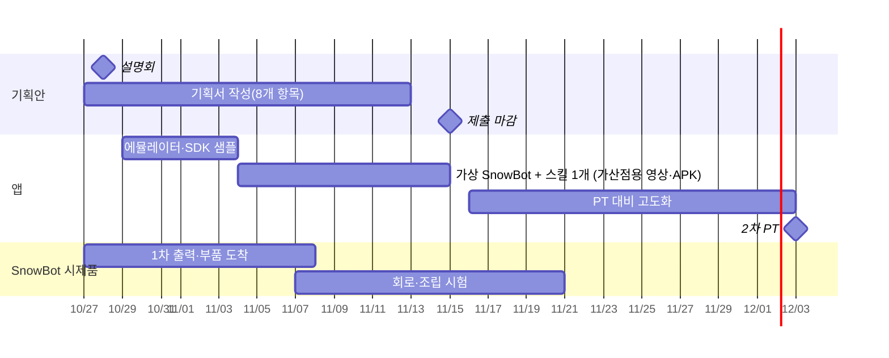

# SnowBot × Pleos 공모전

SnowBot 을 **현대차·기아 차량용 앱 개발 공모전**(Pleos Playground)과 묶어 진행한다.
공모전 마감이라는 날짜가 생기면 SnowBot 제작도 일정에 맞춰 밀고 나가기 쉽다(사용자, 2026-10-26).

- 출처: claude.ai 대화에서 정리한 인계 묶음 `snowbot-pleos.zip` (2026-10-26 받음). 내용은 이 폴더 문서로 옮겼다.
- 공식 홈페이지: https://appdevchallenge.auto-hmg.io
- 참가자: 꼉태 (PHP 백엔드 개발자, 서버 운영 경험). 차량 앱(Kotlin/Android, AAOS)은 처음 해 보는 영역
- **참가 단위: 개인 (사용자 결정, 2026-10-26).** 부문은 일반(스타트업 포함)
- 기기 간 통신·AI 처리 구조: [../07-communication-ai.md](../07-communication-ai.md) — BLE 대신 서버 경유 네트워크 연결

## 일정 (공식 요강 기준, 2026-10-26 확인 → [00-contest-rules.md](00-contest-rules.md))

| 날짜 | 할 일 | 남은 날 (2026-10-26 기준) |
|---|---|---|
| 10-28(수) 오후 | 온라인 설명회 (질의응답 — 하드웨어 동반 시연 질문) | 2일 |
| **11-15(일) 23:59** | **접수양식(=기획서) 이메일 제출 마감.** 시연 영상·GitHub(APK) 함께 내면 가산점 | 20일 |
| 11-23(월) | 1차 서류 결과 (20팀) | |
| **12-03~04** | **2차 오프라인 PT + 동작하는 앱 시연(에뮬레이터 또는 기기)** — 서울 강남대로사옥 | 약 5주 |
| 12-18(금) | 최종 10팀 발표 | |
| 2027-02 | 행사 전시·시상식 (선정 시 현장 참석·APK 제출 의무) | |

## 문서

| 문서 | 내용 |
|---|---|
| [00-contest-rules.md](00-contest-rules.md) | **공식 요강 정리** — 일정·제출·심사 기준·접수양식 8개 항목·개발 환경·유의사항·우리 계획에 미치는 영향·사무국 문의 초안 |
| [04-pleos-sdk.md](04-pleos-sdk.md) | **Pleos 개발 문서 확인** — 지금 SDK(Vehicle·NaviHelper·STT·TTS·FusedLocation·Gleo Interface), LLM SDK 없음, 에뮬레이터 BT 미지원, 시동 OFF=Suspend, 기획에 미치는 영향 |
| [contest-application-consent.docx](contest-application-consent.docx) | 공식 접수양식(=기획서 양식) 원본 |
| [01-proposal.md](01-proposal.md) | **기획서 초안 (2026-10-26)** — 접수양식 2장 8개 항목 순서. 사업성 숫자는 가정·목표로 표시 |
| [01-proposal.pptx](01-proposal.pptx) | **기획서 검토용 PPT 21장** — 만드는 코드 [deck/build-proposal.js](deck/build-proposal.js), 사진 `deck/img/` |
| [review-2026-10-28.md](review-2026-10-28.md) | **기획서·구조 문서 검증 (2026-10-28)** — 코드·요강과 대조, 사실 오류 10곳 고침, 남은 제안 |
| [../12-latency-measurements.md](../12-latency-measurements.md) | **응답 시간 실측 기록** — 말 끝 → 첫 소리 보통 1.5초(17번), 글자 확정 0.2~0.35초 |
| [02-research.md](02-research.md) | 공모전 정보, Pleos SDK 조사, 커뮤니티 불편 조사, 현대차 기존 기능, 출처 (2026-10-24~26 조사) |
| [03-module-protocol.md](03-module-protocol.md) | 모듈 ↔ 앱 연동 규격 초안 v0.1 (기능 선언 `hello`, 센서 이벤트, 표정 명령 `express`) |
| [05-vehicle-data.md](05-vehicle-data.md) | 차량 데이터 3가지(SDK 기어·주의 경고 + 앱이 잰 운전 시간) 구현과 Virtual Console 시험법 |
| [06-system-architecture.md](06-system-architecture.md) | **시스템 구조도 3장 (2026-10-28)** — 구성도 · 대화 처리 순서 · 차 상태 흐름 |
| [06-system-architecture.pptx](06-system-architecture.pptx) | **시스템 구조 발표용 PPT 8장** — NCP · Pleos 공식 아이콘, 도형으로 다시 그림(편집 가능) |

## 확정된 방향 (claude.ai 대화에서 합의)

1. **앱 단독으로는 안 된다.** 화면 속 음성 AI 캐릭터는 현대차 글레오 AI(페르소나 AI 포함)와 겹친다. 심사에서 "이미 있는 기능인데 굳이?"가 된다.
2. **모듈이 있어야만 되는 가치**를 중심에 둔다.
   - 차가 앱에 주지 않는 감각(카메라 영상, CO₂, 뒷좌석 온도 등)을 외부 모듈이 채운다.
   - 고급 트림에만 있는 센서 기능(운전자 모니터링, 실내 모니터링)을 모든 Pleos 차량에 싸게 준다.
   - 차에서 떼어 집·캠핑에서도 쓰는 하나의 동반자.
   - 화면을 보지 않아도 되는 표정·고개 표현.
3. **SnowBot 은 레퍼런스 디바이스(규격을 처음 구현해 보이는 기준 장치) 하나일 뿐이다.** 카메라·센서 등 어떤 모양이든 같은 규격이면 연결된다.
4. **앱 = "Pleos 모듈 허브" 플랫폼.** 모듈이 자기 기능을 알려 주면 앱이 맞는 스킬을 켠다. 다른 회사 하드웨어도 참여할 수 있다.
5. **모듈 없이도 기본 동작한다.** 심사가 에뮬레이터 시연일 수 있으므로 앱 화면 안에 가상 SnowBot 을 둔다.

## SnowBot 현재 설계와 맞춰 볼 점 (Claude 검토, 2026-10-26)

> **사용자 결정 (2026-10-26): SnowBot 은 테이블용으로 먼저 만든다. 아래 차량용 보완은 공모전 합격 뒤에 진행한다.**
> 기획안에는 차량용 계획으로 적고, 시연은 테이블용 SnowBot + 앱 화면의 가상 SnowBot 으로 한다.

공모전 문서는 SnowBot 이 **차 안에서** 쓰인다고 본다. 지금 설계(`../01-concept.md`, `../03-parts-list.md`)는 **책상 위 + Mac 중계**가 기준이라 아래가 달라진다.
확인 안 한 부분은 "확인 필요"로 적었다.

| 항목 | 지금 설계 (책상) | 차 안에서 필요한 것 | 판단 |
|---|---|---|---|
| 통신 | XIAO ESP32S3 ↔ Mac 을 Wi-Fi·WebSocket 으로 연결 | 차 안에는 Mac 이 없다. Pleos 앱과 BLE(저전력 블루투스)로 연결 | XIAO ESP32S3 는 BLE 를 지원하므로 **보드는 그대로**. 펌웨어에 BLE 연결 기능을 추가한다. 집에서는 Wi-Fi·Mac 경로를 그대로 쓴다 |
| 음성 (듣기·말하기) | 로봇 마이크 → Mac → 클라우드 STT·LLM·TTS → 로봇 스피커 | Gleo AI SDK(차의 STT·TTS·LLM)를 쓴다 | BLE 는 전송이 느려 음성을 실시간으로 주고받기 어렵다. **차 안에서는 차 마이크·차 스피커를 쓰고, SnowBot 은 표정만 맡는 쪽**이 간단하다. 프로토콜의 `say` 를 어디서 재생할지 정해야 한다 |
| 카메라 | 사진을 Mac 으로 보내 클라우드 AI 가 본다 | 프로토콜은 "모듈 안에서 처리한 결과만 보낸다"가 기본 | ESP32-S3 안에서 얼굴 찾기 정도는 알려진 예제가 있다. 그러나 **졸음 판단·기둥 글자 읽기("B3 C-12")를 보드 안에서 하는 것은 어렵다(확인 필요).** 대안: 사진 한 장만 BLE 로 앱에 보내 앱에서 읽는다 |
| CO₂·온도 센서 | 없음 | 졸음·공기질 시나리오(S3)에 CO₂ 센서 필요 | **부품 추가 필요.** CO₂·온습도를 같이 재는 센서(예: SCD40 계열, I2C 연결)를 알아본다. 아직 장바구니에 없다 |
| 전원 | USB-C 5V (기존 충전기) | 차의 USB-C 포트 | 그대로 된다. 시동을 끄면 USB 전원이 끊기는 차가 있어 "하차 후 지킴이"는 전원 확인 필요 |
| 재료 내열 | PLA (흰색·회색) | 여름 대시보드는 매우 뜨겁다 | PLA 는 약 60℃ 근처에서 물러진다. 차에 두려면 **PETG 나 ASA 같은 열에 강한 재료**로 출력하거나, 내릴 때 떼어 가는 방식으로 한다. 서보·보드의 동작 온도 범위도 확인 필요 |
| 고정 | 고무발 + 금속 무게판 (책상용) | 주행 중 흔들림·급정거 | 대시보드나 컵홀더에 고정하는 받침이 따로 필요하다. 에어백이 터지는 자리와 시야를 피한다 |
| 고개 움직임 | 좌우 ±90°, 끄덕임 | 주행 중 운전자 시선을 끌 수 있다 | 기획안의 "주행 중 1~2문장, 표정 위주" 규칙에 고개 움직임 제한도 넣는다 |
| 뒷좌석 카메라 큐브 | 없음 | 펫 지킴이(S2)용 | XIAO ESP32S3 Sense 는 보드 하나에 카메라·마이크가 다 있다. **보드 하나 + 작은 케이스 = 카메라 큐브**로 같은 펌웨어를 다시 쓸 수 있다. 시연용으로 XIAO 1개를 더 사 두는 것을 검토 |

정리하면 **SnowBot 하드웨어(보드·서보·눈 구조)는 바꾸지 않아도 된다.** 바뀌는 것은 펌웨어(BLE 추가), CO₂ 센서 추가, 재료·고정 방식이다.

## 남은 작업 (우선순위 순)

- [x] **공모전 요강 확인** (2026-10-26) → [00-contest-rules.md](00-contest-rules.md). 하드웨어 동반 여부는 요강에 없음 → 설명회 질문·문의 초안. 양식 8개 항목, 분량 제한 없음
- [ ] 10/28 온라인 설명회 참석 (하드웨어 동반 시연·LLM SDK 질문)
- [ ] 기획서 6번용 사업성 숫자: 타깃 고객·예상 MAU·Retention·확대 계획
- [x] **Pleos SDK 상세 확인** (2026-10-26) → [04-pleos-sdk.md](04-pleos-sdk.md). 아래 세부 질문의 답도 거기에 (BLE·카메라·LLM 은 "없음/불명" → 네트워크 중계·Gleo Interface 로)
  - 주행 여부 판별 방법 (기어·속도 API 가 있는지 — Vehicle SDK 목록에 속도 API 가 따로 안 보였다)
  - 카메라 영상 API 가 정말 없는지, ADAS SDK 가 무엇을 주는지
  - 앱 백그라운드 동작, 시동 OFF 뒤 앱 실행 가능 여부 → 펫 지킴이가 되는지 결정
  - BLE 사용 권한 (에뮬레이터는 USB BT 동글 연결로 시험 가능)
  - Sync SDK 로 차 ↔ 폰·서버 동기화가 어디까지 되는지
- [ ] `01-proposal.md` 의 `TODO` 채우기 → 양식 확인 후 형식 맞춰 제출용 기획안 완성
- [ ] `03-module-protocol.md` 검토·확정
- [x] **시스템 구조도** (2026-10-28) → [06-system-architecture.md](06-system-architecture.md). 그림 3장 `docs/assets/architecture/`
- [ ] 12월 시연 대비: Pleos 에뮬레이터 셋업 → 가상 SnowBot + 스킬 1개(주차 위치 또는 펫 지킴이) 시제품
- [ ] SnowBot 하드웨어 일정 점검: 부품 도착, 내열 재료, 차량 고정 방식, CO₂ 센서 추가

## 열린 질문

- 하드웨어 동반 출품·시연 → 요강에 없음. 설명회 질문 또는 이메일 문의 (초안: 00 문서)
- Pleos SDK 에 LLM 이 있는가 → 공모전 페이지 SDK 목록은 STT·TTS 만. 개발 문서 확인 필요

- 공모전이 하드웨어를 같이 가져와 시연하는 것을 허용하는가?
- 모듈 통신: BLE 만? USB-C 유선도 지원? (차량 USB 전원과 겸용 가능)
- 외부 카메라 모듈의 법적 문제(촬영 범위, 개인정보) 정리 필요
- PHP 서버는 무엇을 맡나: 폰 푸시 알림, 기록 저장, 모듈 펌웨어 배포?
- 차 안 음성은 Gleo AI SDK, 집 음성은 Mac 중계 → 이전에 하려던 "AI API(STT·LLM·TTS) 후보 비교"는 집 모드에만 해당한다
